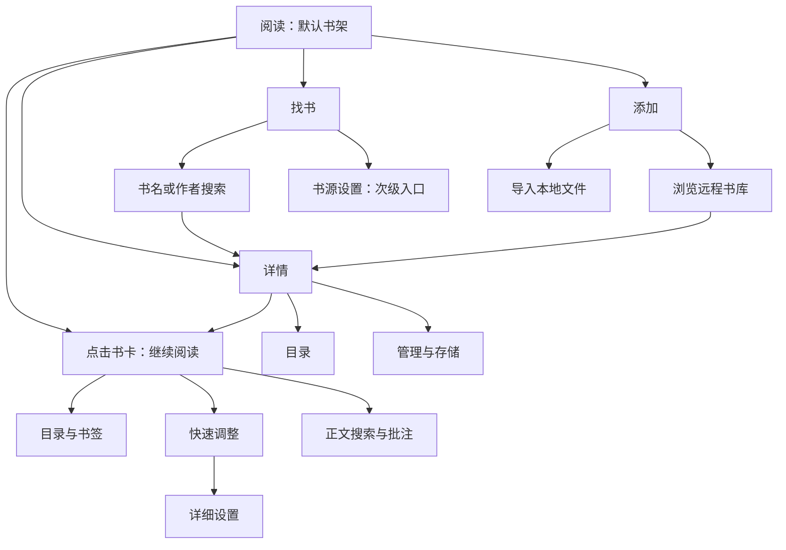
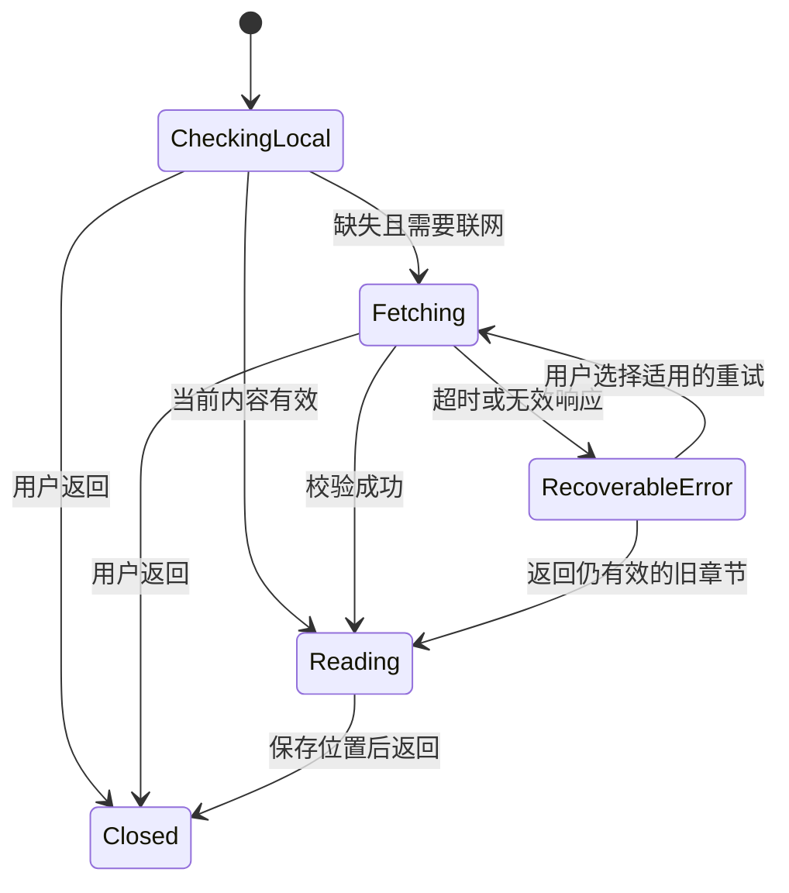

# MyTools 电子书：完整阅读体验设计

状态：设计提案，尚未实施本轮结构调整。依据：本轮虚拟机实际操作、11 张新截图、当前 ArkTS 实现。范围：手机竖屏文本阅读为主；不改变 MyTools 全局五个底部入口。

## 1. 设计判断

下一阶段应围绕三个目标组织：快速回到正文、理解当前阅读状态、出错时有路可走。绿色主题、列表书架、点击书卡直接阅读、独立详情入口、章节搜索、字号微调与设置保存继续保留。

当前主要问题是结构和状态表达。书架、书源配置、远程文件、本地来源处在同一导航层；阅读位置、估算页数、缓存范围和来源可用性没有明确边界。继续逐个增加按钮，会让首屏和阅读面板越来越拥挤。

以下观察只代表本次样本，不推断所有书籍或用户都遇到同样问题。测试书正文包含接口地址，适合验证交互，不代表正常小说的排版质量。

## 2. 实际流程审查

| 步骤 | 当前健康度 | 证据与发现 | 保留与改变 |
| --- | --- | --- | --- |
| 01 书架 | 可用，首屏效率偏低 | 第一条书名起点 y=1264，屏幕高2856，约在44%处；此前有大标题、模式、搜索、重复书架标题、标签。筛选混合 TXT、书源、在线小说三种维度 | 保留点击即读；合并重复标题，压缩上方区域，按阅读任务排序 |
| 02 找书 | 任务与页面主内容不一致 | 点“找书”进入书源列表，同屏有找书搜索和书源搜索，默认展示启用开关与规则状态 | 找书先展示查询和书籍结果，书源设置单独进入 |
| 03 远程书库 | 可用，语义偏文件管理 | 格式、文件大小和标签清楚；书名一行截断，主操作为上传 | 保留远程文件能力；在添加流程中说明加入书架与下载的区别 |
| 04 本地空态 | 清楚但重复 | 有明确导入动作，空书架仍显示无用搜索，两个添加入口 | 空态优先一个主要导入动作，不占用搜索行 |
| 05 详情 | 需要优先修正 | 最新章节位置出现原始结构数据；来源状态显示“目录已验证”“可用”，但正文样本实际是地址；验证延迟和上传占据主要版面 | 显示字段必须可信；目录、继续阅读前移；诊断和上传进入次级操作 |
| 06 管理 | 操作可见，风险层次弱 | 清缓存、仅移出、移出并清记录集中在红色面板；背后详情与继续阅读仍露出 | 中性管理面板，按影响范围分组；永久删除单独确认 |
| 07 正文 | 可进入，位置语义需明确 | 样本显示“全书0% · 1/1页”；短文本处于页面中部且上方留白大 | 不能据此断言进度算法错误；区分位置百分比与已读完成，检查短章顶对齐 |
| 08 阅读工具栏 | 功能齐全，重复入口 | 顶部“听书”和底部“朗读”、顶部更多和底部更多、重复章节状态 | 合并同义操作，保留清晰且稳定的一层工具栏 |
| 09 夜间目录 | 明确不一致 | 正文已变深色，目录仍为大面积白色 | 目录、设置、批注、搜索统一使用阅读主题色 |
| 10 设置 | 微调可用，常用项分散 | 预览、字号、字体、预设占满主要区域，主题与亮度需要下滚；面板高度78% | 拆成快速调整与详细设置，快速调整时仍看得到正文 |
| 11 打开失败 | 有退出，恢复路径不足 | “远程图书响应类型与格式不符”，仅“返回书架” | 明确失败原因、保留数据、按原因给出重试或重新选择来源 |

截图见同目录 `audit.html`，每步均来自本次采集且已检查。没有执行删除、上传、清缓存或新增书架记录。临时切换夜间后已恢复原纸张主题，最终返回书架。

## 3. 新的信息结构

来源是一本书的属性，书架是用户主动保留的集合。远程、本地、书源不应再被理解为三个互斥的阅读空间。数据层继续保留既有 origin 和模式标识，先变更入口映射，再迁移页面，不直接重编号。

“找书”只在已启用的网络书源中搜索，书架搜索只查书架；两个搜索分别保留输入与返回位置。不要默认悄悄跨全部来源搜索，避免慢响应和结果范围不明。添加页提供本地导入、远程书库；高级入口保留书源导入管理。

## 4. 核心页面布局与交互

### 4.1 书架：打开后的第一眼就是书

| 层级 | 内容 | 行为与约束 |
| --- | --- | --- |
| 顶栏 | 书架、找书、添加 | 沿用应用头像入口；阅读页不重复“阅读”和“我的书架”两组大标题 |
| 检索 | 搜索书架 | 有书时显示；输入后的清除只清关键词，不暗中取消来源筛选 |
| 列表工具 | 最近阅读、筛选、管理 | 默认最近阅读；可切书名／加入时间，账号范围内保存选择 |
| 书卡 | 封面、两行书名、作者、最近章节、状态 | 点击主体立即读；详情按钮44vp；长按进入菜单，不能作为唯一入口 |
| 次要状态 | 第12章·约36%；已缓存至第32章 | 正文位置与缓存范围分开；没有可信百分比时只显示章节 |

不增加一张占据半屏的“继续阅读”大卡。默认把最近阅读图书排第一，并用小标签标记；搜索和筛选时不额外重复这本书。排序冻结到返回书架时更新，避免后台同步让手指下的列表跳动。

来源筛选、格式筛选、用户标签在筛选面板中分组，面板外最多显示两个已选条件和“清除”。长标签不得静默截掉后再无法选择；当前标签列表的12项截断应改为“更多”。

设计目标：在约360×780vp的参考视口，首条书名在屏幕前28%以内，普通字号至少看到4条完整书卡。大字体优先完整文字，不为了数量裁切。数值是后续验收目标，并非已测达成。

### 4.2 详情：先回答能不能读、读到哪里

次序：封面与书名 → 上次位置／可读状态 → 目录 → 简介 → 来源与存储。底部主按钮为继续阅读／开始阅读／加入书架；加入书架成功后应清楚提示，是否立即阅读沿用既有产品约定并保持文案一致。

来源卡默认只显示来源名与状态；延迟、规则诊断收在“来源详情”。“目录已获取”不能等同于“正文已验证”。最新章节字段为空或返回协议对象时，回退为可信目录末章或“章节信息暂不可用”。原始字段仅进入脱敏诊断，不能直接展示。

不能全局删除包含 URL 或 JSON 的正文：技术书可能正常包含这些内容。判定必须结合字段类型、书源契约、响应类型和解析结果；合法文本允许继续，疑似错误响应保留用户可解释的恢复入口。

上传到远程属于管理动作，下沉到更多或存储页。管理面板使用中性色，危险动作本身强调，避免整个面板都像错误状态。

### 4.3 正文：一次只做一件事

默认隐藏工具栏，保留底部轻量位置。点击中央显隐工具栏；连续滚动、选字、滑动翻页不触发显隐。底部目录入口需要小型目录符号或明确可访问名称，不能只靠用户猜百分比可点。

底部文案按格式区分：文本分页显示“本章3/12页 · 约36%”；滚动文本显示“第12章 · 约36%”；PDF显示“12/240页”；漫画显示“12/80页”。全书页数是估算时必须标“约”，不能呈现成文件固有页码。

0%是位置，不代表未读；打开过而停留开头显示“已开始·第1章”。100%是当前目录结尾，不自动改为用户“已读完”，尤其连载更新后。完成状态应独立于 locator 和目录版本。

顶部保留返回、书名和一个更多入口；底部建议“目录、外观、朗读、书签”。搜索、详情、批注、AI改编进入更多或选文菜单。书签成功用短提示并给撤销，失败提供重试；不应只写入未被渲染的状态变量。朗读保留单一可见入口，播放时显示暂停和停止状态。

章节或滑杆跳转后保留一个“返回刚才位置”短操作；只保留最近一次用户显式跳转，正常翻页和自动恢复不创建跳回点。切换书籍清除该点。

### 4.4 目录：面向数百章，而非一屏示例

保留本轮已有搜索、序号、当前标识。打开时无搜索则定位当前章节，重新打开时回到当前位置；用户滚动后提供“当前章节”定位按钮。搜索支持章节名称，纯数字按序号定位；查找结果不改变章节原索引。

列表采用可复用／懒加载单元，不一次挂载数千章。筛选结果计数只计算一次并复用。搜索开始置顶，清除后回到当前章节附近，而非目录最上方。行内主操作只负责阅读；AI改编保留在章节更多菜单，避免每章一个高饱和按钮分散注意。

按真实缓存记录显示“已缓存”或缓存范围；未知不显示假标记。目录、搜索框、空结果和书签面板一并跟随阅读主题。

### 4.5 外观：快速调整与详细设置分开

快速面板高度约38%–45%，仅放字号−/+、三种排版预设、常用主题、更多设置。直接以露出的真实正文作为预览，减少额外样例占用。详细设置放字体、行距、段距、边距、翻页与方向，样例预览可以折叠。

保留上一轮的刻度修正、松手后分页、关闭即保存。滑动时只更新待提交值及预览，松手统一提交，防止重排导致读位漂移。详细设置打开后固定预览区域或折叠，不能调行距时预览已滚出视口。

当前“亮度”实际是正文容器 opacity，不是窗口亮度。设计要求：若使用系统窗口亮度，提供“跟随系统”并在退出阅读时恢复；若继续使用应用遮罩，应命名“阅读遮光”，用背景遮罩保持正文对比，而不降低整层文字透明度。不要把两者混为一项。

夜间保持已有深色正文基底，面板使用对应深色表面和分隔线；退出夜间恢复用户上次的日间主题，而非固定纸张色。

## 5. 状态模型与恢复规则

缓存、打开、同步是三个独立维度，不能共用一个“已缓存／加载中”字符串。

| 维度 | 状态 | 展示规则 |
| --- | --- | --- |
| 文件缓存 | 未下载／下载中／完整且校验有效／损坏 | 仅完整有效文件显示“可离线阅读”；local origin不等于文件权限有效 |
| 章节缓存 | 无／部分／已缓存到某章／当前目录全量 | 展示范围，不能把目录缓存算正文缓存；目录更新后重新计算 |
| 打开 | 准备本地／加载目录／加载章节／可阅读／失败／取消 | 有正文则保留正文；用户取消后迟到请求不能覆盖新页面 |
| 进度同步 | 已保存在本机／待同步／已同步／冲突 | 失败不阻塞阅读；跨设备更新不在当前正文中突然跳页 |

局部失败不抹掉已加载正文；下一章失败在章节尾提供“重试本章／返回上一章／换源”，可用项随来源能力变化。首次打开失败显示书名、可理解原因、主要恢复动作、返回；格式错误主动作是检查来源或重新选择文件，不循环推荐无意义重试。网络瞬时失败才推荐重试。

超过短暂等待后显示“正在读取本地文件／获取目录／下载章节”，没有可靠进度就不伪造百分比。优先读取缓存，不为查询徽标或同步进度阻塞打开。损坏缓存只对当前书隔离处理，其他缓存与读位保留。

## 6. 管理操作的影响范围

| 操作 | 保留 | 删除或改变 | 交互 |
| --- | --- | --- | --- |
| 移出书架 | 原文件、书签、批注、进度 | 书架成员关系 | 优先支持撤销；需协调同步 tombstone，不做只有视觉撤销 |
| 清离线缓存 | 原文件或网络资源、书架、阅读记录 | 设备缓存 | 展示可释放大小与离线影响；未知大小明确未知 |
| 清阅读记录 | 书籍与文件 | 进度、书签、批注、统计 | 独立确认并逐项说明，不与“移出”默认捆绑 |
| 删除原文件 | 仅明确保留的阅读记录 | 本地或远程原文件 | 指明位置与文件名，最后确认；远程响应成功后才移除界面记录 |

管理说明与删除确认是产品中的数据保护设计，不要求用户为普通阅读或可逆查看反复确认。

## 7. 视觉与可访问性规则

沿用现有背景 #F3F6F4、绿色品牌、18vp卡片圆角、16vp输入圆角和44vp控制高度。不要换一套无关联风格。缩减重复大标题与过大的纵向空隙，避免所有次级操作都使用大胶囊。

使用现有语义色分层：正文、次级说明、强调动作、危险操作。按代码色值计算，#0DA678在白底对比约3.11:1，在#DDF4EA底约2.70:1；#98A29C在白底约2.63:1。较小字存在阅读风险，建议新增较深的文字强调色并重新测量，而不是直接改变全局品牌色。这些是静态色值计算，不代表屏幕像素或完整无障碍认证。

字号使用可缩放文本；次要信息建议12–13sp，正文维持用户设置。点击区域至少44vp。书卡主体和详情按钮分别标注可访问名称；选中状态同时使用文字／符号，不能仅靠绿色。面板打开将焦点移入，关闭恢复触发点，返回一次只关闭最上层。大系统字体、横屏、屏幕阅读器、键盘与减少动画仍需设备验证。

## 8. 落地顺序与工程边界

| 阶段 | 工作包 | 依据 | 验收退出条件 |
| --- | --- | --- | --- |
| P0-1 可信内容与错误恢复 | 详情字段校验、来源状态分层、打开错误分类、局部重试 | 步骤05/07/11 | 错误对象不进入章节名称；目录成功不暗示正文成功；恢复不丢读位 |
| P0-2 阅读主题与反馈 | 夜间面板统一、亮度语义修正、书签与错误反馈出口 | 步骤09/10及代码 | 所有阅读弹层无白色闪屏；操作成功／失败可见；退出恢复亮度 |
| P1-1 书架与找书结构 | 顶栏压缩、最近阅读排序、添加入口、来源配置下沉 | 步骤01–04 | 缓存书一击进入；首屏目标达成；返回保留搜索／滚动；现有书不丢失 |
| P1-2 正文与目录 | 进度语义、目录定位当前、懒加载、跳转后返回位置 | 步骤07–09 | 千章目录、重名章节、跨章跳转和字体切换均保持正确定位 |
| P1-3 设置与管理分层 | 快速外观、详细设置、中性管理与破坏性确认 | 步骤06/10 | 常用调整不必滚动；取消无副作用；影响范围与结果一致 |
| P2 长期整理 | 批量管理、更多筛选、读完状态、跨设备冲突提示 | 当前未充分验证 | 先补样本和需求验证，不阻塞核心阅读 |

建议先完成 P0 两组，再整体调整书架和找书。不要同时改路由、缓存键、分页、同步与视觉，否则回归难定位。

当前实现入口集中在 Index.ets：BooksPage / BookShelfCard / ReaderPage / ReaderCatalogPanel / ReaderSettingsPanel / ValidateDetailSource / ReaderSingleLineStatus。分批抽出 ShelfViewState、ReaderOpenState、ReaderOverlayState、ReaderThemeTokens 等明确责任；名称为建议，不是已存在类。打开流程统一持有 bookId、accountScope、requestRevision，异步返回同时检查；面板状态逐步从多个布尔变量变为单一当前面板，保留已有返回层级测试。

不要在书架渲染时逐本扫描磁盘或联网。缓存状态应来自带账号与版本的索引并异步更新；界面先显示可确认的信息。当前章节搜索保留原索引策略，新增懒加载不可破坏跳章与改编定位。

## 9. 可执行验收矩阵

- 有效缓存／缺缓存／损坏缓存 × 冷启动／重复打开；度量点击至首屏正文、正文可交互分别计时，30次记录p50/p95，不能把单次UI自动化耗时当性能结论。
- 建议缓存打开预算：中等文本样本p95≤1秒作为待验证目标；超大TXT、EPUB、PDF分别设预算，不承诺所有格式瞬开。
- 全文缓存断网可读、部分缓存断网提示范围、缺缓存恢复、账号切换无串读。本轮未断网验证。
- 0章、1章、千章、重名／超长标题、纯数字标题、错误结构字段、合法技术文本含URL/JSON。
- 字体14/19/32，日间／夜间，大系统字体，竖横屏，滚动／分页；调整后锚点仍指向同一句附近。
- 打开中返回、换书、切账号；旧请求不能弹出旧目录或覆盖正文。
- 首次失败与下一章失败；返回旧正文、重试成功、长期失败均有清楚路径。
- 管理取消、操作成功、服务器失败、撤销与同步竞争；列表和文件真实状态一致。

本轮没有做真实新增书籍、远程上传、永久删除、断网或屏幕阅读器操作，也没有完成正常长篇正文的排版验证。相应设计属于待实施／待验证要求。未修改应用源码或安装新包；这里只交付可落地设计与审查证据。
