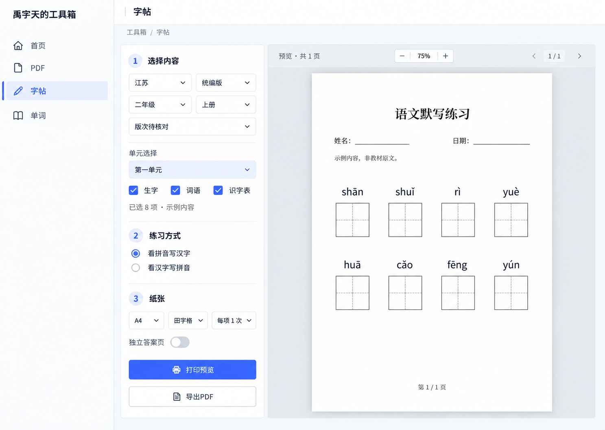
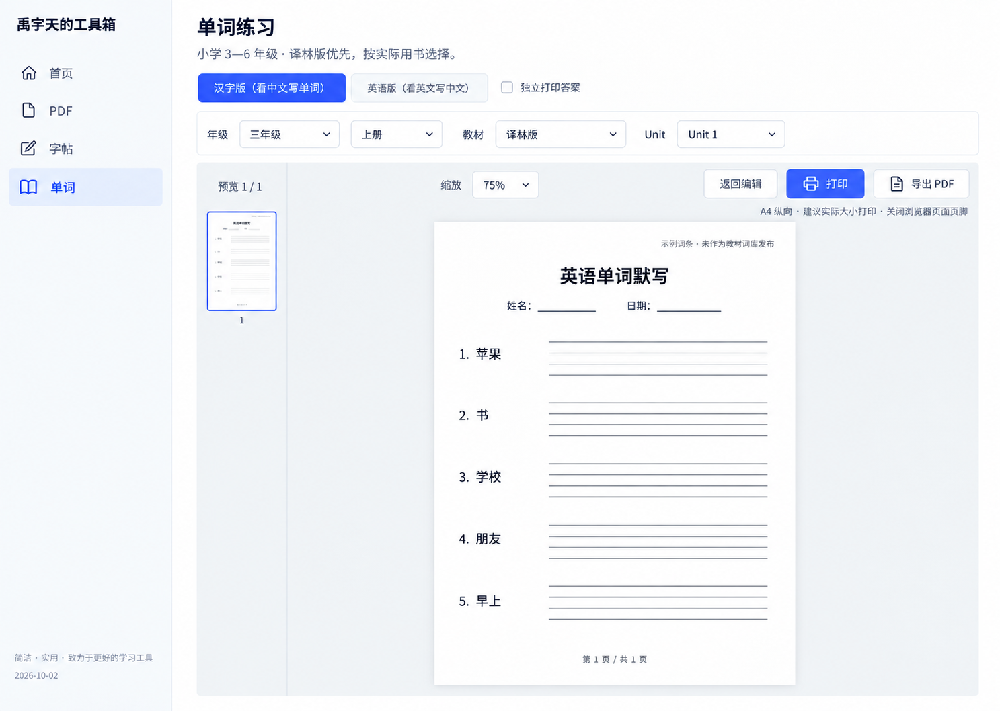
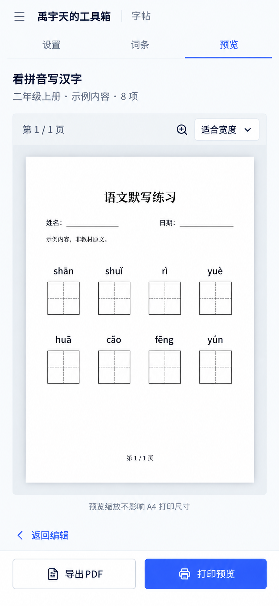
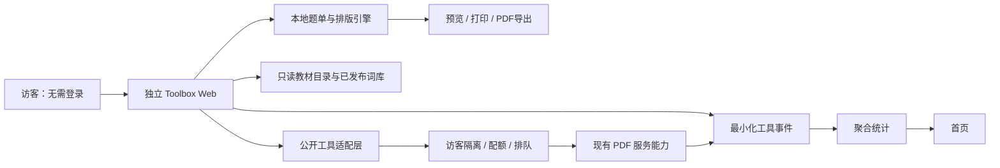

# 禹宇天的工具箱：UI 与功能详细设计

> 2026-10-03：字帖/单词页面的修改请先读[统一输入流程修改方案](../2026-10-03-worksheet-workflow-revision/modification-plan.md)。字表仅筛选内容，用户随后统一选题型；新方案覆盖旧字帖布局、OCR 范围和输入/预览流程，不改变站点左侧导航与框架。

日期：2026-10-02。状态：UI 与功能设计基线；后续已完成可交互原型，正式教材、全站统计及公开后端仍待接入。执行步骤以[Agent 实施交接文档](implementation-handoff.md)为准。已按最新要求统一为左侧目录，并将移动端适配作为首期验收条件。

本方案覆盖独立开放网站的首页、PDF、字帖、单词，以及教材数据、打印、统计和扩展机制。框架和控件沿用 MyTools，页面布局针对公众工具站单独设计。数值配额、尺寸和性能目标若未注明“现有”，均为建议默认值，需在实现时验证。

## 1. 产品定位与范围

站名固定为“禹宇天的工具箱”。面向家长、教师、小学生以及需要处理 PDF 的普通访客。进入即可使用，无注册、登录、会员、个人中心或账号绑定。

网站独立构建、独立发布，有自己的入口、路由和统计。可放在同一代码仓库中，通过共享组件保持与 MyTools 一致；不通过修改 MyTools 的登录守卫来实现公开访问。

| 一级目录 | 用户要完成的事情 | 首期交付边界 |
| --- | --- | --- |
| 首页 | 了解工具、快速进入、查看点击与使用情况 | 指标 block、折线图、工具入口、使用排行 |
| PDF | 生成、拆分、分割、合并与转换文档 | 对齐现有八项 PDF 能力，新建 Web 工作台 |
| 字帖 | 自动选择小学 1—6 年级字词并生成练习 | 看拼音写汉字、看汉字写拼音、打印预览 |
| 单词 | 生成小学 3—6 年级英语练习 | 汉字版、英语版、打印预览 |
| 后续目录 | 持续添加新工具 | 注册机制预留，不显示无内容的“其他”空页面 |

“无登录鉴权”在产品上表示访客无需账号即可完成全部公开工具操作。文件处理仍要使用临时访客会话隔离任务，这是文件隐私边界，不增加用户登录步骤。

## 2. 现有项目核查与复用方式

### 2.1 已确认的技术基线

| 层级 | 当前 MyTools 实际依赖 | 新站设计 |
| --- | --- | --- |
| 框架 | Vue 3.5.32、TypeScript 6.0.3、Vite 8.0.8 | 保持同一技术栈与初始依赖版本 |
| UI | Naive UI 2.44.1、Soybean Admin 基础 | 同一按钮、表单、卡片、菜单、提示组件 |
| 样式 | UnoCSS、主题 token | 沿用主色、字号、间距和明暗模式机制 |
| 路由与状态 | Vue Router 5.0.4、Pinia 3.0.4 | 独立公开路由、独立存储命名空间 |
| 图表 | ECharts 6.0.0、useEcharts 封装 | 复用图表能力，重新定义公开工具统计口径 |

来源：[package.json](/Users/pankang/mycode/MyTools/webapp/package.json)、[主题配置](/Users/pankang/mycode/MyTools/webapp/src/theme/settings.ts)、[图表封装](/Users/pankang/mycode/MyTools/webapp/src/hooks/common/echarts.ts)。package 描述中的 Vite7 与实际依赖不同，以依赖项为准。

### 2.2 复用与新增的边界

- 复用或抽取：主题 token、Naive UI Provider、SvgIcon、ButtonIcon、CountTo、滚动容器、去除管理端状态依赖后的 ECharts 封装。
- 新增：ToolboxLayout、公开路由、工具注册表、公开 API 客户端、教材选择器、练习排版引擎和打印页。
- 当前管理端 AdminLayout 为左侧导航。新站沿用这个方向，抽取其样式，使用“左侧目录 + 正文”的公开站布局，避免引入账号菜单、后台标签栏与权限状态。
- 当前请求客户端包含登录 token、刷新、退出和业务请求头逻辑。公开站新建客户端，不整份复制旧请求配置。
- 当前首页存在演示指标，部分图例与实际请求统计不一致。新站只借用视觉组件，统计重新实现。
- 当前 `webapp` 没有 PDF 工作台。PDF 能力在 App 和后端；新站需要实现浏览器界面与适配层，不能把 HarmonyOS PDFKit 当作浏览器组件。

## 3. 整站 UI 规范

### 3.1 布局

桌面端从左到右依次为：**固定左侧目录 → 页面工作区**。顶部工具栏位于工作区上方；左侧目录独立占满视口高度。

| 区域 | 建议规格与行为 |
| --- | --- |
| 左侧目录 | 展开宽 220px，收起宽 64px；顶部站名；首页、PDF、字帖、单词四项；当前项浅主色底 |
| 顶部工具栏 | 高 56px；当前页面标题/面包屑；工具搜索、主题切换；不放账号区域 |
| 页面工作区 | 外边距 24px，模块间距 16px；超宽屏主体最大 1600px 并居中 |
| 页面标题 | 24px、半粗；一句说明；主要操作最多一个主按钮 |
| 表单 | 默认控件高约 36px；明确字段标签、就地校验、可见默认值 |
| 操作区 | 生成、打印预览或开始处理固定在工作区底部；不遮挡内容 |
| 打印阅读模式 | 可收起设置区和目录，将空间让给纸张；退出回到原编辑状态 |

目录不会混进 PDF 操作或课文列表。PDF 子工具放在页面内部；教材单元、课文列表放在内容选择器中。

### 3.2 视觉语言

| 项目 | 规范 |
| --- | --- |
| 主色 | `#646cff`，沿用 MyTools 蓝紫色 |
| 页面/容器 | `#f7fafc` / 白色，轻阴影、清晰分区 |
| 正文 | `#1f1f1f`，14—16px；辅助文字保持可读对比度 |
| 圆角 | 控件 6px；卡片沿用现有 `card-wrapper` 的 8px |
| 状态 | 成功绿色、警告橙色、错误红色；同时配文字，不能只靠颜色 |
| 图标 | 使用现有 Iconify / 项目图标组件，同一种线性风格 |
| 纸张 | 永远白底、深色文字、灰色格线；不随界面深色模式反转 |
| 字体 | 界面沿用系统中文字体栈；练习纸使用经过许可与字形核验的印刷字体 |

首页可以有数据 block；编辑页优先展示内容与纸张，不把每个设置项包进卡片。学生用打印纸以清晰、省墨为原则。

### 3.3 响应式与可访问性

- ≥1280px：左侧完整目录；字帖/单词为“最左目录 220px + 设置约 320px + 右侧自适应预览”。
- 768—1279px：左侧目录收成 64px 图标栏；页面内设置与预览切换，避免三个窄列挤压纸张。
- <768px：左上角目录按钮打开左侧抽屉；页面顶部“设置 / 词条 / 预览”切换；底部固定主操作和 PDF 导出，正文预留同等高度与安全区。
- 移动端纸张只做显示缩放，不改变排版字号、格线或分页。系统打印不可用时可导出 PDF。
- 菜单、复选框、切换、页码和打印可用键盘完成；拖拽排序同时提供上移/下移按钮；抽屉关闭后焦点回到触发按钮。
- 图表有文字摘要和表格查看入口；统计加载失败不影响工具使用；遵循减少动态效果的系统偏好。

| 页面 | 手机端安排 | 操作保持一致 |
| --- | --- | --- |
| 首页 | 四个指标变 2×2；趋势图全宽；排行与工具入口顺次排在下面 | 7/30 天切换保留，X 轴减少刻度；工具入口不靠悬停触发 |
| PDF 入口 | 宽度足够时两列，小于 360px 时单列 | 分组与桌面一致，卡片点击区域至少 44px |
| PDF 工作台 | 选择文件 → 参数 → 结果分段；文件列表用卡片；页范围可键入 | 上下按钮替代拖拽排序；裁切比例可数字输入；触摸也可拖动切线 |
| 字帖与单词 | 单列表单；设置、词条、预览分屏签；词条用列表代替横向表格 | 返回编辑保留选择和预览页码；没有自动跨设备同步承诺 |
| 打印预览 | 整页适合宽度，可放大查看；页码与翻页固定可达 | 纸面仍按 A4 毫米排版；独立 PDF 导出不依赖系统打印功能 |

手机外边距建议 12—16px，控件触控区至少 44px，输入字号建议不小于 16px；长版本名可换行且保留完整标签。软键盘弹出后当前字段与错误提示必须可见，底部动作可临时收起，不能挡住输入。支持 320/360/390/430px 视口及横屏，页面无整体横向滚动；纸张放大仅在预览容器中滚动。左侧菜单抽屉点遮罩或返回键关闭并恢复焦点。

### 3.4 概念图的使用方式

本目录附桌面首页、字帖、单词以及手机字帖概念图，采用左侧导航。它们是视觉示意，不是可点击页面或可直接打印的模板。图中的数字、课次和词条均为示例，功能以本文矩阵为准。四线三格、田字格和排版尺寸必须由后续排版引擎精确生成。旧版右侧导航图片已归档，不作为当前设计。

图片由内置 Image Gen 生成；[提示词记录](image-prompts.md)记录当前版本各图约束。

## 4. 首页详细设计

页面顺序：标题与简短说明 → 四个指标 block → 使用趋势与排行 → 工具快捷入口。常用工具入口在首屏下沿可见，避免用户必须先浏览大量运营数据。

### 4.1 指标与图表

| 模块 | 内容 | 交互与口径 |
| --- | --- | --- |
| 今日工具点击 | 从零开始的当天入口点击数 | 点击卡片、菜单或搜索结果进入工具记一次；直达 URL 记工具访问，不冒充入口点击 |
| 今日成功使用 | 当日成功生成有效结果的任务数 | PDF 输出就绪、字帖/单词首次生成有效题单算一次；刷新预览不累加 |
| 累计成功使用 | 发布以来成功任务数 | 与今日口径一致，不混入测试任务 |
| 今日打印发起 | 打开系统打印对话框的次数 | 名称不能写“成功打印”；用户取消也可能被计入 |
| 趋势折线图 | 点击、成功使用两条线 | 默认 7 天，可选 30 天；按 PDF/字帖/单词筛选；不堆叠；缺数据与真实 0 区分 |
| 工具使用排行 | 工具名称、成功使用次数 | 与趋势同一时间范围，点击名称进入工具 |
| 工具快捷入口 | PDF、字帖、单词及核心描述 | 直达对应工作台；显示当前范围的使用数，数量少时保持三列 |

统计默认展示全站汇总，标注 Asia/Shanghai 日期口径和“更新于 HH:mm”。今日数为当前自然日，趋势包含当天并标注未结束。服务端聚合结果建议每 5 分钟刷新；不是硬编码动画数字。

### 4.2 事件与去重

事件最小字段为 `eventId、toolId、eventType、occurredAt、operationId`，无文件名、文档正文、练习字词、学生姓名。客户端事件做批量上报、重试去重和限速；服务端 PDF 任务以最终完成记录为成功依据。

浏览器本地练习成功只能由客户端上报，属于可被干扰的运营统计，应做基本反刷并承认其精度边界；不向公众展示“精确用户数”。打印再次发起可以单独累加，但不能再次增加题单成功生成次数。

一次使用对应一个稳定的 `operationId`。同一题单的自动重分页、纯纸张/字号调整、预览、下载、打印和重试都沿用该 ID，不增加使用次数。用户更改题目/模式或“换一组”后，待有效新题单成功生成才分配新的 `worksheetId/operationId`；只改筛选但没生成不计。PDF 只有最终任务成功才计一次，轮询重复回调去重。

### 4.3 页面状态

首次上线为真实 0 和“开始使用第一个工具”；加载时显示 skeleton；统计不可用显示“统计暂时不可用”，工具按钮仍可用。开发预览数据必须带“示例数据”标签，发布时删除模拟回退逻辑。

## 5. PDF 详细设计

### 5.1 工具首页与完整功能矩阵

PDF 首页按“生成 / 整理 / 转换”分组，八个入口卡片，每张卡片只含标题、一句说明、输入与输出格式。区分“文件拆分”与“页面分割”。

| 分组 / 工具 | 输入 | 配置 | 结果与预览 |
| --- | --- | --- | --- |
| 生成 / 图片转 PDF | PNG、JPG，多图 | 排序、删除、A4/A5、横竖方向、适应/填满、边距 | PDF；页预览与下载 |
| 生成 / 文本转 PDF | 输入文字或文本文件 | A4/A5/Letter、边距、页码 | PDF；预览分页 |
| 生成 / Markdown 转 PDF | Markdown 与受管图片附件 | 纸型、边距、页码 | 支持后端现有表格、代码能力；禁原始 HTML、外部资源 |
| 整理 / 合并 PDF | 至少 2 个 PDF | 文件排序、移除、总页数展示 | 一个 PDF；合并顺序摘要 |
| 整理 / 文件拆分 | 一个 PDF | 按范围、每 N 页、自定义多组 | 多个 PDF；列出各结果页范围，可打包 ZIP |
| 整理 / 页面分割 | 一个 PDF | 左右/上下、5%—95%切线位置、选页、两半次序 | 将一页切成两页；前后对照与输出顺序确认 |
| 转换 / PDF 转图片 | 一个 PDF | 页范围、PNG/JPG、72—300 DPI | 单图或 ZIP；预估输出大小 |
| 转换 / PDF 提取文本 | 有文字层的 PDF | 页范围 | 文本预览、复制、TXT 下载；扫描页提示无文字层 |

此矩阵按 [PdfRules.java](/Users/pankang/mycode/MyTools/service/pdf-service/src/main/java/com/yuyutian/mytools/pdf/service/PdfRules.java) 和 [App 工具入口](/Users/pankang/mycode/MyTools/app/entry/src/main/ets/features/tools/pdf/PdfToolsPage.ets) 核实。裁切不等于永久擦除内容。OCR、Office 转换、PDF 转 Word、压缩不属于现有八项，不作为首期承诺。

### 5.2 统一操作工作台

1. **选择文件/输入内容**：点击或拖入文件；展示类型、大小、页数；错误就地提示，不到提交后才校验。
2. **设置**：左侧参数区；中间展示页面缩略图或原稿；裁切线可拖动也可输入比例；提供“全部页/奇数页/偶数页/指定范围”。
3. **结果确认**：开始按钮上方显示输入页数、预计输出文件/页数，以及将上传处理的提示；提供返回调整。
4. **处理中**：校验、上传、排队、处理、结果就绪分阶段展示。仅上传阶段显示可测量百分比；未知处理进度不显示假百分比。
5. **完成**：结果名称、文件大小、页数、预览、下载/ZIP、继续处理；显示实际过期时间。本次处理记录仅当前访客可见。

切换子工具时保留可兼容的已选文件；不兼容则说明需要重新选择。修改设置后旧结果标注“参数已修改”，不得作为新结果下载。刷新页面根据临时会话恢复服务端任务；本地未保存输入不声称可以恢复。

### 5.3 公开站处理模式与限制

首期建议使用独立公开适配层复用服务端八项能力，以保持行为一致；浏览器承担预览与参数交互。输入区清楚标注“文件将上传处理”。后续本地处理真正实现后才显示“本机处理”，不以 App 的本机能力替代 Web 实现。

当前服务限制包括单文件/任务输入共 100 MiB、最多 100 个输入、单 PDF 500 页、输出合计 1000 页、拆分最多 100 个文件、转图片最多 100 页、文字/Markdown 256 KiB。公开站可更严格，限制通过能力接口下发，前后端一致。

匿名配额建议先按会话限 1 个活动任务，配合 IP 弹性限流、全局队列上限与压测结果调整。不能直接沿用当前“账户每日 30 次”等规则当作访客保障。

当前服务没有密码解锁入口，拒绝部分签名、表单、批注 PDF；前端必须在可检测阶段提示具体限制。App 的会话密码功能需独立 Web 适配后才能加入，不能承诺首期已有。

预览按页加载，长文档懒加载；当前服务缩略图最多 40 张，新站完整文档阅读需另建按页浏览能力。任务链接失效用“结果已过期，请重新处理”说明。以实际清理机制决定文件保留说明，不承诺尚未验证的 24 小时全存储物理销毁。

## 6. 字帖详细设计

目标：家长按正在学的教材范围，快速得到一份能直接打印的练习，不需要逐个录入生字。

### 6.1 内容选择

顶部显示“语文 · 小学 1—6 年级”，默认推荐江苏适用的统编语文，首次需要用户选择年级、册次。之后可记住本机最近选择，但不声称知道学生年级。

选择顺序：年级 → 上/下册 → 教材版本 → 单元/课文 → 内容类型。内容类型为识字表、写字表/生字、词语表；根据所选册次真实存在的表动态显示，不人为补出教材没有的类别。

范围树支持全册、若干单元、指定课文。展示每项数量，父节点有半选状态。列表支持检索、单项勾选/删除、添加自定义内容、恢复教材顺序。

“自动选择”提供三种：选中范围全部生成；随机抽 N 项；按所选单元均衡抽 N 项。默认使用选中范围全部内容；随机模式默认 20 项建议值。不足 N 项明确显示可用数量，不重复补满。支持随机排序并固定本次种子，预览、下载、答案顺序完全一致。

### 6.2 两种练习模式

| 模式 | 学生看到的提示 | 学生书写区域 | 必须避免 |
| --- | --- | --- | --- |
| 默写字帖：看拼音写汉字 | 标声调的拼音；词语逐字对齐 | 对应数量的空田字格，亦可选方格 | 学生页出现答案汉字、描红或暗色答案 |
| 拼音字帖：看汉字写拼音 | 汉字或词语 | 逐字对应的空拼音四线格；可选空横线 | 学生页出现已标拼音 |

示例（排版示例，非教材摘录）：`shān shuǐ` 对应两个空汉字格；“山水”对应两个空拼音书写区域。

单字读音不一定唯一。多音字按课文或词语义项保存读音；不使用无上下文自动转换的第一个读音。自定义内容不能可靠确定读音时，标记“待确认”，用户选择后再生成。仅靠拼音可能对应多个汉字，可选“显示词义提示”或选择词语练习，答案依据本次题单而不是假定只有唯一汉字。

### 6.3 页面布局与控件

左侧设置包含：教材范围、模式切换、格子大小、重复次数、题目顺序、页眉、独立答案页。内容编辑采用抽屉，列出字词、拼音、来源课次、选中状态；批量操作放在列表上方。

中间是实时 A4 预览，可缩放、翻页、查看总页数。更改纸型、格子、重复次数会重新分页。长词优先整词换行，不能把一个字的汉字与拼音拆到不同页。

底部显示“已选 X 项 · 预计 Y 页”，主要按钮“打印预览”，次要按钮“导出 PDF”。高级选项折叠，默认即可生成。

## 7. 单词详细设计

沿用字帖的设置、内容编辑、纸张预览和打印操作，只替换教材范围、词条字段和题目模板。

### 7.1 教材与词条

默认推荐译林版，允许切换其他已核验版本。年级仅 3、4、5、6 年级；按上/下册、Unit、单词/短语选择。可手动输入或 CSV 导入“英文、中文义项”，导入仅用于当前练习，不直接写入公共教材词库。

同一个词的不同义项按教材语境显示，避免中文提示歧义；可选择保留词性帮助定位。短语、大小写、撇号、连字符按词条原文保留。新旧版相同 Unit 名也不混合数据。

### 7.2 模式

| 模式 | 每行左侧提示 | 每行右侧答题区 | 默认设置 |
| --- | --- | --- | --- |
| 汉字版：看中文写单词 | 中文意思，可选词性 | 空白英语四线三格 | 不显示英文/首字母/音标；1 次书写空间 |
| 英语版：看英文写中文 | 英语单词或短语 | 写中文意思的空横线 | 不显示中文义项；1—2 条横线按长度排版 |

示例（非教材摘录）：汉字版“苹果”后留空四线三格；英语版 `apple` 后留空横线。四线三格必须是四条线、三个间隔，不用普通下划线或五线谱替代。

支持教材顺序、随机顺序、抽 N 项、去重、重复 1—5 次建议值。长词/短语增大书写宽度或独占整行，不通过缩小到不可读来硬塞。同一题的提示和空格不跨页。

## 8. 打印与导出共用设计

打印页是独立的文档渲染面，和网站 UI 分离。屏幕预览、导出 PDF、答案页共用固定题单快照、字体版本和分页结果。

默认 A4 纵向，页边距 15mm；中文低年级建议 14mm 田字格，高年级可选 12mm。英语四线间距建议 3mm。具体毫米布局与边界处理见 [字帖与打印补充规范](worksheet-and-print-spec.md)。

“打印预览”打开专注阅读界面：页缩略图、当前页/总页数、缩放、返回编辑、打印、导出 PDF。站点预览与系统打印对话框区分清楚；点击“打印”才调起系统对话框。

学生练习与答案使用独立渲染数据和 DOM；默认只打印学生页。开启答案页时另开预览、单独下载或单独打印，纸张标题明确标注“参考答案”。不能仅通过 CSS 把答案藏起来。

所有字体加载和分页完成后才允许打印。页眉可选标题、姓名空线、日期空线、班级空线；不必录入真实学生信息。格线、字号、页码固定，预览缩放不影响纸面物理尺寸。

提示建议“选择 A4、实际大小/100%、关闭浏览器页眉页脚”。浏览器无法替用户保证打印机设置，也不能可靠知道纸张是否真的打印。打印结束事件只用于界面恢复，统计只能记录打印发起。

## 9. 教材数据设计与来源

### 9.1 江苏优先的具体解释

江苏规定语文使用国家统编教材，其他学科由设区市组织选用。因此语文默认命名“统编语文（人教版）”；英语“译林版优先”是产品推荐，不表示所有学校统一使用。依据：[江苏省中小学教材选用管理实施细则](https://jyt.jiangsu.gov.cn/art/2024/1/18/art_88010_11138172.html)。

教材目录可用于核对系列与年级，不能直接替代具体学校的版本，也不能证明已经拥有整套字词库。官方入口：[教育部教学用书目录](https://www.moe.gov.cn/srcsite/A26/s8001/202408/W020240805496325238752.pdf)、[人教教材产品中心](https://www.pep.com.cn/products/jc/)、[译林电子教材](https://edu.yilin.com/index.php/Category/index?nav_id=14)。

教育部官网 2026 年 9 月报道确认修订统编教材于当年秋季完成替换。因此优先核验现行新版，旧版仍独立保留，不将旧网络字词表直接标为最新数据。[教育部报道](https://www.moe.gov.cn/jyb_xwfb/s5147/202609/t20260907_1449516.html)

每册显示出版社、课标年份、版次/ISBN、适用学期、核验日期。不能只用“新苏教版”“最新版”作为不可追溯的唯一标识。旧版保留独立 ID，不覆盖历史题单。

### 9.2 数据结构与审核

| 对象 | 主要内容 |
| --- | --- |
| TextbookEdition | 学科、出版社、课标、ISBN、版次、年级、册次、适用学期、来源、发布状态 |
| Unit / Lesson | 单元、课次、名称、教材顺序、所属版本 |
| Entry | 字/词/英文、逐字拼音、中文义项、词性、表类型、来源页码、校对状态 |
| WorksheetSnapshot | 版本 ID、词条快照、顺序、随机种子、重复规则、练习模式、排版与字体版本 |
| Tool / DailyStats | 工具标识、目录、启用状态；按日和事件类型汇总的统计 |
| AnonymousTask | 临时会话、任务、受控文件、到期时间、执行状态；不公开展示 |

词库流程：来源确认 → 录入或授权导入 → 格式/重复检查 → 人工校对拼音与义项 → 发布。公众只能选择已发布版本；词库维护走单独的内部流程，不在开放站增加无鉴权管理页面。

全范围目标为语文 12 册、英语 8 册，共 20 册（不含额外版本）。UI 可以完整覆盖年级，但词库没核验完时必须显示“部分可用/待校对”与可用单元，提供自定义录入。只有全部相应册次验收后才能标注全学段教材覆盖完成。

## 10. 独立网站的功能架构

### 10.1 建议模块与路由

独立前端建议目录 `toolbox-web/`；抽取共享 UI 时再引入适当的 shared package，避免为了复用一张卡片引入管理端整个 store。

| 路由 | 页面 | 主要组件 |
| --- | --- | --- |
| `/` | 首页 | NGrid、NCard、NStatistic、ECharts、简洁排行 |
| `/pdf` | PDF 工具入口 | NCard、分组入口 |
| `/pdf/:tool` | 对应 PDF 工作台 | NUpload、NForm、参数控件、页面阅读器、结果列表 |
| `/copybook` | 中文字帖 | NSelect、NTree、NCheckbox、NRadioGroup、NInputNumber、练习画布 |
| `/words` | 英语字帖 | 同一编辑器框架 + 英语词条模板 |
| `/print/:draftId` | 当前设备题单预览 | 独立打印壳层，不含站点导航 |

打印草稿 ID 默认仅用于当前设备，不可当作跨设备分享链接。URL 不包含学生信息、文件内容或临时内部服务凭证。

### 10.2 建议接口与权限边界

下面是新站接口设计，不是已存在 API。

| 接口组 | 目的 |
| --- | --- |
| `GET /public/v1/tools` | 工具目录、能力和当前限制 |
| `GET /public/v1/stats` | 只读聚合统计，允许缓存 |
| `POST /public/v1/events` | 限速、去重的最小化事件上报 |
| `GET /public/v1/textbooks` | 已发布教材版本与覆盖状态 |
| `GET /public/v1/textbooks/:id/entries` | 指定版本和范围内的词条 |
| `/public/v1/pdf/uploads`、`/tasks` | 临时访客任务创建、状态与下载 |

工具使用无需账号，任务文件使用短期会话和受控下载校验。后端服务凭证只存在服务器；不直接向匿名访客暴露内部 `/api/app/v1/pdf` 接口。域名/Cookie/存储命名空间与管理站隔离，不在两个站间共享用户 token。

适配层在服务端分配匿名身份，并将会话绑定到独立 `owner_id`；ID 分配必须保证不与 MyTools 账号身份碰撞，客户端不能指定或覆盖 `owner_id/X-Owner-Id`。每次上传关联、创建任务、读取历史、预览和下载均验证归属，禁止所有访客共用固定代理账号。匿名过期与内容清理有明确关联；验收包含猜测、替换文件/任务 ID 仍无法读取另一访客资源。

字帖预览和自定义内容优先在浏览器处理；公共词库只读。选项偏好可以保存在本机，保存自定义内容草稿需要显式选择，并提供清除本机数据入口。

### 10.3 扩展方式

每个工具注册 `id、category、route、labelKey、icon、descriptionKey、enabled、order`。左侧目录、首页入口、搜索索引和统计分组由同一注册表驱动；新增目录不修改四套名单。服务能力和词库发布状态决定功能是否可用。

代码标识、路由、配置键与错误码使用英文；中文注释遵守项目规则。界面中文文案集中管理，避免散落在业务实现；如果“非注释禁止中文”按全文件严格执行，资源使用 Unicode 转义形式，运行时仍展示中文。

## 11. 状态、异常与恢复

| 场景 | 用户看到的内容 | 可以继续的操作 |
| --- | --- | --- |
| 尚未选择教材 | 年级/册次选择提示与排版示例 | 选择或手动录入 |
| 版本未校对 | 真实覆盖范围与待校对提示 | 改选已发布范围或自定义 |
| 没有勾选词条 | “请选择至少 1 项” | 返回内容选择 |
| 多音字/词义未确认 | 定位到具体词条 | 修正、选定义项或移除 |
| 字体缺失/缺字 | 标出字体与字符 | 重试加载或选择覆盖完整的字体 |
| 文档/页数超限 | 显示实际值和允许值 | 减少文件或范围 |
| 网络中断 | 保留配置，显示任务是否已提交 | 恢复查询或手动重试；不自动创建重复任务 |
| 队列忙/限流 | “当前任务较多，请稍后重试”及服务返回的等待信息 | 留在页面、取消未开始任务（接口支持时） |
| 结果过期 | 明确过期状态 | 使用仍可用的本机输入重新处理 |
| 统计失败 | 统计区错误提示 | 工具照常使用 |

## 12. 分期与验收

### 12.1 实施顺序

1. **公共基础与样张**：独立站壳、左侧导航、手机交互、同框架控件、三种纸张模板、四种练习模式、小规模校验样例。
2. **内容与处理能力**：教材版本与词库流程、范围选择/抽题、八项 PDF 的公开适配和文件隔离。
3. **完整发布条件**：20 册目标数据逐册核对、打印兼容验证、真实统计、匿名负载限制和异常恢复。

开发可先用明确标注的样例推进 UI；样例可用不能替代教材全覆盖验收。阶段划分表示开发顺序，不减少最终需求范围。

### 12.2 验收清单

| 要求 | 通过标准 |
| --- | --- |
| 独立与开放 | 新访客访问全部工具无登录跳转；不影响 MyTools 的原鉴权 |
| 框架一致 | Vue/Naive UI/UnoCSS/ECharts 与既有版本对齐；无另一套 UI 框架 |
| 左侧目录 | 桌面四个目录固定左侧；窄屏从左侧打开抽屉；键盘可操作 |
| 首页 | 真实点击与成功使用分别统计；重复回调不重复计数；图表与排行口径一致 |
| PDF | 八项逐项通过真实文档；范围/顺序/边界/不支持文件提示符合规则 |
| 中文 | 1—6 年级上下册有明确覆盖状态；拼音和汉字模式提示/答案方向正确 |
| 英语 | 3—6 年级上下册；汉字版空四线三格、英语版空横线，义项正确 |
| 自动选择 | 全范围、按单元、随机抽取正确；去重与题单/答案顺序稳定 |
| 打印 | A4 无多余空页、无裁切、无导航、无隐含答案；跨页不拆题；缩放不改纸面尺寸 |
| 字体 | 生僻字、ü、声调、英文上下伸部清晰，无替换方框 |
| 隔离 | 两个匿名访客不能互读任务/文件；短期下载到期失效 |
| 兼容 | Chrome、Edge、Safari 的预览与实际导出检查；320/360/390/430/768px 与横屏无整体溢出，软键盘不遮输入，手机能导出 PDF |

详细打印边界与验收数据见 [字帖与打印补充规范](worksheet-and-print-spec.md)。本文件记录设计阶段的要求；后续原型实际构建与检查见 [原型验收记录](../../../toolbox-web/design-qa.md)，正式实现步骤和完成条件见 [Agent 实施交接文档](implementation-handoff.md)。原型验证不代表实纸验收或线上发布已完成。
