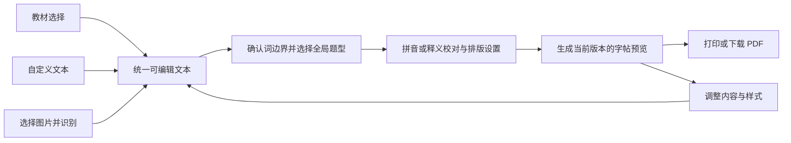

# 字帖与英语字帖：统一输入流程修改方案

版本：2.0；日期：2026-10-03。交付对象：接手实现的 Agent。本轮交付为设计与实现规范，下面的新流程、OCR、米字格和紧凑排版尚未因编写文档而实现或验收。

## 0. 最新要求与阅读顺序

**以用户最后一次修正为准：先选择/输入内容，再由用户统一决定生成拼音字帖还是汉字字帖。识字表、写字表、词语表只是内容筛选条件，不决定题型。** 不实现按字表自动切模式、同卷混合模式或新的混合工具 ID。英语同样先输入，后选择练习方向。

阅读顺序：根 `AGENTS.md` → 本文件 → [数据、处理和排版契约](data-and-layout-contracts.md) → [44 项修改验收](acceptance.md)。后端改动再读 `service/AGENTS.md`。

本方案覆盖旧方案中与字帖冲突的部分：2026-10-02 的 [实施交接](../2026-10-02-public-toolbox/implementation-handoff.md) M03/M04、[字帖规范](../2026-10-02-public-toolbox/worksheet-and-print-spec.md)、[接口契约](../2026-10-02-public-toolbox/implementation-contracts.md) 的题单与排版章节。旧方案的站点框架、左侧目录、匿名统计、教材来源核验和公开 PDF 隔离要求继续适用。

两项明确变更：原来固定单字四列/词语两列的规则废止；原来“OCR 不在首期”的边界对**字帖图片输入**取消。本次不会顺带实现 PDF 工作台的扫描 PDF OCR。

文中代码路径相对 `/Users/pankang/mycode/MyTools`。标注“新增”的文件、类型和脚本均需要实现，不能把本文当作现有 API 文档。

## 1. 最终用户流程



| 步骤 | 用户做什么 | 系统输出 | 下一步条件 |
| --- | --- | --- | --- |
| 1 输入内容 | 选择教材范围、直接输入文本，或选择图片识别；编辑共同文本框 | 原始文本及词语边界预览；保留来源信息 | 至少一项可解析内容；OCR 结果已确认使用 |
| 2 处理与排版 | 选择全局题型，校对读音/释义，选择紧凑程度、格距、重复次数 | 待生成题单、错误定位、预计题数 | 满足当前学生卷需要的字段；没有阻断错误 |
| 3 预览与调整 | 看真实 PDF；需要修改时点“调整内容与样式” | 当前修订的学生卷/可选答案卷 | 产物与当前草稿一致；没有生成中的新版本 |
| 4 打印或 PDF | 打开打印预览，主动打印；或下载 PDF | 同一份已预览文件 | 不重新抽题、不重新分词、不另排一份文件 |

步骤 4 是输出动作区，不增加一个必须点击“下一步”才能下载的空页面。

### 1.1 全局题型名称

| 页面显示 | 解释文案 | 现有 mode（继续使用） | 学生卷 |
| --- | --- | --- | --- |
| 拼音字帖 | 看汉字，填写拼音 | chinese-pinyin | 汉字 + 空四线三格 |
| 汉字字帖 | 看拼音，填写汉字 | chinese-dictation | 拼音 + 空米字格 |
| 英语默写 | 看中文，填写英文 | english-dictation | 中文释义 + 空四线三格 |
| 中文释义练习 | 看英文，填写中文 | english-meaning | 英文单词/短语 + 空横线 |

题型在步骤 2 统一选择，覆盖本次全部有效词条。教材类别、来源切换、重新 OCR 都不能擅自改题型；切学科后只能选择该学科的合法模式。首次新建练习要求明确选择，恢复草稿时回填原选择。

## 2. 已核对的当前实现

以下来自本轮本地代码和内容清单核对，未重新运行产品测试，也未核验公网部署状态。旧 README/实施记录包含不同阶段的数量，接手时以代码、当前 manifest 和新执行证据为准。

| 现有位置 | 可复用能力 | 本次差距/修改 |
| --- | --- | --- |
| `toolbox-web/src/views/WorksheetView.vue` | Naive UI、全局模式、预览、下载、独立打印窗口 | “设置/词条/预览”不能等同完整输入流程；需要明确返回原文入口 |
| `src/components/CurriculumPicker.vue` | 年级/册次/教材、单元/课树、清单类别与缺口说明 | 当前直接选题生成；新增“导入所选内容到文本框” |
| `src/components/EntrySelector.vue`、`src/lib/csv.ts` | 两列 CSV/TSV/竖线导入、逐项编辑 | 当前要求文字+拼音/释义，导入后清空输入；新增纯文本主入口，旧导入保留高级入口 |
| `src/composables/useWorksheetDraft.ts` | 教材加载、选择、快照、生成、主动保存草稿 | 缺少原文模型、处理步骤、OCR 会话和统一失效规则 |
| `src/domain/worksheet-snapshot.ts` | 内容与版式身份、四模式、版本引用 | renderHash 未包含 contentHash；快照浅冻结；没有可恢复原文和原文版本引用 |
| `src/lib/worksheet.ts` | 字体实测、投影、分页、四线格 | 写死 4/2/1 列、8 mm 列间距、5 mm 题间距；没有米字格 |
| `src/components/WorksheetPreview.vue`、`src/lib/pdf-runtime.ts` | PDF.js 预览同一份 bytes、字体子集及缺字检查 | 保留；补当前修订校验、取消与长卷资源释放 |
| `src/config/tools.ts`、`src/lib/analytics.ts` | 四个字帖工具 ID 与成功/打印统计 | 沿用 ID；步骤切换和重试不计新使用 |
| `toolbox-web/content/catalog/published.json` | 5 个发布版本、2635 条，均标 partial | 语文 1/2/3/4 上册及英语 3 上册；不退回“0 册”，也不宣称全部教材完成 |
| `toolbox-web/package.json` | 类型检查、单测、教材校验、生产构建、E2E 已有 | 没有浏览器 OCR/自动拼音依赖，需要新增与固定版本 |

当前五册分别为 318、760、777、640、140 条；这些是本地清单数量，不是本轮重新校对教材准确性的结论。教材数据继续使用原版本来源与缺口标记。

### 2.1 应随本次一起修复的衔接问题

1. `WorksheetView.vue` 的 renderSignature 主要依赖条目 ID；同 ID 改正文、拼音或释义可能不触发新预览。改为明确的输入/处理/渲染 revision。
2. `computeRenderHash()` 只含版式与条数，同数量不同内容可能得到同 hash。将 contentHash、kind、所有排版参数加入。
3. 清空选择后 scheduleGenerate 可能保持 busy 且留旧产物。清空统一取消任务、释放产物、退出 busy，输出按钮禁用。
4. 快速切教材/范围时迟到请求可能覆盖新状态。教材、OCR、拼音和 PDF 生成都必须有独立请求代次及取消边界。
5. 已选择顺序不能再被无条件教材排序覆盖；教材导入初始按教材顺序，之后按用户可见的词条顺序/明确抽题结果生成。
6. 教材空范围或加载失败不能悄悄填回示例。新建输入默认为空；示例只能通过显式“加载示例”加入。
7. 生成真正读取冻结快照，不能创建快照后仍拿外部可变 entries/options 渲染。

## 3. UI 设计

### 3.1 页面外框

保留站点左侧导航、浅/深主题、Vue 3、TypeScript、Naive UI、UnoCSS 与既有图标。只重构“字帖”和“单词”工作区，共享同一流程组件，以 subject 驱动内容。

页头显示页面名与一句说明；其下是“1 输入内容 / 2 处理与排版 / 3 预览 / 4 输出”步骤条。主要操作使用同一位置、同一文字；不要同时出现“生成”“打印预览”“查看预览”三个含义重叠的主按钮。

### 3.2 步骤 1：所有来源进入同一个文本编辑区

上方三个来源入口：**教材选取 / 自定义文本 / 图片识别**。入口只决定如何填充文本，原文始终在共同的多行输入框中；切入口不清空已有内容。初始不自动塞入 24 条示例。

- **教材选取：** 复用现有选择器。显示年级、册次、教材版次、单元/课、识字/写字/词语类别和真实覆盖。点击“导入所选内容”后，将字词按顺序串成文本，以空格分隔。单个汉字是一项，教材词语保留为整词；不把识字和写字转成不同题型。全册必须读完所有分页。
- **自定义文本：** 直接聚焦共同文本框；提示“字或词之间用空格分开，也可以每行一项”。用户无需先准备拼音或第二列。高级入口“导入已有词条表”继续支持 CSV/TSV/旧竖线格式，保留其中已给出的读音/释义。
- **图片识别：** 提供文件选择按钮、拖放区、手机相册入口；选择后展示缩略图、排序、删除、旋转和识别区域。点击“识别文字”后出现可修改识别结果，确认“使用识别文字”才填入共同文本框。这就是“文件选择控件 + 识别文本框”，不能用一个文本输入框冒充文件读取。

共同文本框下方显示解析后的词条标签、数量和错误位置，例如 `春天 花朵 山 水` → 4 项。可在标签中改读音/释义，但源文字修改必须同步原文模型。保留原始空格、换行和引号，规范化只作用于派生数据，不回写用户原文。

已有原文时，外部导入提供明确的“追加到末尾 / 替换全部”动作；默认追加。替换前展示将被替换的条数，并保留一次撤销。已识别结果、换教材预览或切来源不能自动覆盖用户刚输入的文本。

### 3.3 步骤 2：先展示原文，再处理

顶部仍显示可编辑的原文输入框，下面是题型卡片。语文选择拼音/汉字字帖；英语选择两个方向。所有选择来源一视同仁。

处理区包含：词条数、可生成状态、待校对列表、重复练习次数、排序/抽取（默认全部按输入顺序）、标题、格距和紧凑程度。拼音和词义错误能定位到具体词条；不把“自动生成”误标为“教材已审核”。

默认紧凑：A4 纵向、15 mm 安全边距、12 mm 米字格、2.5 mm 项间距、3 mm 行间距；提供 10/12/14 mm 格距。既有明确保存的手动格距保持；新建默认紧凑 12 mm，低年级可手动选择 14 mm，不因换年级覆写用户选择。

模式解释始终显示“看到什么、填写什么”，避免“拼音字帖”被误解为显示拼音。主按钮为“生成字帖预览”，另有“返回选取内容”。编辑文本过程中不连续自动生成 PDF，先完成轻量解析/校验，再由用户确认生成。

### 3.4 步骤 3：预览与回编

展示真实 PDF、页数、题数、学生/答案切换、缩放与翻页。显著按钮为“调整内容与样式”，点击后返回步骤 1 的完整编辑区，**原文输入框默认展开并填有原内容**，模式、手工读音、释义、顺序和版式设置也在。

不得只打开一个空白“新增词条”弹窗，不从 PDF 反解析原文，也不通过重新取教材来重建用户已改过的输入。用户只返回查看再取消修改时，原 artifact 可继续使用；实际编辑后旧 artifact 立即标记过期并禁用打印/下载，直到新生成成功。

用户每次进入调整都能看到输入框；如果从预览直接点“调整格距/标题”，同样进入带原文的编辑区，不能跳到没有文本的另一套设置弹窗。同一原文可以来回切换两种字帖，不重新导入。

### 3.5 输出与移动端

- 保留“打印预览 / 下载学生 PDF / 下载答案 PDF”。没有完整参考答案时，学生卷按模式条件可生成，答案入口禁用并列明缺什么。
- 打印预览窗口只展示选定文件的纸张图像，提供打印、下载 PDF、关闭；不自动弹系统打印框。主输出默认学生卷，答案按钮明确标识。
- ≥1280 px：编辑区为主，右侧窄栏放摘要与校对计数；预览阶段纸张为主。768—1279 px 可上下堆叠；<768 px 单列，顶部短步骤提示，底部一个主按钮加返回，适配安全区。
- 320/360/390/430 px 无整页横向溢出；纸张内部放大可平移。键盘弹起时输入末行与确认动作可见；所有实际点击区域至少 44×44 px。

## 4. 数据处理决策

### 4.1 统一输入与词边界

原文是唯一可返编真值；教材和 OCR 只是给原文提供初始内容及来源旁路信息，不再有三套直接生成路径。中文默认空格/换行分项：`春天 花朵` 是两词，`春天花朵` 是一项，不能静默拆成四字或自动猜两词。

英语默认空格分词，短语用双引号，例如 `apple "ice cream" don't`；也提供“每行一个单词或短语”模式，此时行内空格保留。从教材导入时自动为含空格的短语加引号，解析后去掉包裹引号。原文往返与 parser/serializer 必须有测试。

语文可在处理区选择“逐字练习”作为显式二次拆分，默认“保留词语”；拆分结果不覆盖原文，切回来恢复原词边界。标点、引号、无效字符与单条过长规则详见契约，不使用一个 split 正则包办全部输入。

### 4.2 拼音与英语释义

优先保留本次用户明确确认的修正；没有覆盖值时使用精确教材来源匹配的已审读音/义项，再提供本机拼音候选。手工覆盖标明“已自定义”，不改公共教材。自定义词、OCR 多音字和读音歧义必须显示可校对状态，不能将库的首选读音当作已核验事实。

英语自定义只输入英文时，先在当前已选教材的匹配词条中找释义；唯一候选可预填但标来源，多义必须选择。没有可靠匹配就让用户在校对表填中文，可用已有双列表批量补全。本次不依赖外部翻译 API，也不承诺任意输入都能自动翻译。

模式校验区分学生卷和答案卷：拼音字帖学生卷只需汉字，英语“看英文写中文”学生卷只需英文；对应参考答案缺失时不能导出答案卷。汉字字帖必须有确认读音，“看中文写英文”必须有确认释义和英文目标，不能输出空提示或静默少题。

### 4.3 图片 OCR

新增浏览器本机 OCR 适配器，默认采用 Tesseract.js 的 Worker/WASM 路线，固定依赖和模型版本，同域托管按需加载。官方项目说明其可在浏览器识别图片、支持复用 Worker，且不直接支持 PDF；因此这次图片入口不借用 `PDF_TO_TEXT` 冒充 OCR。[官方说明](https://github.com/naptha/tesseract.js)

首期处理 PNG/JPEG/WebP，每张 ≤10 MiB、总计 ≤30 MiB、最多 5 张；检查尺寸 ≤2400 万像素、最长边 ≤8192。识别预处理工作图控制在 600 万像素/最长边 4096，明确提示缩放，原图仍可重新裁选；逐图串行，避免手机同时创建多个 OCR Worker。

图片在本机读取，不发送到服务器；识别文本只在用户主动保存草稿时本机保存。首次模型下载、识别进度、120 秒单次超时、取消、失败重试都要实现。中文 OCR 不能可靠自动推断词语边界，结果必须经过可编辑文本确认；区域识别可帮助避开页码、拼音行和插图，不能保证“自动只识别词表”。

具体资产、请求代次、结果确认、预算与质量验收见契约及 W 系列用例。本机引擎若达不到验收，应记录问题并改进预处理/模型；不能悄悄改成外传图片。

### 4.4 紧凑排版

废除 4/2/1 固定列，把题目看作按内容计算宽高的块，保持用户看到的顺序，当前行放得下就继续放。汉字字帖按汉字格数与每个拼音的实测宽度计算；拼音字帖每字留足四线三格；长词不能被压成不可书写的小格。

默认参数下，固定短音节单字夹具首行目标 **10 项米字格题**；固定短音节双字词 **6 项**；拼音字帖单字至少 **8 项**。长词、长读音、14 mm 大格或英文长短语按实际宽度减少列数，不把“所有题都必须超过五项”作为缩小字格的理由。详见契约中的公式、固定输入和宽度证明。

米字格必须包含外框、横竖中线和两条对角虚线；不是把田字格按钮改名。全部用 PDF 矢量线条绘制，屏幕缩放不改变打印毫米数。

## 5. 可执行改造步骤

任务顺序：T00 → T01 → T02；T03/T04 可并行；T05/T06 接收统一处理结果；T07 统一预览输出；T08/T09 做集成；T10 验收；T11 交付。多人协作先分配文件所有权，共享 composable、types 和视图由集成 Agent 合并。

### T00 核对基线与新旧要求

操作：读取相关 AGENTS、检查当前工作区，保留他人修改；核对本地教材 manifest；运行现有类型检查/单测/生产构建并记录真实结果。建立 `docs/verification/worksheet-workflow-v2/status.md`。不复制旧报告的测试数量，也不接受系统许可或清空目录解决环境问题。

产物：改动前截图/基线日志、现状缺口、任务进度表。完成标准：能定位现有四模式与输出入口，新要求在状态表明确为待实现。

### T01 建立原文模型与纯函数解析

新增 `src/domain/worksheet-input.ts`、`src/domain/worksheet-processing.ts`、`tests/worksheet-input.test.ts`。按契约实现原文、token、来源引用、候选修正与 parser/serializer；中文空白、英文引号/逐行、Unicode、错误定位、限额和去重均作为纯函数。

保留全局 WorksheetMode；不增加每题 mode 或按字表规则。完成标准：相同文本、解析策略及已确认读音/义项得到相同题单，来源引用与待校对状态仍按各自来源保留；原始空格/换行不丢；词边界测试可复现；重复字词的不同读音/义项不会错误合并。

### T02 统一输入 UI 与教材导入

新增 `components/worksheet/WorksheetInputStep.vue`、`WorksheetTextEditor.vue`，复用 CurriculumPicker；改 `useWorksheetDraft` 为持有 InputDocument，新增教材“导入所选内容”。EntrySelector 变为校对/高级导入组件，导入完成不清空原文。

落实空初始、追加/替换/撤销、全分页、导入顺序、来源引用和异步取消。完成标准：教材/自定义进入同一可编辑框，改类别不改 mode；失败不回退样例；桌面和手机均能直接进入输入框。

### T03 读音、释义与模式处理

新增 `lib/pinyin-adapter.ts`、`components/worksheet/WorksheetProcessStep.vue`；本机拼音库可用 pinyin-pro，锁定实测版本，以 adapter 隔离 API，不依赖 CDN。该库提供带声调数组、多音字和自定义读音能力，但库候选仍需遵守本方案校对规则。[官方项目](https://github.com/zh-lx/pinyin-pro)

实现来源匹配、候选、手动修正、字段级失效和学生/答案两套校验；补英语双列导入与缺义项表。完成标准：只输入汉字就能进入处理；不要求先输入“汉字|拼音”；缺答案不会伪造，四模式字段要求正确。

### T04 新增图片 OCR

新增 `components/worksheet/WorksheetImageInput.vue`、`services/worksheet-ocr.ts`、`lib/image-preprocess.ts`、`scripts/prepare-ocr-assets.mjs`。固定 Tesseract.js/核心/模型版本与 hash、保留许可证；参考项目官方 API 实现 Worker 初始化、按需加载、真实进度、串行识别、超时终止和重建，不照抄旧版 initialize/loadLanguage 调用。

实现选择、预览、旋转/区域、字节/像素预算、识别结果校对与显式应用；消息绑定 jobId/inputRevision，迟到结果只保留在候选区或丢弃，不能覆盖现有文本。完成标准：真实中英图片能完成输入→预览→PDF；断网首次下载、取消、异常文件、低清结果均有恢复路径；网络证据证明无图片/正文上传。

### T05 替换排版算法并绘制米字格

重构 `lib/worksheet.ts` 的 projectWorksheet/layoutWorksheet/drawQuestion，或拆出 `lib/worksheet-layout.ts`、`lib/worksheet-grids.ts`。保留字体子集和学生答案投影边界。为 options/layout 增加 density、itemGapMm、rowGapMm、pinyinCellMinMm、`chineseGrid: 'mi'`。

先纯函数测量/装行/分页，再 PDF 渲染。替换“恰好四列”的旧测试，保留缺字、CFF、500 题、长题、页码和答案隔离回归。完成标准：真实字体密度、米字对角线、拼音四线高度、边距与整题分页达到契约。

### T06 原文草稿、快照与迁移

升级 StoredDraft 为 schemaVersion=2，使用新本机键 `yuyutian-toolbox:draft:v2:<subject>`。保留主动保存策略，新增原文、解析策略、已确认修正、来源索引、模式和版式；图片二进制及临时 URL 不写入草稿。

只读迁移 v1：旧 customEntries 转为可编辑原文并保留读音/释义，旧全局 mode 与手动格距延续；旧草稿未保存的教材原文不可编造，提示重新选取。旧田字格迁移时明确提示新汉字字帖使用米字格；不覆盖 v1 键。恢复时暂停 watcher，完成后再校验教材引用，不用远端响应覆盖恢复文本。

快照增加 schema/inputRevision，深拷贝冻结；renderHash 引用 contentHash。完成标准：刷新恢复与返回编辑保真；同 ID 改文本失效正确；相同数量换内容 hash 改变；旧草稿能安全迁移或说明缺项。

### T07 步骤、预览与输出统一

重构 WorksheetView 为流程容器；新增 `composables/useWorksheetWorkflow.ts`（可与 useWorksheetDraft 拆分职责）及 `lib/worksheet-print.ts`，将现有打印实现抽出而非重写协议。

所有编辑动作先递增 revision 并使产物过期；点击生成时从同一冻结快照产生学生/答案。返回调整始终展示原文；旧请求完成不能覆盖新请求；清空/切学科释放忙碌状态与对象 URL。完成标准：完整循环至少反复三次，输入不丢；当前预览/下载/打印 revision/hash 一致。

### T08 英语、选题与统计一致性

英语复用步骤组件，只替换模式、解析提示和校对字段；含空格短语不拆散、大小写/撇号/连字符保留。默认全部按输入顺序，高级抽题保留固定 seed，“恢复上一组”恢复快照。

四个原 toolId 继续使用。输入、OCR 完成、校对、切步骤、预览翻页、纯布局重排不计成功使用；有效题单首次生成学生 PDF 计一次。相同操作重试沿用 operationId；新题/换 mode 形成新题单。完成标准：统计契约回归通过，无新增 mixed ID 或正文上报。

### T09 响应式与性能

按第 3.5 节验收七种宽度与键盘。OCR 与 PDF 重计算不能阻塞用户取消/返回，必要时拆 Worker；新 OCR 资产不进入首页/普通输入首屏下载。500 题按页渲染/释放预览资源，保留字体缓存但不永久占有已关闭的 OCR Worker。

完成标准：手机可完成图片→文本→编辑→PDF，长卷不崩溃；所有失败保留原文；没有因为缩小到无法书写而达成密度。

### T10 执行修改验收并回归原功能

执行 [W01—W44](acceptance.md)，每项记录版本、环境、输入、操作、实际结果和证据。自动检查、真实 OCR、浏览器下载落盘、系统打印与实纸分别记录，不互相替代。

现有 E2E 默认访问公网，执行时必须显式指定本地/测试目标；现脚本会清理临时下载目录，修改测试以在清理前复制必要文件到稳定证据目录。无需重做与本次无关的完整 PDF 后端隔离，但原 PDF 工具、统计和教材加载不能回归。

完成标准：用例有 pass/fail/blocked/not_run；必测条件未满足不声称完整交付；原有断言因需求改变而更新时记录具体理由，不直接删失败测试。

### T11 文档、交付与可回滚发布准备

更新前端 README、四模式说明、图片格式/本机识别说明、资产版本与许可证、草稿迁移说明。提交文件清单、构建产物、验收结果、未完成项和回滚办法；如有已授权发布要求再执行发布，不把本轮写方案当作生产发布授权。

回滚时保留 v1/v2 两种草稿，不清空用户本机内容；旧版本不认识 v2 时忽略它，不尝试降级覆盖。OCR 可单独禁用并显示原因，教材和自定义输入仍可用；禁用不代表图片需求验收完成。

## 6. 命令与交付门禁

以下是交给实施 Agent 的命令，本轮未执行。Node 使用当前项目建议的 24；Java 仅在确实涉及后端时使用 21。新增测试可放进现有 `tests/*.test.ts`，由 npm test 发现。

```bash
# 从仓库根执行，现有脚本。
npm --prefix toolbox-web run typecheck
npm --prefix toolbox-web test
npm --prefix toolbox-web run test:curriculum
npm --prefix toolbox-web run build:production

# 先启动隔离本地/测试服务；不要省略目标而默认测试公网。
E2E_TARGET=http://127.0.0.1:4173 npm --prefix toolbox-web run test:e2e

# 待新增：真实本机 OCR 固定夹具与纸面几何检查。
npm --prefix toolbox-web run test:worksheet-ocr
npm --prefix toolbox-web run test:worksheet-layout
```

`verify:release` 需先检查其调用链已继承 E2E_TARGET，才对本地目标执行；不能让外层传本地、内层仍写生产统计。没有安装真实浏览器/打印机时记录 blocked，不伪造通过。

交付应含：修改代码与 lockfile、OCR 同域静态资产/版本清单、v1→v2 迁移测试、三来源四模式样例、真实 PDF 和几何报告、修改前后密度对照、回编录像、浏览器与实纸证据、当前失败/阻塞表。

## 7. 可复制给实施 Agent 的任务

```text
请在 /Users/pankang/mycode/MyTools 按以下方案修改字帖与英语字帖：
docs/design/2026-10-03-worksheet-workflow-revision/modification-plan.md
并读取同目录 data-and-layout-contracts.md、acceptance.md 及相关 AGENTS.md。

以用户最后修正为准：识字/写字/词语表只是内容筛选，先输入，后统一选择全局题型。
不要实现字表自动映射、逐题混合模式或 mixed 工具 ID。
复用现有 Vue/Naive UI、教材API、四模式、PDF字体/预览/输出与统计。
实现教材/自定义/图片OCR统一可编辑原文→处理→可返编预览→打印/PDF；
汉字字帖改用米字格，按真实宽度紧凑装行，保留原文与人工修正。

按 T00—T11 推进，保护工作区其他修改，不把当前计划写成已完成。
在 docs/verification/worksheet-workflow-v2/ 记录命令、实际结果和 W01—W44 证据。
测试显式指向本地或独立测试环境；不要沿用默认公网 E2E 目标。
条件不足时记录具体阻塞，继续独立可做部分；不得用样例、假 OCR 或旧 PDF 冒充通过。
除非用户另有明确发布授权，完成实现与发布准备后报告结果，不自动更新生产。
```
