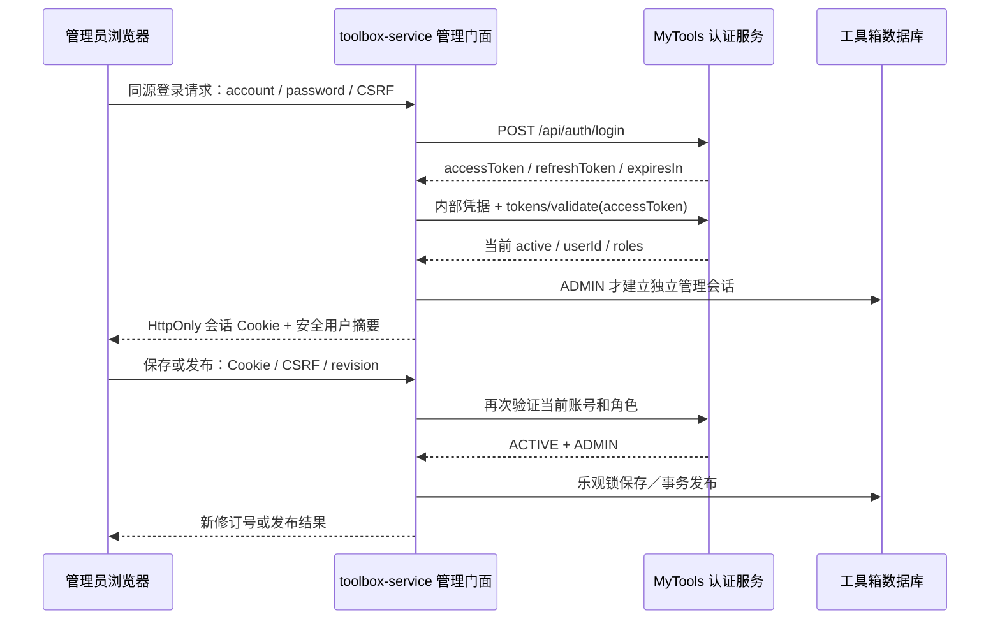

# 工具箱管理员模式与教材录入：详细设计及实施方案

日期：2026-10-05。状态：设计稿，未实施、未部署。本方案以当前仓库代码为依据；本次没有访问生产账号、读取生产配置或验证生产管理员凭据。

## 1. 产品决定

在“禹宇天的工具箱”右上角增加“管理员登录”。使用 MyTools 的用户名／邮箱和密码；服务端确认该账号当前有效且角色为 `ADMIN` 后，左侧显示“管理”，下设“教材录入”。手机左侧抽屉使用同一菜单。

教材录入只设置两个主页面：**教材列表、教材编辑**。新增和修改共用编辑页，核心操作是“填写教材信息 → 录入对应内容 → 保存并发布”。未完成的内容可以保存草稿。无需建立另一套用户、密码、管理员名单或审批角色。

普通首页、PDF、语文字帖、英语字帖继续开放使用。管理功能使用独立接口和管理员会话，不改变公开工具的匿名使用方式。

| 决定 | 具体约定 |
| --- | --- |
| 前端风格 | 复用 Vue 3、TypeScript、Naive UI、Pinia、现有紫色主题、深色模式和响应式外壳。 |
| 管理员身份 | MyTools 的当前账号状态和 `ADMIN` 角色是唯一依据，不能按用户名是否叫 admin 判断。 |
| 登录体验 | 工具箱自己的登录弹窗、独立会话；复用 MyTools 账号与权限，不假设两个域名已具备共享浏览器登录态。 |
| 教材层级 | 教材 → 单元／附录 → 可选课文 → 内容条目。没有课文的英语单词表可以直接挂单元。 |
| 内容排列 | 语文左汉字、右拼音；英语左中文、右英语；一行一组，短语内部空格保留。 |
| 自动补全 | 每条新内容最多首次自动补一次，后续改写、清空、保存、重新打开都不自动覆盖。显式补全按钮只处理空白。 |
| 保存与生效 | 保存草稿不影响访客；“保存并发布”通过校验后生成新版本，公开选择器无需重启即能读取。 |
| 已发布版本 | 永不原地覆盖。发布修订后，正在使用旧版本的练习内容保持稳定。 |
| 首期范围 | 登录／退出、教材列表、新增与修改、单元与课文维护、双列录入、批量粘贴、图片识别、草稿、校验、发布、历史记录。 |
| 后续扩展 | 整册下架、恢复旧版为新版、Excel 批量导入、专门的操作日志页面；首期不显示未完成的占位按钮。 |

## 2. 当前实现与必须补齐的部分

| 当前代码 | 已有能力 | 本次需要补齐 |
| --- | --- | --- |
| `toolbox-web/src/App.vue` | 左侧菜单、右上操作区、移动抽屉、全局 KeepAlive | 管理登录入口、权限菜单、退出时移除管理缓存。 |
| `toolbox-web/src/main.ts` | hash 路由；没有管理员守卫 | 管理路由、会话初始化和权限守卫。 |
| `toolbox-web/src/config/tools.ts` | 公开工具、搜索与统计注册表 | 新增独立管理菜单定义，管理功能不计入公开工具点击统计。 |
| `toolbox-web/src/components/worksheet/WorksheetPairedEditor.vue` | 双列、换行粘贴、逐行编辑 | 管理编辑适配层、稳定行 ID、教材级容量、校对状态。 |
| `toolbox-web/src/composables/useWorksheetPairCompletion.ts` | 一次补全、编辑取消、迟到响应保护 | 将同样规则用于持久化管理员草稿。 |
| `toolbox-web/src/domain/curriculum.ts` | 教材、单元、课文、条目与公开版本契约 | 独立的管理员编辑 DTO，不把 UI 状态混进公开 schema。 |
| `service/toolbox-service/.../CurriculumCatalog.java` | 启动时读取文件；只读内存目录 | 数据库仓储、完整快照原子切换、历史版本读取。 |
| `service/toolbox-service/.../TranslationDictionary.java` | 构造时从已发布教材建立词典 | 发布后同步更新词典，不能一直使用启动时的内容。 |
| MyTools `AuthController` | 登录、刷新、注销 | 工具箱同源登录门面及管理员会话。 |
| MyTools `LegacyGatewayTokenController` | 验证 token 对应会话及数据库中当前用户状态／角色 | 通过受保护的服务端通道复用，不能直接向浏览器开放内部验证入口。 |

当前仓库清单有 5 册、2635 条；这只是本地迁移基线，不作为生产数据的未经核实结论。英语样本是 140 条、9 个单元／附录、0 课文，全部来自词表类别。其中 129 条单元词表、11 条专有名词附录；新编辑器必须能原样承载。

## 3. 页面和交互

### 3.1 全局导航和右上入口

左侧公共顺序保持“首页、PDF、字帖、单词”。管理员登录后，在其下增加分组“管理”，展开后显示“教材录入”。“管理”是展开分组，不额外设计空白管理首页。

| 状态 | 右上角 | 管理菜单 | 访问编辑链接 |
| --- | --- | --- | --- |
| 正在检查会话 | 占位／轻量加载，不闪现账号信息 | 隐藏 | 等待检查后决定。 |
| 未登录 | `管理员登录`，普通文字按钮 | 隐藏 | 显示管理员登录界面，记住站内目标地址。 |
| 管理员 | `管理员 · 昵称`，下拉含“教材录入”“退出管理员模式” | 显示 | 正常进入。 |
| 普通 MyTools 用户 | 登录框提示“当前账号没有管理员权限” | 隐藏 | 不建立管理员会话。 |
| 登录过期 | 恢复“管理员登录”，管理编辑区域提示重新登录 | 隐藏 | 暂停保存／发布，保留本页尚未保存的编辑缓冲。 |

桌面显示完整文案；手机使用盾牌／账户图标加“管理”短标签，保证可发现和 44px 点击区。在 320px 宽度下允许品牌文字适当缩短或省略，不能挤压登录和目录按钮。工具搜索仅向已验证管理员展示教材管理结果。

登录入口在公共页面使用弹窗；直接访问管理链接时用同一表单的内联版本。成功后回到原页面，展开管理分组，显示“已进入管理员模式”和“教材录入”入口；从受限链接登录则进入原目标地址。允许的返回地址只能是本站已注册路由。

### 3.2 登录弹窗

- 标题：`管理员登录`。
- 说明：`使用 MyTools 管理员账号登录`。
- 两个必填项：`用户名或邮箱`、`密码`；密码支持显隐，回车提交。
- 主按钮：`登录`；提交期间加载且防重复。
- 不增加注册、记住密码、角色选择、新建管理员等入口。
- 登录失败保留账号、清空密码；提示区靠近表单，错误使用现有消息样式。
- 错误场景分别处理：账号或密码不正确、暂时锁定／尝试频繁、无管理员权限、服务暂不可用。
- 取消登录不会改变已有字帖输入和当前公开页面。

### 3.3 教材列表

路径：`#/admin/textbooks`。页面标题“教材录入”，说明“维护语文生字、词语和英语单词表”。右上主按钮“新增教材”。

筛选为一行：关键字、学科、年级、上／下册、状态。关键字匹配教材名称、出版社、系列和版本；高级筛选折叠，包含地区与更新时间。年级由学科联动；切换到英语后不保留一、二年级的无效筛选。

| 列 | 内容 |
| --- | --- |
| 教材 | 真实教材名；第二行出版社和教材版本，不显示内部 ID。 |
| 年级／册次 | 如“三年级 · 上册”。 |
| 内容 | 如“8 单元 · 38 课 · 318 条”，无课文时不显示“0 课”。 |
| 状态 | 草稿、已发布、已发布·有修改；部分收录另显示中性色标签。 |
| 最近更新 | 时间和管理员显示名。 |
| 操作 | “编辑／继续编辑”、更多菜单中的“版本记录”“查看公开内容”（已发布时）。 |

默认按最近编辑排序、每页 20 册。管理列表一个教材只占一行，修订版本不会变成重复教材。筛选结果为空提供“清除筛选”；完全没有教材则提供“新增教材”。手机使用教材卡片，筛选放抽屉，不横向挤压桌面表格。

### 3.4 新增与修改教材：同一编辑页

路径：`#/admin/textbooks/new`、`#/admin/textbooks/:editionId/edit`。

页面顶部为“返回教材列表”、教材名、保存状态；固定底部操作栏为“预览字帖”“保存草稿”“保存并发布”。主按钮只保留“保存并发布”。不要把新增和编辑设计成两套表单。

**上方：教材信息。** 新增时展开；已有教材进入时折叠为摘要，点击“编辑教材信息”展开。

| 字段 | 必填与默认 | 规则 |
| --- | --- | --- |
| 学科 | 必填，未选择 | 语文／英语；已有正文后切换需明确处理原内容，已发布后锁定。 |
| 年级、册次 | 必填，未选择 | 语文 1—6；英语 3—6；上册／下册。 |
| 出版社 | 必填 | 现有值可搜索选择，也可录入新值，对应 `publisher`。 |
| 教材名称（系列） | 必填 | 如“统编语文”“译林英语”，对应 `series`；不得出现 U+FFFD 乱码。完整展示名由系列＋年级＋册次＋教材版本组合，不增加另一个无法发布的 displayName。 |
| 教材版本 | 必填 | 如“2024 年修订版”，对应 `editionLabel`；与系统发布的内容修订号分开。 |
| 适用地区 | 默认江苏，可改为全国或多选地区 | 存地区代码，显示地区名称。 |
| ISBN、课标／修订年份 | 可选，放“更多信息” | ISBN 按真实封面／版权页填写，不推断。 |
| 来源说明 | 发布必填，草稿可暂缺 | 如“纸质教材附录词语表，第 78—82 页”；可录入来源链接，不自动抓取链接。 |
| 收录范围 | 默认“部分内容” | 选择“完整收录”时需核对范围及总数；不能凭当前条数自动认定完整。 |

已发布后，学科、年级、册次和真实教材版本身份不得改成另一册。出版社／教材显示名的笔误可以在新内容版本中修订；换实际出版社、系列或教材版次应“新增教材”。系统内部 ID 永久稳定，管理员不手填版本号或哈希。

**下方：内容工作区。** 大屏为左侧约 220px 的单元／课文目录和右侧内容编辑器；页面已有全局导航，不再增加额外第三层导航栏。目录工具为“新增单元／附录”，节点菜单提供重命名、新增课文、上移／下移、删除。拖拽排序是可选增强，必须保留按钮方式。

- 单元名称显示真实名称，如“第一单元”或“Unit 1 Hello!”；课文显示“天地人”等真实标题。
- 允许单元无课文，内容可直接挂单元。英语附录作为命名单元承载，禁止为了满足 UI 生成虚构课文。
- 语文右侧有识字表、写字表、词语表筛选；同一条可属于多个表类别。类别只表达教材来源，不自动决定字帖题型。
- 英语默认“单词表”，接收单词、短语和表中句式；`See you tomorrow!` 仍是一个完整条目，`after school` 不拆分。专有名词保留附录归属。
- 第一次新增可先只建单元，再录入内容；课文不是额外的必经步骤。
- 切换节点前提交当前输入缓冲；没有通过结构校验的变更保留并就地提示，不能悄悄丢失。
- 删除含内容的节点，明确显示影响条数并确认；删除只发生在草稿，支持当前编辑会话撤销。已发布版本完全保留。

### 3.5 双列内容编辑

语文列名为“汉字”“拼音”；英语列名为“中文”“英语”。桌面并排；窄屏可将同一行的两栏上下排列，保留行号和配对边框，不能拆成两个互不对应的列表。

每行主显示：行号、两栏输入、校对状态、删除。页码、来源定位、词性、备注等放“详细信息”折叠区域，避免主表出现十几列。每屏默认编辑 30 条，可分页；筛选“待补全／待核对”仅改变视图，不更换条目的稳定身份。

编辑器工具栏只保留：`添加一行`、`批量粘贴`、`图片识别`、`补全空白`，其余选择和移动操作放更多菜单。

**批量粘贴：**

1. 支持向任意一栏粘贴多行；按换行对应，不按空格拆词。
2. 支持从表格复制的两列 TSV；弹层明确列顺序，先预览再“追加到当前范围”。
3. 两列数量不等时保留空行，标明缺失；不能删除空行导致后续错位。
4. 默认追加，不默认替换。选择替换当前范围时展示将移除的数量并确认。
5. 重复词提供提示，不默认全册去重；同一个词可在不同单元、课文、义项出现。

**图片识别：**

复用现有浏览器端识别，先显示对应的双列结果，管理员修正后才追加。图片尽量留在浏览器；草稿保存识别出的文字及来源页码／说明，不隐式上传原图。词表原有英文与中文优先保留，缺失才做一次建议补全。识别结果、机器翻译和拼音都标为“待核对”，不能视作教材原文已确认。

**自动补全与人工校对：**

- 新行第一次具备一侧内容时，允许自动补另一侧；完整配对立即标记已初始化。
- `automaticInitialized` 在请求发起前保存到行状态，草稿持久化时一并保存。
- 对已创建的管理草稿，首次自动请求前先成功保存该行与 initialized 标记；保存失败不发送自动请求。图片识别弹层内的未入库候选只承诺当前弹层生命周期内一次，追加到草稿时沿用其标记，不能重新触发。这样刷新已保存草稿也不会重发同一次自动补全。
- 修改任一栏、清空、切换单元、保存、重新进入、恢复草稿都不重置这个标记。
- 显式“补全空白”仅补空字段；不覆盖任何非空字段，不重新翻译教材已给出的释义。
- 请求失败／取消后不自动重试；修改时取消请求，回包必须核对 rowId、原文、目标空白和请求代次。
- 编辑完成后可逐项“已核对”，也可选择当前页批量标记。标记绑定该行内容摘要；再次改动内容会使该行恢复“待核对”，但不会再次自动翻译。
- 已发布教材导入修订草稿时，原样内容沿用已核对状态；只对新增或改动条目重新核对。

### 3.6 草稿、保存、发布、预览

草稿状态文案：`未保存`、`正在保存…`、`草稿已保存 14:32`、`保存失败，请重试`。保存失败不能显示已保存，也不能清空输入。

新教材先完成最少信息并点击“创建并开始录入”，取得教材 ID；这一步只建草稿，不公开。之后在修改停止约 2 秒且没有未提交输入时自动保存草稿，手动按钮仍可用。写请求串行，后一个版本必须基于上一成功响应；不会通过多次并行全量 PUT 把新内容覆盖回旧内容。

每次保存冻结请求 payload 和编辑代次，发送后仍允许继续输入。响应只更新 revision、保存时间和当前仍存在节点的 ID 映射，不能用服务器旧整包覆盖当前编辑缓冲。保存期间发生的新改动继续保持未保存，排队使用新 revision 再提交；已经删除的行不能被迟到响应复活。

“保存并发布”的顺序：提交输入缓冲 → 等待／执行保存 → 后端校验指定草稿修订 → 展示发布摘要 → 点击“确认发布”。摘要只显示教材名称、范围、总条数、本次新增／修改／移除数、待核对问题；有阻断问题时提供“定位问题”，不额外增加独立审核页面。

发布成功显示“已发布，字帖中可选择”，按钮“在字帖中查看”。跳转只预定位这本教材，**不勾选任何单元或内容**。部分收录也可以发布，但必须显示其真实范围。

“预览字帖”使用当前草稿的已选范围，在侧面板选择对应两种题型并调用现有 PDF 渲染／打印链路。标注“草稿预览”，管理员预览不算公开工具使用统计。缺少目标题型必需字段时定位缺失行，不在预览过程中自动重译。

版本记录放右侧抽屉：版本号、发布人、时间、修改摘要和内容对比。首版提供只读历史；恢复某版将来应复制为新草稿发布，不回写旧版本。

### 3.7 并发、失效、移动端与无障碍

- 同一本教材首期使用一个共享草稿。两位管理员可打开，但保存必须带修订号；过期修订返回冲突，不“后保存者覆盖前保存者”。
- 冲突面板显示“服务器已有更新”，提供“查看差异”“读取最新”；当前本地改动暂存在内存，读取最新前确认。首版不做自动三方合并。
- 正常离开有未保存修改时提示“保存后离开／继续编辑／放弃未保存修改”。刷新只承诺已保存草稿可恢复，不宣称关闭前必能完成请求。
- 首次未授权直达不加载编辑器。已经打开的编辑器因明确的期限届满失效时不被守卫立即跳转卸载：保留按 userId＋editionId 绑定的内存缓冲并冻结写操作；同一账号重新登录后先比对最新 revision，再允许保存，不自动补发旧发布请求。
- 403 权限撤销、未到期限却被验证为无效的会话、主动退出和切换账号均清除管理缓冲；服务端不可用时锁定写入并提示重试，不将其伪装成已退出或已保存。
- 主动退出清理管理 store、请求和 KeepAlive 实例，不清空公共字帖草稿。跨标签页退出通过 BroadcastChannel 同步，不广播 token 或教材正文。
- 重新登录为另一个账号时先清除上一个账号的编辑缓冲，不能把旧草稿内容写入新账号会话。
- 1280px 以上为目录＋内容；768—1279px 将教材目录变成可收起面板；小于 768px 用“选择单元／课文”按钮打开目录抽屉。
- 手机底部保留“保存草稿／保存并发布”，预览放更多操作，适配安全区和软键盘；不使用 hover 才出现的操作。
- 标签与输入关联，错误可聚焦定位；弹窗关闭焦点回触发入口；控件点击区至少 44px，字体至少 16px，键盘可完成创建／编辑／保存。

## 4. 权限与会话实现

### 4.1 请求链路



### 4.2 复用的真实上游接口

| 用途 | 已存在的 MyTools 接口 | 调用约定 |
| --- | --- | --- |
| 登录 | `POST /api/auth/login` | JSON `{account,password,deviceName:"Yuyutian Toolbox Admin"}`。 |
| 当前资料 | `GET /api/user/info` | 用户 access token；仅获取显示资料，不能代替实时管理员判断。 |
| 权威校验 | `POST /internal/v1/gateway/tokens/validate` | Authorization 是服务内部凭据；JSON `{accessToken}` 是要验证的用户凭据。返回 `active,userId,username,roles`。 |
| 刷新 | `POST /api/auth/refresh` | `Authorization: Bearer <refreshToken>`；不是 JSON 请求体。 |
| 注销 | `POST /api/auth/logout` | `Authorization: Bearer <accessToken>`；只注销这次工具箱登录对应会话。 |

内部验证读取当前数据库用户状态与角色，而不是仅信任 JWT 的历史 role。每个管理读取、保存、发布请求都校验，只有 `active && roles.includes('ADMIN')` 放行。普通用户无管理权限；管理员被禁用、降级或会话被撤销后，下一次管理请求必须拒绝。浏览器提供的 `userId/role/isAdmin/X-User-Id` 均不能成为授权依据。

上游登录成功已经创建一个 MyTools 会话。如果后续 ADMIN 校验失败，或者工具箱建立会话失败，应尽力注销这次刚创建的上游会话，再返回 403／503；清理失败也不能形成有效的工具箱管理会话。

内部凭据来自运行环境，不写仓库；现实现使用 `migration.gateway.internal-token`。只允许后端从固定配置的内网／loopback 地址调用，公网代理拒绝 `/internal/**`，工具箱不能做可传任意 URL 的代理。若部署策略要求服务独立凭据，在原验证端点增加针对工具箱的限定凭据配置；不能复制 MyTools JWT 签名密钥到前端。

MyTools Identity 新链路虽然存在，但当前 Web 登录仍走上述 legacy API；首期按当前链路实现一个 `MyToolsAdminIdentityClient` 适配层，将来替换内部适配，不改变工具箱的管理员 API。

### 4.3 独立管理员会话

使用 `__Host-toolbox_admin` 随机会话 Cookie：`Secure; HttpOnly; SameSite=Lax; Path=/`，不设置 Domain。服务端只存随机值哈希；上游 access／refresh 加密保存，密钥由部署环境注入。密码只在本次登录请求中使用，不持久化、缓存、记录日志或返回浏览器。

浏览器不保存 MyTools access／refresh token 到 localStorage、sessionStorage、Pinia 持久化或 URL。管理接口响应 `Cache-Control: no-store`。Cookie 与服务器会话组合、失效和退出设计参考 [OWASP Session Management](https://cheatsheetseries.owasp.org/cheatsheets/Session_Management_Cheat_Sheet.html)。

会话默认空闲上限 30 分钟、绝对上限 8 小时；同时受上游会话／令牌约束，以更短的有效边界为准。这是拟定产品上限，不代表现有 MyTools refresh 必然有效 8 小时。自动轮询不会刷新空闲时间，真实编辑／管理请求才更新活动时间。

登录表单打开时领取短期的登录 CSRF nonce，同时绑定独立预认证 Cookie `__Host-toolbox_admin_login`（Secure、HttpOnly、SameSite=Lax、Path=/）。服务器记录 Cookie 随机值及 nonce 的哈希、10 分钟截止和消费状态，登录提交一次性消费，失败后获取新 nonce，防止重放；成功则删除预认证 Cookie、旋转正式会话标识和 CSRF token。管理写请求使用独立 `X-Toolbox-Admin-Csrf`，绑定管理会话并严格校验 Origin；匿名 Guest Cookie／CSRF 不能混用。来源过滤和 SameSite 不能替代 token 校验。参考 [OWASP CSRF Prevention](https://cheatsheetseries.owasp.org/cheatsheets/Cross-Site_Request_Forgery_Prevention_Cheat_Sheet.html)。

刷新使用服务端登录响应中记录的确定到期时间，在 access 尚有效且即将到期时处理；先实时验证仍为管理员，再进行 session 级单飞刷新和版本 CAS，刷新后再次验证当前权限。上游刷新会复制旧 role，因此刷新响应中的 role 不能直接作为授权。

并发普通请求可能拿到刚被轮换的旧 access。读取凭据、验证、刷新、保存新 refresh_revision 必须受会话级协调；若验证返回 inactive，先比较该请求使用的凭据 revision 与数据库当前 revision。只有已被合法刷新推进时，允许加载最新凭据重验一次，此重验不触发刷新；revision 未变才按失效处理。否则旧请求会误删新会话。

`active=false` 目前无法区分过期与撤销。首期不得对任意 401／inactive 自动刷新重试：未到期却失效立即销毁管理会话；已经过期且没有完成提前刷新则要求重新登录。需要“过期后无感续期”时，应先扩展受保护的上游会话状态契约，明确区分 `ACCESS_EXPIRED` 与撤销／禁用，不作为首期的隐含能力。

退出先销毁本地管理会话／Cookie，再尽力注销该次上游会话；上游失败不能导致本地仍登录。有效 access 不再存在时，不为注销而自动刷新并重建会话。MyTools 其他浏览器会话不受影响。

### 4.4 前后端防护的实际接入点

- 前端创建 `adminRequest`，不修改公开 `publicRequest` 去携带 MyTools Authorization。
- 管理状态 `checking/anonymous/admin/expired/unavailable`；初始化失败不阻塞公共页面。路由 `meta.requiresAdmin`，首次访问先完成会话验证。
- 移除管理页面的通用 KeepAlive；公共字帖继续保留其现有缓存。过期锁定编辑器仍保留当前已挂载实例，恢复流程见第 3.7 节。
- `/admin/v1/**` 默认逐请求鉴权；精确例外仅为 `GET /admin/v1/session`（可选 Cookie 认证）、`GET /admin/v1/auth/csrf`、`POST /admin/v1/auth/login`、`POST /admin/v1/auth/logout`（本地清理）。无 Cookie 的 session 查询可匿名返回 false，有 Cookie 则实时验证。禁止按 `/auth/**` 通配放行；所有例外仍执行各自 Origin、CSRF、体积及频率规则。列表、详情、历史全部需要管理员。
- 管理接口不接受任意字段透传到实体。发布人、核对人、角色、状态、哈希、版本号均由服务端计算。
- 登录频率限制复用 MyTools 现有锁定规则，工具箱增加按账号＋来源的入口限流；不得使用前端按钮禁用作为唯一限流。
- 管理正文、密码、上游凭据不写普通访问日志；审计只记操作者、对象 ID、版本、动作、差异摘要、结果和 requestId。

## 5. 数据模型和版本策略

### 5.1 保留现有公开契约

公开 `PublishedBook/TextbookEdition/CurriculumEntry` 的 schemaVersion 继续为 1。语文 `text` 存汉字，`pinyinDisplay/pinyinSegments` 存拼音；英语 **`text` 存英语、`meaning` 存中文**。UI 左中文右英语只是展示顺序，不能把字段存反。

`editionId` 表示哪一册哪个教材版次；`contentVersion` 表示这册内容的校对修订。同一册每次发布生成递增版本，例如 `1.0.2 → 1.0.3`；初次发布为 `1.0.0`。版本由服务端在事务锁内分配，管理员不手填。

原有 unitId、lessonId、entryId 保留；新 ID 由服务端生成。新节点和行使用 clientUnitId／clientLessonId／稳定 rowId，首次保存以幂等键生成并持久化映射，响应返回正式 ID 与引用映射；rowId 在整个草稿生命周期内不变，避免 ID 回填中断配对身份。异步补全回包始终核对稳定 rowId。调整顺序、改标题和修改文本不得重新分配正式 ID。引用和归属以 ID 为准，展示始终用标题。

新节点引用使用明确的互斥字段：`unitId` 与 `clientUnitId` 二选一，`lessonId` 与 `clientLessonId` 二选一；无课文时二者均为空，不根据字符串前缀猜身份。服务端在同一事务解析引用并返回 unit／lesson／entry 三类映射，映射保存在草稿文档中。重复临时 ID、已有 ID 改挂其他教材、一个临时 ID 映射多个正式 ID 均拒绝。

### 5.2 首期持久化表

草稿和已发布快照放同一个工具箱数据库，发布指针与正文在同一事务提交，避免把数据库保存成功和文件清单切换成功混为一谈。单元、课文和条目首期存于版本化文档内，不需要立刻拆成大量可变关系表。

| 表 | 核心字段与约束 |
| --- | --- |
| `toolbox_admin_session` | token_hash、mytools_user_id、username、encrypted_access／refresh、access_expires_at、created_at、last_activity_at、absolute_expires_at、revoked_at、refresh_revision；userId 输出给 JS 时为字符串。 |
| `toolbox_admin_login_challenge` | 预认证 Cookie hash、csrf hash、expires_at、consumed_at；限量创建并定期清理，不保存账号密码。 |
| `toolbox_textbook` | edition_id PK、current_version_id nullable、draft_id、created_by／at、updated_by／at。一个 edition 一条管理列表记录。 |
| `toolbox_textbook_draft` | draft_id PK、edition_id UNIQUE、base_content_version、revision、editable_json、source_metadata_json、updated_by／at。一个教材一个共享草稿。 |
| `toolbox_textbook_version` | version_id PK、edition_id＋content_version UNIQUE、content_bytes、content_sha256、edition_metadata_json、source_metadata_json、published_by／at。发布后不可 UPDATE 正文。 |
| `toolbox_curriculum_catalog` | 单例 catalog_key、epoch、catalog_version、updated_at；publish 时行锁、单调递增。 |
| `toolbox_curriculum_audit` | actor_user_id、action、edition_id、draft_id、from／to_revision、from／to_version、摘要、request_id、created_at。 |
| `toolbox_admin_operation` | actor_user_id＋operation_scope＋idempotency_key UNIQUE、request_digest、result_json、created_at；创建／保存／发布均记录回执，同键同内容返回原结果和完整 ID 映射。 |

所有 ID 参数都验证格式、权限和存在性；数据库查询使用参数化 SQL。迁移文件使用现有独立服务 Flyway 序号，执行前检查最新编号，不能覆盖已经运行的 migration。

### 5.3 管理草稿 DTO

管理员 DTO 独立维护，例如 `AdminTextbookDraft`，包含：

- 教材基础信息、单元、课文、内容、来源说明。
- `draftId/editionId/revision/baseContentVersion`。
- 条目稳定 `rowId/entryId`、`automaticInitialized`、补全来源、`confirmedContentDigest`、服务端核对记录。
- `coverageDeclaration`、缺失范围说明、字段校验结果。

草稿的 `automaticInitialized`、校对 UI 状态、rowId／临时节点 ID 不直接进入 PublishedBook JSON；发布使用显式映射。现后端启用了未知字段拒绝，直接把管理 UI 字段塞进公开 schema 会破坏读取。

写入 DTO 不接收客户端指定的核对人、核对时间或最终 reviewed 状态。“已核对”按钮只产生 `confirmations:[{rowId,expectedContentDigest}]` 确认意图，随当前冻结保存请求提交；前后端使用明确一致的内容规范化和摘要规则。服务器对待保存行自行计算摘要，比对确认意图后写当前管理员和服务器时间。摘要覆盖两栏正文、逐字拼音、义项／上下文、可接受答案、来源定位等影响教材含义的字段；相关字段变化自动撤销旧确认。机器补全不能生成确认意图；规范化导致摘要不一致时返回行级问题，要求重新核对。响应中的 `confirmedContentDigest` 仅作为服务端核对结果读取。

已存在且完整配对的教材行导入草稿时为已初始化；旧管理草稿缺少一次补全标记时按已初始化迁移，不因打开草稿而批量重译。

### 5.4 教材来源、范围和校验

保留现有 `sourceRefs={sourceId,locator,page}`。编辑器可给当前范围设置默认来源和页码，再对少数条目调整；发布展开为明确引用。来源元数据跟随不可变版本保存，不能事后修改来源记录使旧发布审计失真。公开 API 继续仅返回现有允许字段，内部核验备注不整包公开。

| 校验层 | 草稿保存 | 发布 |
| --- | --- | --- |
| ID 和归属 | 重复 ID、无效 ID、跨教材归属直接拒绝 | 同样拒绝；必须确认 lesson 所属 unit 等于条目的 unit。 |
| 结构与次序 | 非法顺序拒绝；名称暂缺作为问题保存 | 单元／课文标题必填，同父顺序唯一；可无课文。 |
| 教材元数据 | 允许部分缺失并返回定位 | 必填完整，学科／年级／册次有效，标题无替换字符乱码。 |
| 双列内容 | 允许暂缺并显示待补全 | 语文汉字＋有效逐字拼音，英语英文＋中文释义；空白行不作为条目发布。 |
| 拼音 | 不合法作为待处理问题 | 音节合法、数量与汉字对齐，多音字以核对结果为准。 |
| 内容性质 | 保留短语空格、标点和教材义项 | 不因英语句末标点改变词表归属；不把正文任意抽词当附录词表。 |
| 人工核对 | 自动结果待核对；手工标记绑定内容摘要 | 新增／改动条目必须明确核对且摘要未变化，自动生成不能自行标 reviewed。 |
| 来源和覆盖 | 可暂缺来源定位 | 来源有效、范围声明真实；完整收录需要确认依据，不凭已收录数相等推断。 |

统一在 Java `CurriculumValidator` 中给出问题码、字段路径、rowId、unitId、lessonId 和严重程度；前端即时校验用于体验，后端重新校验决定能否发布。现 Node 校验规则整理为共享测试样例，两端对同样 fixtures 给出同样结果。

建议上限：每册 5000 条、单次批量粘贴 500 行、草稿请求体 8MiB、单栏内容 512 个 Unicode 字符、名称 120 字符。上限应集中配置并校验真实字节数，分块请求同样生效；不要把现有练习生成的题数上限套到整册编辑器。前端每次只渲染当前页，超限明确返回，不静默截断。

### 5.5 保存与事务发布

保存使用 `If-Match: "draft-<revision>"` 和必需的 `Idempotency-Key`。服务端按期望 revision CAS 更新，成功递增 revision 并返回新 ETag、必要 ID 映射。草稿内容、revision、ID 映射、确认记录和操作回执同事务提交。相同键和完全相同冻结 payload 的重试返回原结果，即使其 If-Match 已旧；同键不同 payload 返回 409。每次重试仍先验证当前权限，不因存在回执绕过鉴权。网络中断后用同键确认结果，不直接覆盖服务器最新版本。真正的 revision 冲突返回 409，保留客户端缓冲并停止自动保存。

发布算法：

1. 校验管理员、CSRF、请求体和幂等键；取得目标草稿的指定 revision。
2. 对指定草稿修订做结构、来源和内容预校验，准备可复用的派生数据；失败返回定位，不修改公开内容。此时还不生成最终带版本正文或最终哈希。
3. 获取当前进程目录写锁；数据库事务锁定 catalog 行和教材／草稿行。按固定锁顺序执行，复核 revision、baseContentVersion 和当前公开版本；分配新的 contentVersion 与统一发布时间，沿用真实人工核对记录，不把发布时刻冒充人工核对时刻。
4. 用已分配的最终版本和时间生成确定性内容字节、哈希、完整目录／词典快照并验证。完整快照必须基于取得写锁后的最新 epoch／事务内 current 指针集合，再替换本册；锁前只允许准备本册候选，重试不能复用旧全目录，否则不同教材并发发布会丢掉其中一本更新。全部成功后插入不可变版本、更新教材当前指针、递增 catalog epoch、写审计与幂等成功结果。草稿更新为刚发布的干净基线并递增 revision。锁内不调用外部翻译、OCR 或其他网络服务。
5. 同事务提交成功后，将新 `CatalogSnapshot` 通过单个 AtomicReference 交换；失败不交换。正常请求在交换完成后收到成功。
6. 提交后、交换前进程崩溃时，重启从 DB 重建快照；同幂等键重试返回已经提交的版本，不再重复发布。
7. 若提交成功但本实例重载失败，停止该实例教材接口就绪并重建；不能持续宣称发布成功却一直读旧快照。重试依照幂等操作记录返回既有结果，并完成本地刷新。

单个请求只取得一次 `CatalogSnapshot`；目录、版本、条目和翻译词典均从本次取得的同代快照读取。用短读锁取得引用，与发布写锁协调，拿到不可变引用后释放读锁；发布写锁保持至事务提交和引用交换完成。禁止更新多个 volatile 字段，让目录、正文、哈希和词典处于不同代。公共目录只列当前指针；显式 version／entries 可以读取曾发布的历史。历史正文按需加载并使用有界缓存，不一次加载无限历史。

若未来多实例部署，各实例在教材请求前比较 DB catalog epoch，使用一次一致性事务读取新快照再原子替换；仅靠本地锁不构成跨实例一致性。首期发布服务不要宣称具备未经验证的多实例能力。

新快照包含当代英语教材词典。`TranslationDictionary` 不再只在构造函数加载；`TranslationService` 对教材相关缓存按 catalog epoch 隔离或失效，迟到的旧请求不能污染新代。不同册同词不同义不任意选择第一条，保留现有唯一精确匹配规则。

新发布只影响后续教材选择和新条目的首次补全，不能主动重译用户已经编辑的字帖行或管理草稿。

### 5.6 哈希与缓存

当前 `contentSha256` 是原始 book.json UTF-8 字节的哈希。book 内 `edition.contentSha256` 为空，真实哈希保存在发布清单。迁移应将原文件字节原样存 BLOB，并独立保存声明元数据；不能重序列化后声称哈希未改变。

新版本使用确定性 UTF-8 序列化，book 内 hash 继续留空，再计算正文哈希并写入独立元数据／响应。禁止计算包含自身哈希的自引用 JSON。

公开目录改为 `Cache-Control: no-cache` 并增加基于 catalog epoch 的 ETag；匹配才返回 304，取消当前目录 300 秒无条件新鲜缓存。指定不可变版本继续一年缓存和固定哈希 ETag。条目响应如增加缓存，缓存键包含完整版本和筛选／游标。

前端进入教材选择或发布后预定位时重新验证目录，保留默认未选择状态。已打开练习使用自己的已导入数据快照；不在后台切换成新发布条目。

## 6. 管理 API 契约

以下均为**拟新增接口**；现有 MyTools 上游接口见第 4 节。工具箱使用现有 `ApiResponse`：`{code:"OK",data,requestId}`；错误信封沿用 `code/messageKey/details/requestId`。不能混用 MyTools 的原始响应信封。

| 方法和路径 | 用途 | 要点 |
| --- | --- | --- |
| `GET /admin/v1/session` | 恢复会话／查询状态 | 无会话返回 authenticated=false，不因每个访客打开首页创建数据库登录会话；有会话需实时校验。 |
| `GET /admin/v1/auth/csrf` | 登录表单 nonce | 10 分钟短期、限流；只在登录表单需要时建立预认证状态。 |
| `POST /admin/v1/auth/login` | 登录 | `{account,password}`，csrf header；普通账号 403；成功返回安全用户摘要、能力、到期提示、csrfToken。 |
| `POST /admin/v1/auth/logout` | 退出 | 同源／CSRF；即使上游不可用也清本地会话。 |
| `GET /admin/v1/textbooks` | 列表 | keyword、subject、grade、semester、status、page、pageSize；pageSize 最大 100。 |
| `POST /admin/v1/textbooks` | 创建教材草稿 | 最少信息；Idempotency-Key；201 返回 editionId/draftId/revision。 |
| `GET /admin/v1/textbooks/:id/draft` | 读取编辑数据 | 返回 draft DTO、基线版本和 ETag；已发布无草稿时可在显式开始编辑时创建。GET 不隐式写库。 |
| `POST /admin/v1/textbooks/:id/draft` | 基于当前版开始编辑 | 幂等；已有共享草稿返回当前草稿，不复制第二份。 |
| `PUT /admin/v1/textbooks/:id/draft` | 保存 | If-Match 和 Idempotency-Key 必需；整个有界草稿文档、稳定行 ID；返回新 revision、保存时间和 ID 映射，前端不整包替换当前缓冲。 |
| `POST /admin/v1/textbooks/:id/validate` | 校验已保存修订 | `{draftRevision}`；返回问题、计数、是否可发布、差异摘要。 |
| `POST /admin/v1/textbooks/:id/publish` | 发布 | `{draftRevision,baseContentVersion,changeNote}`；Idempotency-Key；服务端再次校验，不能信任先前 validate 的前端结果。 |
| `GET /admin/v1/textbooks/:id/versions` | 历史列表 | 只返回安全元数据。 |
| `GET /admin/v1/textbooks/:id/versions/:version` | 历史内容与差异依据 | 只读、管理 no-store；来源内部备注仅管理员可见。 |

语文拼音补全继续在浏览器执行。英语管理补全调用新增 `POST /admin/v1/translations`，复用现有翻译业务核心，使用管理员主体和独立额度，不挪用 Guest 身份假装鉴权。只接收当前请求的缺失项，不接受网页 URL 或整本任意文件；单批不超过现有 20 项，输出仍为待校对建议。为复用需将 TranslationService 的主体／配额接口从 GuestSession 依赖中抽出，公开翻译额度及安全检查保持原样。

所有 admin 接口响应 no-store，写操作使用独立 CSRF；任何教材 ID／版本 ID 都不能绕过管理员验证。历史／来源读取同样受保护。

建议错误码放入工具箱现有 `common/ErrorCode.java`：

| 错误码 | HTTP | 处理 |
| --- | --- | --- |
| `TOOLBOX_ADMIN_001` | 401 | 未登录／过期，暂停写入并打开登录。 |
| `TOOLBOX_ADMIN_002` | 403 | 当前账号无管理权限，销毁管理会话。 |
| `TOOLBOX_ADMIN_003` | 403 | 来源／CSRF 不符，保留输入，不执行变更。 |
| `TOOLBOX_ADMIN_004` | 409 | revision、baseVersion 或同幂等键不同内容冲突。 |
| `TOOLBOX_ADMIN_005` | 422 | 发布校验失败，返回可定位问题清单。 |
| `TOOLBOX_ADMIN_006` | 404 | 教材／草稿／版本不存在。 |
| `TOOLBOX_ADMIN_007` | 413 | 请求体／条目数量超限。 |
| `TOOLBOX_ADMIN_008` | 429 | 登录、保存或翻译频率限制；返回 Retry-After。 |
| `TOOLBOX_ADMIN_009` | 503 | 身份依赖或管理存储不可用，禁止继续变更。 |
| `TOOLBOX_ADMIN_010` | 428 | 缺少要求的 If-Match 等并发前提。 |

例如发布成功的 data 为：

```json
{
  "editionId": "stable-edition-id",
  "contentVersion": "1.0.3",
  "catalogVersion": "catalog-42",
  "catalogEpoch": "42",
  "contentSha256": "server-calculated-sha256",
  "entryCount": 318,
  "draftRevision": 18,
  "publishedAt": "2026-10-05T06:30:00Z"
}
```

## 7. 公共路径兼容改造

当前 toolbox-service 整个 Servlet context-path 是 `/public/v1`。新增 `/admin/v1` 不能只把 controller 写成 `/admin/v1`，否则实际路径会变成 `/public/v1/admin/v1`。

推荐改为根上下文，并给六个既有控制器显式增加 `/public/v1` 前缀：session、stats、events、textbooks、translations、tools。外部 URL 全部保持原样，管理控制器使用 `/admin/v1`。

同步完成以下修改，不能遗漏：

1. `BodySizeLimitFilter` 原来按 servletPath `/events`、`/translations` 匹配，改为完整 public 路径；新增 admin 登录／草稿／翻译各自的实际体积限制。
2. Actuator 配置显式维持 `/public/v1/health`、`/public/v1/info`；不能把健康检查意外移走或扩大暴露端点。
3. `CorsAndOriginFilter` 分 public/admin 策略；管理支持所需 PUT、If-Match、Idempotency-Key 和独立 CSRF header，不放宽公共来源白名单。
4. nginx 同源代理保留 `/public/v1/` 和 `/admin/v1/` 前缀，不 strip；内部认证地址不通过工具箱公网反代。
5. 登录／管理路径禁止 CDN 缓存，返回 Set-Cookie 的响应不得缓存；公共教材缓存按第 5.6 节执行。
6. 在真实随机端口集成测试中验证路径和过滤器；仅 MockMvc 通过不足以证明 context 迁移正确。

## 8. 初始数据迁移及回退

1. 读取部署目标当前 manifest、当前书文件和来源记录，核对数量、ID、原始 bytes 和 SHA，生成只含摘要的迁移报告。本地 5 册／2635 条用于开发 fixtures，不直接覆盖生产差异。
2. 以原 editionId＋contentVersion 幂等导入 DB；重复导入同哈希不新增，不同哈希停止并报告。旧 book 的原始字节、声明元数据和来源核验记录分别保存。
3. 当前版本指针严格来自 manifest。旧文件目录中的历史版本只有核实曾发布且通过迁移校验后才进入历史表，不能把未发布草稿当公开历史。
4. 旧数据用兼容验证导入；新的严格发布规则用于后续修订。本地三／四年级存在名称替换字符问题，需生成待修订项，不偷偷修改旧字节或旧哈希。
5. 在管理写入尚未启用时做文件／DB 双读对账：教材目录数据、结构、所有条目分页、类别过滤、指定版本的原始 bytes／hash／ETag 必须一致。初始迁移保留旧 catalogVersion，catalog epoch 独立初始化，首次真实发布才生成新 catalogVersion。目录 ETag 和 Cache-Control 的调整、历史版本可读是计划差异，单列核对，不要求新旧目录响应头完全一致。
6. 开启 DB 读取后，验证公开页面、教材选择、翻译词典、PDF 和打印，再开放管理写入。公开选择范围仍默认为空。
7. 写入前阶段可切回文件仓储。已有新发布后回退时，先停管理写入，从 DB 导出包含最新 current manifest、全部曾发布历史的独立索引、原始版本字节和来源的完整兼容内容包、校验后切换；不能直接回退成最初文件而丢失新教材。标准回退保留新后端，files repository 同样支持 current 与历史索引；不能靠扫描所有文件猜测发布历史。
8. 回退保留 DB 草稿、历史和审计；不执行删除表或清空数据。原文件作为只读基线，后续发布以 DB 为权威，不维持文件／DB 两个可独立写入的事实来源。

回退到旧后端二进制会失去新增历史读取等能力，不能声称满足 C04 或作为透明标准回退；只有另行说明能力降级和数据保留方案后才采用。

## 9. Agent 实现步骤

以下为可执行顺序，每一步达到验收门槛后进入下一步；用户当前只要求设计，不在本轮执行这些变更。

| 步骤 | 修改和交付物 | 完成标准 |
| --- | --- | --- |
| 1：契约与基线 | 管理 DTO、API、错误码、只读数据盘点、真实 upstream 身份适配测试 fixtures。 | 明确当前认证链路；旧教材 hash／ID 基线完整，不复制生产密钥。 |
| 2：路由与鉴权 | context 前缀改造、管理 session/filter、MyToolsAdminIdentityClient、登录／退出 API。 | 公共匿名合同全通过；ADMIN 可进、USER／guest 不可进；实时降级生效。 |
| 3：数据库与迁移 | 独立 Flyway 表、draft/version 仓储、迁移／对账／导出脚本。 | 幂等导入、原 bytes/hash 保留；失败不改变 current。 |
| 4：后台编辑与校验 | 创建、草稿 CAS 保存、来源处理、统一 validator、幂等写入。 | 刷新恢复、并发冲突、乱码／归属／配对／校对问题均可定位。 |
| 5：发布与公开读取 | 事务发布、AtomicReference 快照、当前／历史索引、字典刷新、缓存。 | 发布无需重启；新旧版本各自正确；崩溃和幂等恢复验证通过。 |
| 6：前端入口与页面 | 管理 auth store、登录框、条件菜单、列表、单页编辑、移动适配。 | 所有页面权限一致、未保存提示正常；退出清管理缓存不动公共草稿。 |
| 7：输入复用与预览 | 管理配对编辑适配、图片导入、一次补全持久化、按题型草稿预览。 | 不受练习题数限制误截整册；后续编辑不会重译；打印复用现有已修复链路。 |
| 8：联调与上线 | 自动测试、真实浏览器与手机尺寸验收、旁路对账、演练回退。 | 第 10 节全部首期必需项通过，未通过项明确列出，不能用菜单可见代替权限验收。 |

建议新增前端模块：`stores/admin-auth.ts`、`services/admin-api.ts`、`services/admin-textbooks-api.ts`、`domain/admin-textbook.ts`、`components/admin/AdminLoginDialog.vue`、`components/admin/TextbookStructureTree.vue`、`components/admin/AdminPairedEditor.vue`、`views/admin/TextbookListView.vue`、`views/admin/TextbookEditorView.vue`。修改 App、main 路由和公开教材刷新适配。

建议服务端按现有分层新增 `controller/admin/auth`、`controller/admin/curriculum`、`service/admin/auth`、`service/admin/curriculum`、`mapper/admin`、管理模型和配置；提取 `CurriculumRepository`（files／database）、`CurriculumValidator`、`CatalogSnapshot`、`CurriculumPublisher`。为后端 public 方法补中文 Javadoc，关键流程写中文注释，错误码集中定义。

不要重写公开字帖会话；只抽取确实共享的配对编辑、补全与预览核心。管理菜单用独立配置扩展，不把 admin 强塞进 `ToolCategory` 导致公开统计上报失败。

建议验证命令（实施 Agent 按最终新增测试调整）：

```bash
cd toolbox-web
npm run typecheck
npm test
npm run test:curriculum
npm run build:production

# 返回仓库根目录后执行；toolbox-service 不隐式并入根 Maven 构建。
mvn -f service/toolbox-service/pom.xml test
mvn -f service/toolbox-service/pom.xml compile
mvn -f service/toolbox-service/pom.xml package -DskipTests
```

只有确实修改 MyTools 根认证代码时，补跑相关根模块测试和编译。实现完成后的 Ubuntu 部署沿用本机配置的直接 SSH 通道，先验证连接；不通过飞书或 Hermes 传输，不输出密钥、凭据或生产环境内容。

## 10. 验收矩阵

| 编号 | 操作 | 预期结果 |
| --- | --- | --- |
| A01 | 匿名打开首页、PDF、两科字帖 | 正常使用，不要求管理员登录；管理菜单和管理搜索项隐藏。 |
| A02 | 匿名直达编辑 URL／调用管理 GET、PUT、publish | 前端要求登录；服务端 401；不能读取草稿。 |
| A03 | 普通 MyTools USER 登录 | 明确无管理权限，403，无有效 admin session。 |
| A04 | 合法 ADMIN 登录、刷新页面 | 右上显示身份，左侧和移动抽屉出现管理／教材录入。 |
| A05 | MyTools 降级／禁用／撤销当前会话后保存 | 下一管理请求拒绝；不信任旧 JWT role，不自动刷新绕过。 |
| A06 | 伪造 Pinia、localStorage、userId、role、Guest Cookie／CSRF | 不能获得管理 API 权限。 |
| A07 | 跨站／无 CSRF 保存、登录或退出；预认证 nonce 重放 | 被拒绝；正常同源操作成功；上游不可用仍能完成通过本地校验的退出。 |
| A08 | 上游超时、并发普通保存／读取与 refresh 交错、旧 refresh 重放 | 超时失败关闭；只执行一轮合法刷新；旧 access 请求不误删新会话，不恢复撤销权限。 |
| A09 | 退出、另一个标签页打开、换账号登录 | 管理实例／数据缓存清理，公共字帖输入保留，不串账号草稿。 |
| B01 | 新建语文／英语教材并保存草稿 | 列表可见草稿，刷新恢复；公开目录不可见，公开指定版本返回 404。 |
| B02 | 建单元、课文、无课文的英语单元、附录 | 真实名称正常显示，顺序正确，没有内部 ID 或虚构课文。 |
| B03 | 重命名／重排／删除后撤销 | ID 不变；引用正确；只修改草稿，旧公开版不变。 |
| B04 | 输入“after school”等词组、粘贴双列不等长内容 | 短语不按空格拆分；空行不导致配对错位。 |
| B05 | 同词位于两课或同条属于两类 | 不自动全局去重；类别和义项保留。 |
| B06 | 新内容第一次补全，再改写／清空／切单元／刷新草稿 | 只第一次自动请求；所有后续人工内容和空白原样保留。 |
| B07 | 显式补空并在回包前修改 | 只补空目标，迟到回包不覆盖新编辑；自动结果待核对。 |
| B08 | 两管理员从同一 revision 保存 | 一个成功，另一个 409；失败者本地改动保留。 |
| B09 | 断网／响应丢失／重试保存；保存过程中继续输入或删行 | 不假装已保存；同键重试不重复写入；回包不覆盖新输入、不复活删行，临时节点引用正确回填。 |
| B10 | 编辑已有 760／777 条整册 | 不被练习题数上限截断；分页切换、保存、重新读取无漏行。 |
| B11 | 伪造核对人／摘要、自动补全、人工确认后改来源或义项 | 服务端拒绝伪造；补全不会自行确认；影响含义的改动撤销旧确认，不重译。 |
| C01 | 缺拼音／中文释义、未核对、错误课文归属、重复 ID／顺序 | 发布失败且明确定位；旧公开版保持不变。 |
| C02 | 正确新教材首次发布 | 新版本和目录同时生效、无需重启；前端预定位但默认零勾选。 |
| C03 | 修改已发布教材，先保存再发布 | 保存时仍显示旧公开内容；发布后新选择读取新版本。 |
| C04 | 新版发布后访问旧 version 和原生成字帖 | 旧数据、hash、ETag 及练习快照保持不变。<br>**2026-10-05 用户决定（方案 C）**：旧版本**不经公开接口**读取；公开接口只服务每册的当前版本。旧版本仍需在数据库中保持不可变并被保留，但本目标不提供公开的历史版本读取。**此处与第 8 节第 5、7 条及第 426 行「历史读取等能力」的表述存在差异，已按用户决定记录，不静默改写原文。** |
| C05 | 发布重复点击、超时重试、崩溃注入 | 只产生一个版本；结果可查询／恢复；不存在混合目录和正文。 |
| C06 | 发布英语修订释义后新建输入、观察已编辑输入 | 新词典使用新内容；已编辑输入不自动覆盖。 |
| C07 | 发布部分教材／勾选完整收录 | 部分内容如实标注；完整声明有核对依据，不能由计数自动升级。 |
| C08 | 两位管理员同时发布不同教材 | 两册更新均保留；完整目录、current 指针及词典来自最新同代快照。 |
| D01 | 迁移前后原始字节与 API 全量对账 | 原版本 ID、正文 bytes/hash、计数、来源和筛选一致。 |
| D02 | 切回文件仓储／已有新发布后的回退演练 | 不丢新教材、草稿与审计；导出包的 current 和曾发布历史索引通过验证，旧版本继续可读。 |
| D03 | context-path 调整后的真实 HTTP 请求 | 所有 public URL、匿名 Cookie、体积限制、健康检查仍有效。 |
| D04 | 320／375／768／1280／1440px，深色模式和键盘 | 无整页横向溢出，保存发布可达，标签与错误可访问。 |
| D05 | 四种草稿字帖预览／PDF／打印及两页以上样例 | 题目与编辑数据一致；打印页全部准备后才能打印，后台标签页不超时。 |

测试证据保存到新的 `docs/verification/toolbox-admin-textbooks-<date>/`，包含权限 API 矩阵、迁移对账、并发与崩溃恢复、桌面／手机截图及 PDF 样张。设计稿不能被标成已实现或已验收。

## 11. 给实现 Agent 的范围说明

按本文件顺序实现“管理员登录＋管理目录＋教材新增／修改／发布”。保留公共免登录体验、现有前端框架、双列配对、一条内容只自动补全一次、默认不勾选教材范围、已发布版本不可变，以及已经修复的打印后台绘制流程。

先完成权限和数据契约，再并行实现管理 UI 与后端编辑／发布；集成后运行验收矩阵。账号与部署配置从当前环境核实，不从文档、旧聊天或示例值推断。出现仓库与本设计事实冲突时，记录差异并优先保证现有用户数据与已发布内容，不静默回退或覆盖。
