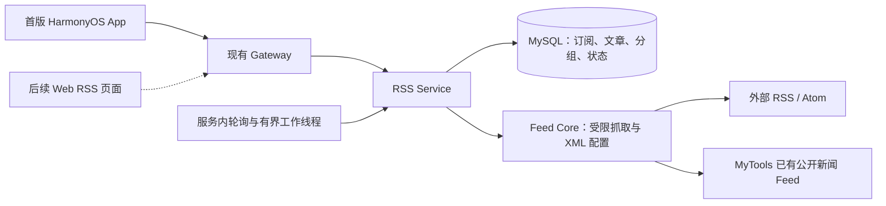

# MyTools RSS 订阅与阅读设计

日期：2026-11-01。状态：待实施的设计建议。本次核对本地代码和协议文档，未核验生产部署状态。

## 1. 产品定位与默认范围

在 MyTools 增加“RSS 订阅”入口：用户添加自己关注的网站，在一个地方查看更新、阅读图文、标记已读和收藏文章。

本方案按“订阅外部内容并在 MyTools 内阅读”设计。项目另有[新闻 RSS 对外发布方案](2026-11-01-news-rss-publishing.md)，那条链路提供可被阅读器订阅的每日新闻；本能力可以把它作为普通订阅源接入。

用户已明确选择 **App 端优先**。首版交付 HarmonyOS App 原生订阅与阅读页面，复用现有登录态；Web 管理端后续使用同一套接口，后端领域模型与阅读状态统一。

首版支持公开 HTTPS RSS 2.0、Atom 1.0。HTTP、需要 Cookie/Authorization 的来源、付费私密源、JSON Feed 和 RSS 1.0 的完整兼容暂不列为首版验收范围；添加时明确说明不支持的情况，不静默失败。

| 能力 | 首版行为 |
| --- | --- |
| 添加订阅 | 粘贴 Feed 或网站地址；展示源名称、候选 Feed 和最近条目预览，选择后保存 |
| 管理订阅 | 改显示名称、分组、暂停更新、取消订阅；同一用户重复添加返回已有订阅 |
| 信息列表 | 全部、未读、收藏，以及按分组/订阅筛选；标题和摘要关键词查询 |
| 自动更新 | 默认每 30 分钟检查一次；支持手动刷新并展示检查结果 |
| 阅读 | 优先展示 Feed 自带图文；只有摘要时保留“阅读原文”入口 |
| 阅读状态 | 已读、恢复未读、收藏、取消收藏、当前范围全部已读；服务端保存，支持跨端 |
| 批量迁移 | OPML 导入预览、去重、逐项结果和导出；仅迁移订阅清单 |
| 来源状态 | 区分从未同步、正在检查、正常、检查失败和已暂停；展示最后成功时间 |
| MyTools 日报 | 提供可选的推荐源卡片，不自动订阅；分类日报仍是一篇日报一个条目 |

第二阶段再增加 Web 页面、按需原文提取、AI 总结/翻译、关键词规则、通知/邮件摘要和完整离线阅读。首版不需要模型调用，也不依赖每日新闻的分析与发送任务。

## 2. 用户操作与界面

### 2.1 页面结构

App 在现有“阅读”页增加“RSS 订阅”入口，打开独立原生页面。现有底部已有阅读、工具、DSH、多媒体、网盘五个入口，不再为 RSS 增加底部标签；保留电子书既有模式。

```text
┌────────────────────────────┐
│ ‹  RSS 订阅          搜索 ＋│
│ 未读       全部       收藏 │
│ 所有订阅 ▾      分组 ▾     │
├────────────────────────────┤
│ 来源 A · 10 分钟前         │
│ 文章标题                   │
│ 两行内容摘要……             │
├────────────────────────────┤
│ 来源 B · 今天 09:30        │
│ 文章标题                   │
│ 两行内容摘要……             │
├────────────────────────────┤
│ 上次检查时间      管理订阅 │
└────────────────────────────┘
       点击文章进入阅读页
┌────────────────────────────┐
│ ‹  来源名称             ⋯  │
│ 文章标题                   │
│ 作者 · 来源发布时间        │
│                            │
│ 清洗后的正文与图文         │
│                            │
│ 收藏    标记未读   阅读原文 │
└────────────────────────────┘
```

列表以文字阅读为主，不依赖封面图；下拉请求刷新，上拉游标分页。阅读页支持字号和浅色/深色主题，返回恢复列表位置，更多菜单提供上一篇/下一篇。列表使用原生组件，正文使用禁脚本、无业务鉴权信息的受限容器，原文通过系统浏览器打开。

页面拆为 `RssHomePage`、`RssReaderPage`、`RssSubscriptionPage`、`RssAddSubscriptionPage`；复用已有 AppControls 和登录请求通道，不把新功能业务逻辑继续堆进 `Index.ets`。首次使用展示添加订阅和导入 OPML 两个入口；未登录时说明登录后可跨设备保存订阅与阅读状态。

App 不承担定时抓取：关闭 App 后服务器仍按计划检查，重新打开时拉取结果。首版可缓存最近列表和已打开正文，并显示离线/缓存时间；断网时不允许提交阅读状态变更，也不显示虚假的同步成功。缓存按服务地址和账户隔离，退出登录时清理；完整离线下载与离线操作队列后续再做。

页面离开、切换来源或切换账户时取消请求并使旧响应失效；读/收藏操作成功后更新服务端 revision，失败回退界面并提示。OPML 通过系统文件选择器导入、保存/分享面板导出，不请求广泛文件访问权限。

后续 Web 采用“订阅导航—文章列表—阅读区”三栏，小屏变为列表进入阅读页；沿用现有组件体系、本地化和暗色模式。

### 2.2 添加流程

1. 输入网址。若是 Feed，直接解析；若是网页，只检查页面声明的 RSS/Atom alternate 链接，不扫描整站。
2. 多个候选时展示名称和地址供选择；未发现时提示填写 Feed 地址。候选数量上限 10，首次发现总时限 20 秒。
3. 展示源名称、最近最多 5 条预览、显示名称和分组；保存后进入首次同步状态。
4. 后台完成首次导入后更新列表。默认首次结果最新 50 条为未读，其余导入条目为已读，可在添加时选择“历史全部已读”。

网站声明订阅地址的发现方式依据 [RSS Autodiscovery](https://www.rssboard.org/rss-autodiscovery)。跨站声明的候选同样需要独立 URL 和公网地址校验，不因为来自网页声明就直接信任。

### 2.3 行为细节

- 打开文章且正文成功展示后，客户端单独提交已读状态；列表预取和详情 GET 不修改阅读状态。
- 手动标记未读后，本次页面停留不立即再次自动标已读；下次真正打开才恢复自动行为。
- “全部已读”只作用于用户选定范围和操作时已存在的文章；处理期间新到的文章仍未读。
- 正文修订更新内容，不重置已读/收藏，也不重新计作一篇未读文章。
- 暂停后保留历史；取消订阅停止抓取并隐藏普通历史，收藏仍可访问。再次订阅原地址恢复保留的状态。
- 更新失败保留已有文章。200 无新条目、304 未修改都属于成功检查；长时间无新文章只标“近期无更新”，不等同于故障。
- 订阅源只暴露最近若干条目，不能承诺补回订阅前的完整历史，也不能保证每一条短暂出现的内容都被轮询捕获。

## 3. 与现有代码的关系

| 已检查的本地能力 | 可以借鉴/复用 | 需要补齐 |
| --- | --- | --- |
| `news-digest-service/.../service/HttpFeedTransport.java` | 实际连接 DNS 校验、条件请求、响应大小限制、超时 | 传输接口目前依赖 News 的 SourceState/错误码，需要抽出中立请求/响应模型 |
| `news-digest-service/.../service/FeedParser.java` | XML 安全配置、基础 RSS/Atom 解析测试 | 当前丢弃 GUID/Atom ID、HTML 和部分元数据，并跳过无链接条目；需新增阅读器模型与解析路径 |
| `news-digest-service/.../service/SourcePollingService.java` | 持久到期时间、租约、失败退避的实现思路 | 当前绑定新闻来源和采集仓储，不能直接当作用户 RSS 调度器 |
| `mytools-gateway/.../controller/NewsGatewayController.java` | Web/App 双前缀、可信用户身份和鉴权模式 | 增加 RSS 路由、客户端和开关 |
| `webapp/src/service/api/news.ts` | 登录请求客户端、稳定错误码、同源 Gateway 调用 | RSS API 类型及阅读页面 |
| `app/.../shared/network/AuthorizedApiClient.ets` | App 认证请求通道、取消机制和令牌刷新 | RSS 数据模型、列表、阅读页和状态同步；补齐 PATCH JSON 方法或在完整契约中统一使用已有方法 |
| 新闻 RSS 发布流程 | 可作为端到端兼容测试来源 | 不修改其条目粒度和发布流程 |

### 3.1 推荐部署边界

新增轻量 `service/rss-service`，Java 21、Spring Boot、MySQL/Flyway，通过现有 Gateway 访问。四张业务表、一组受限后台工作线程即可完成首版；先不引入 Redis、消息队列或独立搜索引擎。

选择独立服务的理由是：RSS 用户订阅与新闻采集注册表、排行榜、日报快照的生命周期不同；本地文档也记录了个人新闻脚本链路与 Java News 服务的部署状态需要分别看待。不能把“新闻在运行”推断为“已有可直接承载 RSS 用户接口的生产服务”。独立服务多一个部署单元，但不要求先完成新闻服务的其他功能。

抽出中立的 `service/feed-core` 库，承载无凭据的受限 HTTP 传输与 XML 安全配置，由 RSS 使用；News 通过兼容适配器接回原有模型，保留原来的接口、字段截断和同主机跳转行为。RSS 阅读器解析输出独立模型，不改变日报输入语义。提取后必须回归原新闻抓取测试。

模块独立构建，不隐式加入根 Maven 构建。服务端口和服务清单在实施时按当前部署清单分配。本方案未检查或更改生产环境。



用户订阅量较小时服务内轮询足够。后续需要统一任务运维时再接现有 Scheduler，沿用已发布不可变任务包与内部认证规则，不为每篇文章创建独立任务。

## 4. 数据设计

首版按用户隔离保存订阅和文章；同一用户、同一地址只抓一份。不同用户暂不共享文章缓存，避免带令牌的 URL 或后续私密来源被错误合并。代价是不同用户订阅同一公开源会有重复抓取，小规模自用阶段可接受。

| 表 | 关键字段 | 约束/用途 |
| --- | --- | --- |
| `rss_group` | `id, owner_id, name, sort_order` | 用户内分组名称唯一；不做嵌套；删除分组后订阅转为未分组 |
| `rss_subscription` | `id, owner_id, group_id, feed_url, feed_url_hash, site_url, title, custom_title, status`；`etag, last_modified, last_attempt_at, last_success_at, next_fetch_at, failure_count, last_error_code`；`lease_token, lease_until, revision, initial_sync_completed, initial_read_policy, unsubscribed_at` | 唯一 `(owner_id, feed_url_hash)`；保存调度状态、初始导入策略及用户设置 |
| `rss_entry` | `id, owner_id, subscription_id, identity_type, identity_hash, source_id, url, title, author, summary_text, content_html, published_at, source_updated_at, discovered_at, content_hash, content_purged_at` | 唯一 `(subscription_id, identity_type, identity_hash)`；来源日期可空；首次发现时间不可因重复抓取而改变 |
| `rss_entry_state` | `owner_id, entry_id, is_read, read_at, starred_at, revision` | 主键 `(owner_id, entry_id)`；文章与初始状态同事务落库，避免缺行导致未读含义不明确 |

分组、订阅、文章之间通过外键/组合约束与仓储 owner 条件保证归属一致。所有者来自 Gateway 认证主体，所有列表、详情、变更、导出和刷新都带 owner 条件；用户请求不得指定 owner。

必要索引：订阅的 `(status, next_fetch_at)`；文章的 `(owner_id, discovered_at, id)`、`(subscription_id, discovered_at, id)`；状态的 `(owner_id, is_read, entry_id)` 和 `(owner_id, starred_at, entry_id)`。ID 沿用现有服务选定的策略，对外传字符串，避免 JavaScript 数值精度损失。

列表默认按首次收录时间与 ID 倒序，页面另显示来源发布时间；这样源修改发布时间不会让分页漂移。提供按发布时间排序作为后续能力。首版游标绑定筛选条件、排序和首次查询的快照边界。

首版标题/摘要搜索采用有长度和结果数限制的数据库查询，中文按实际字符匹配，不预先引入分词服务；压测发现瓶颈后再评估全文索引。

### 4.1 条目身份与日期

身份优先级为：RSS GUID / Atom ID → 无原生 ID 时的保守规范化原文 URL → 再无链接时的标题、来源日期和内容摘要指纹。GUID 是不透明字符串，不能强制当 URL。原生 ID 的命名空间限定在所属订阅；跨源相同文章首版不合并。依据 [RSS 2.0 GUID 规则](https://www.rssboard.org/rss-specification#ltguidgtSubelementOfLtitemgt)和 [Atom 标准](https://www.rfc-editor.org/rfc/rfc4287.html)。

用 `identity_type` 区分原生 ID、URL 和指纹，避免不同身份类型发生碰撞。同原生 ID 不同正文按修订处理；有不同原生 ID 时不因为共用一个链接就合并。源后续变更/新增 ID 不进行模糊合并；无 ID/链接的条目修订可能被识别为新条目，在兼容性说明中保留这一限制。

URL 规范化仅做安全的协议/主机大小写、默认端口和片段处理，不随意删查询参数、重排参数或小写路径，避免破坏签名地址与站点语义。保存输入 Feed 地址与已验证的最终请求地址；永久重定向身份迁移必须处理用户内唯一键冲突，临时重定向不改订阅身份。

正文解析保留 RSS `content:encoded` / `description`，区分 Atom text/html/xhtml 及 `xml:base`，输出清洗后的 HTML；Atom 外部 content src 首版不自动抓取。无标题但有内容时使用内容节选作展示标题；有稳定 ID 和内容但无原文链接也能阅读，隐藏原文按钮。

`published_at` 和 `source_updated_at` 分别保存，缺失/无效时为空；列表可以显示收录时间并标明含义，不把抓取时间伪装成来源发布时间。

### 4.2 并发与保留

- 状态变更提交期望 revision 和明确值，避免 toggle 在重试时翻转；冲突返回当前状态，客户端刷新后再决定，不让离线旧状态静默覆盖新状态。
- “全部已读”先在数据库事务的一致性快照中读取目标文章 ID 和状态 revision，再按这一确定集合更新；不能直接执行可能读到新行的无边界 UPDATE，也不得只用来源发布时间作截止条件。并发新入库条目不进入这次集合，状态版本冲突的条目跳过并返回实际处理数量。客户端不自动重试这类批量操作，响应丢失时先刷新列表。
- 默认普通文章正文保留 90 天，收藏正文保留到取消收藏或删除。过期条目保留紧凑的身份、标题、链接和阅读状态，避免同一历史条目反复导入；默认列表隐藏已清理正文的普通历史，收藏不受影响。
- 取消订阅为软取消，清理非收藏正文按保留策略执行；用户另行选择彻底删除时才删除相关收藏和状态。需要整体账户删除时一并清理 owner 的全部数据。

## 5. 抓取与安全策略

| 项目 | 首版建议默认值/行为 |
| --- | --- |
| 用户容量 | 100 个有效订阅；可配置，不作为协议限制 |
| 自动刷新 | 默认 30 分钟，允许 15/30/60/180 分钟；随机抖动避免同时访问 |
| 工作线程 | 全局最多 4 个抓取任务，同主机最多 1 个；调度扫描每 30 秒一次 |
| 抓取租约 | 60 秒；单任务 20 秒总预算，提交结果必须匹配有效 lease_token |
| 手动刷新 | 把订阅标为到期并返回 202；同源 60 秒内合并请求，不绕过 Retry-After |
| 条件请求 | 保存 ETag/Last-Modified；304 更新成功时间，保留正文与阅读状态 |
| 大小与解析 | 解压前后均设 2 MiB 上限，最多 500 条；XML 深度/文本长度设限 |
| 失败重试 | 连续失败按 5/15/30/60 分钟退避，上限 6 小时；429 尊重 Retry-After |
| 永久停更 | 410 标记来源已移除并停止自动请求，可手动尝试恢复；404 先按失败退避 |
| 导入 | OPML 最大 2 MiB、200 个候选，预览不抓取所有 URL；受用户有效订阅数限制 |

抓取路径：领取到期订阅 → 受控 HTTP 请求 → 解析/清洗 → 按身份幂等写文章与状态 → 更新条件请求标记及下次时间。解析或写入失败不得前移 ETag/Last-Modified。成功数据提交与租约校验处于同一事务；失租任务不能覆盖新任务结果。暂停/取消订阅同样需要阻止在途结果写回。

首版沿用 HTTPS、443 端口、公网域名和同主机最多三次重定向的限制；跨主机跳转提示最终地址，由用户重新添加通过校验的目标，不为兼容性直接放开现有安全边界。后续若放开，必须每跳重新校验、禁止降级并重新处理条件请求头。

用户任意 URL 是 SSRF 入口：域名解析与实际连接阶段都检查 IPv4/IPv6 公网地址，阻止环回、私网、链路本地、保留网段和云元数据地址；关闭系统代理继承、Cookie 和自动重定向。网页发现、Feed、图标和后续原文/图片代理必须走同一策略。[OWASP SSRF 防护说明](https://cheatsheetseries.owasp.org/cheatsheets/Server_Side_Request_Forgery_Prevention_Cheat_Sheet.html)。

XML 禁止 DTD、外部实体、XInclude 和任何解析器隐式联网。HTML 使用成熟 allowlist 清洗器，移除脚本、事件、iframe、表单、不受控 style 和危险 URL；不要用正则表达式承担清洗。阅读容器隔离文档，使用严格 CSP 并禁止脚本执行。

按用户 2026-11-01 的后续要求，文章列表使用左图右文，正文图片默认自动加载，不再提供逐篇确认按钮。图片只允许 HTTPS，正文使用无引用来源策略；列表缺少配图或图片加载失败时由文字占满整行。首版不搭任意 URL 图片代理。日志不记录完整查询串、正文或可能含令牌的地址；列表只展示站点与脱敏地址。OPML 导出仅当前用户可用，并提示文件可能含私密订阅地址。

## 6. API 草案

Gateway 前缀：Web `/api/v1/rss`，App `/api/app/v1/rss`。后台 RSS 服务仅接受可信 Gateway 身份及内部认证，不能通过公网伪造 owner header。

| 方法与路径 | 作用 |
| --- | --- |
| `GET /capabilities` | 协议支持、容量和可用能力 |
| `POST /discover` | URL 检测、Feed 候选与小量预览；只读但有严格频率/耗时限制 |
| `GET /subscriptions` | 本人订阅、未读数、健康状态 |
| `POST /subscriptions` | 新增或恢复订阅；返回订阅及首次同步状态 |
| `PATCH /subscriptions/{id}` | 改名、分组、刷新间隔、暂停/恢复，要求 expectedRevision |
| `DELETE /subscriptions/{id}` | 软取消订阅，保留收藏 |
| `POST /subscriptions/{id}/refresh` | 异步请求刷新；返回 202 和当前检查状态 |
| `GET /entries` | 按 subscriptionId/groupId/read/starred/q 筛选，游标分页，默认 30、上限 100 |
| `GET /entries/{id}` | 正文、来源信息和当前用户状态，无已读副作用 |
| `PATCH /entries/{id}/state` | 设置 read/starred，附 expectedRevision |
| `POST /entries/mark-read` | 按文章集合或筛选范围标记已读，返回处理/冲突数量；客户端关闭自动重试 |
| `GET/POST /groups` | 列表/创建分组 |
| `PATCH/DELETE /groups/{id}` | 改名排序/删除分组 |
| `POST /opml/preview` | 解析导入清单，显示新增、重复、无效及超限条目 |
| `POST /opml/import` | 对选中条目重新校验并保存，逐项返回结果，随后异步抓取 |
| `GET /opml/export` | 导出本人有效订阅与分组 |

OPML 导入导出不包含文章、已读或收藏状态；嵌套分组以完整路径扁平化为单层名称，超长名称在预览时处理。导入重复项保留现有名称/分组/阅读状态，不自动覆盖。格式参考入口：[OPML 官方文档](https://opml.org/)。

用户错误码集中放在新服务 `common/ErrorCode.java`：`RSS_001` 地址不支持、`RSS_002` 未发现 Feed、`RSS_003` 抓取失败、`RSS_004` 解析失败、`RSS_005` 资源不可用、`RSS_006` 超限、`RSS_007` 请求过频、`RSS_008` 网络地址禁止、`RSS_009` 状态版本冲突。跨 owner 访问与不存在统一返回资源不可用。HTTP 状态与错误码分别表达协议和业务语义，前端按错误码本地化。

## 7. 实施顺序与验收

| 阶段 | 交付内容 | 完成标准 |
| --- | --- | --- |
| A：App 阅读闭环 | Feed Core 提取、RSS 服务/四表迁移、Gateway、App 阅读页入口、直接添加 Feed、列表、详情、已读/收藏 | App 可以订阅一个真实公开 Feed 并阅读；重复刷新不重复；服务/App 重启后状态保留 |
| B：App 首版完整 | 网站发现、分组、搜索、定时刷新、故障状态、批量已读、系统文件 OPML 导入导出、缓存隔离、清理策略 | 首版功能表完整；App 关闭后后台仍更新；返回位置/弱网/账号切换正确；取消/恢复和导入去重符合设计 |
| C：Web 与增强 | Web 阅读页面、按需全文/AI/通知等独立扩展 | 与 App 共享状态；每项增强单独评估并验收，不与基础阅读捆绑 |

首版实施落点：`service/rss-service/`、`service/feed-core/`、`service/mytools-gateway/`、`app/entry/src/main/ets/features/rss/`；`Index.ets` 只增加入口与页面挂载，App 网络适配放在 `RssApi.ets`。Web 后续新增 `webapp/src/views/rss/` 和 `webapp/src/service/api/rss.ts`。按当前迁移目录分配版本，不能提前占用其他服务的迁移编号。

关键测试包括：RSS GUID 非 URL、Atom ID 与 XHTML、无链接条目、无日期/无标题、相对 URL；重复抓取与内容修订；304、超时、429、410、错误 XML、过大压缩体；DNS 重绑定/私网跳转/XXE/XSS；owner 隔离；旧租约写入、同时手动与自动刷新；首次导入重试；批量已读与新文章同时进入；跨端状态冲突；OPML 部分失败与重复导入；收藏和取消订阅后的保留。

验收使用固定样本覆盖异常与并发，另用少量真实公开源做端到端验证。MyTools 自有新闻 Feed 用于验证长篇图文和同 GUID 修订；真实源访问只在明确启用的集成验收中进行。数据库迁移与并发测试使用实际 MySQL，不以 H2 通过替代。App 另验收真机/模拟器上的系统返回、暗色/大字号、长文/图片、前后台切换、网络中断、账号/服务地址切换、文件导入导出及两台设备的状态冲突。

2026-11-01 后续用户授权推进开发，首版实现与验收已另行记录。本文保留设计阶段的整体目标；实际 PUT 接口、部署边界、已验证场景和仍需补测的设备矩阵以 [实施方案](2026-11-01-rss-implementation-plan.md)、[接口契约](../../service/contracts/rss-v1.md) 和 [验收记录](../verification/rss-reader/PROGRESS.md) 为准。生产开关默认关闭。
