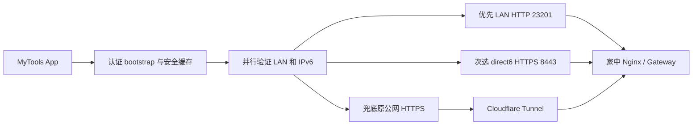

# App 三级连接设计与实施

## 目标与边界

业务优先级为可信局域网、IPv6 HTTPS 直连、原公网 HTTPS。保留既有公网域名及 Cloudflare Tunnel；不购买中转服务器。服务器完成 DNS、证书、入口健康检查后发布候选，App 必须自行验证成功才会启用。首次登录和冷启动时已过期会话的刷新继续使用可信公网地址；有可用登录会话时，安全缓存可以减少对公网隧道的依赖。

现有工作区包含其他未提交变更；本次以当前文件为基线增量实现，不回退其他功能。改动前代码快照位于本机 `/tmp/mytools-ipv6-20261103/baseline`，不包含生产凭据。

## 服务端协议

在既有认证接口 `GET /api/app/v1/connectivity/bootstrap` 增加可选 `ipv6DirectOrigins` 数组与 `directConfigExpiresAt`。旧客户端忽略新增字段，新客户端兼容旧响应。候选由 `gateway.connectivity.ipv6-direct-origins` 显式配置，最多四个；只接受无路径、凭据、查询参数的 HTTPS DNS 主机与合法端口。默认空列表。

局域网短期挑战仍为十分钟，挑战密钥不持久化。直连描述有效期七天，单独存入 App 的 Asset Store，按公网服务地址绑定。冷启动可以通过已可信配置的 HTTPS 直连域名重新取得短期材料，再验证局域网。该 HTTPS 请求保留系统 CA、域名校验，拒绝重定向。描述过期、域名证书失败或服务实例不符均回到公网刷新。

## IPv6 入口

部署域名 `direct6.yuyutian.top`，HTTPS 端口 `8443`，仅 AAAA、DNS only，通过 DDNS 跟踪稳定全球单播地址。地址过滤排除回环、链路本地、ULA、组播、IPv4 映射及文档地址。App 在探测前验证解析结果；独立域名避免修改公网域名的应用级 DNS 规则，保证兜底不被覆盖。

家中 Nginx 配置公开信任的 TLS 证书与 IPv6 监听，将 API 路由送至既有 Gateway/明确旧接口边界。不暴露 `/internal/`、`/actuator/` 或 LAN 明文端口。DSH 直连沿用公网安全 Cookie 换票与鉴权接口；公网与 LAN Cookie 空间继续隔离。证书与 DNS 凭据仅保存在服务器私有目录。

## App 选路与信任

1. 已验证入口可续签 bootstrap；冷启动先试未过期的可信 HTTPS 描述，失败再访问公网。只在有效 HTTPS 校验后向该受信任候选发送认证材料。
2. 同轮并行探测已签发 LAN 地址与 IPv6 候选。局域网与 IPv6 并行探测，LAN 截止时间 1800 ms，IPv6 DNS 截止时间 500 ms、HTTPS 挑战截止时间 1200 ms；旧服务不提供 IPv6 时兼容既有 LAN/mDNS 流程。
3. IPv6 解析必须得到全球单播 IPv6，且不混入 IPv4。对候选使用无令牌随机挑战，核对实例、随机值、期限与 HMAC，再执行已有首次身份验证。
4. 选路结果包含连接类型及已验证备用 IPv6 端点。备用验证最长有效 60 秒；并发失败只允许当前活动端点触发降级。旧网络、旧账号或旧轮次结果不得覆盖新状态。
5. LAN 失败优先使用近期已验证 IPv6；备用验证过期或不存在时先回公网，并重新发现直连。IPv6 失败回公网。失败端点冷却 30 秒，故障后第 31 秒进行一次恢复探测，网络变化清除备用结果并重新发现。公网地址是最终兜底。

## 请求与会话语义

只读传输失败可在有限总次数内换线路重试。写入、上传、任务创建与令牌轮换不因超时自动跨线重放。401/403 按原认证流程处理；业务异常不作为 IPv6 不可达证据。端点响应校验失败可以淘汰端点，但不会自动重放写入。

所有请求通过统一会话端点状态取得当前地址，已知资源来源随线路切换，第三方 URL 不改写。播放器及 WebView 继续调用已有切换重连机制。DSH 的 HTTPS 直连通过一次性票据建立独立 Host Cookie，不复制公网 Cookie。首次 IPv6 页面加载发生主文档网络错误、5xx 或 60 秒未就绪时，独立回退至公网 DSH，一轮网络环境只执行一次；不重放已挂载页面中的聊天操作，也不改变其他业务的活动 API 地址。

## 验证与上线

- 单元测试覆盖：旧协议、非法候选、过期描述、DNS 地址过滤、LAN/IPv6/公网优先级、两级故障、冷却、并发旧失败、写入不重放、端点资源重写和 DSH HTTPS 换票。
- 运行相关 App 网络回归脚本、Gateway 测试与打包、HarmonyOS 构建。真机可用时安装并检查网络切换；未具备外部蜂窝网络时明确记录未测项。
- DNS/TLS 可用后先做独立入口检查，再通过 Gateway 配置发布候选；旧公网入口保持可用。服务端以当前运行工件为基础应用经过测试的类增量，避免覆盖其他会话发布内容。
- 回退：停止发布 IPv6 候选并撤回新增站点及本次服务配置；App 直连失败会回公网，DNS 缓存不会影响公网域名。

## 实际链路与端口选择

域名解析与连接仍由系统网络栈完成。App 查询 AAAA 结果用于资格检查，实际请求保留域名 URL、TLS SNI 和证书校验，不将 URL 改成裸 IPv6，也不关闭证书验证。Cloudflare 橙云域名解析到边缘节点，不能从其 AAAA 得到真实家庭地址，所以单独设置 DNS only 的直连子域名。

2026-11-03 蜂窝真机检查：443 的 TCP SYN 到达主机、主机发出 SYN-ACK，但握手未完成；同一 DNS、地址和证书的 8443 HTTPS 可访问。现有证据只能定位到端口相关的网络路径问题，不能据此断定具体运营商设备。最终只保留 8443 监听与对应 IPv6 防火墙规则，撤回临时 443 放行。手机 App 已通过 HMAC 挑战与认证用户接口，选中 IPv6。

## 时限和状态

| 环节 | 限制 | 失败行为 |
| --- | --- | --- |
| 短期挑战材料 | 10 分钟，只留内存 | 明确拒绝时刷新一次 |
| HTTPS 直连描述 | 7 天，Asset Store | 过期、实例不符或 TLS 失败回公网 |
| 缓存直连 bootstrap | 整体取消时限 2 秒 | 请求公网 bootstrap |
| LAN 并行探测 | 1.8 秒选择窗口 | 选择已验证 IPv6 或公网 |
| IPv6 DNS / 挑战 | 0.5 秒 / 1.2 秒 | 不选中该候选 |
| IPv6 备用健康结论 | 最多 60 秒 | 过期先回公网并重探测 |
| 失败端点冷却 | 30 秒 | 同轮不重新使用故障端点 |
| 网络事件去抖 | 0.8 秒 | 清理旧网络候选，重新发现 |
| 只读请求重试 | 最多 3 次总尝试 | 最终错误交给界面 |
| 写入和上传 | 不跨线路自动重放 | 更新后续路由，当前操作报告失败 |

这些是应用层选择预算，不代表首次登录或所有业务请求都在两秒内完成。业务 API 保持原有请求超时。仅 GET 类只读传输在故障时重试；401/403 和业务错误不会当作网络不可达处理。

## 传输性能

IPv6 入口为 `application/json` 开启 gzip，App JSON 请求声明接受 gzip。下载流明确发送 `Accept-Encoding: identity`，继续保持文件长度和签名校验，不压缩二进制。原 LAN 入口的配置保持原样。直连代理将 `X-Forwarded-Proto` 设为 HTTPS。小健康探针成功只能证明连通，不能代替较大响应的实际传输验收。此次蜂窝测试中，小请求成功，但书源同步超过 20 秒触发原有请求超时；TCP 样本显示约 45–50 ms RTT、明显重传和很小的拥塞窗口。JSON gzip 已生效，仍不能消除网络丢包，故保留公网故障回退。线路优先级遵循用户要求，不将轻量挑战延迟当作吞吐测速。

## 服务器运维

- Gateway 配置：`gateway.connectivity.ipv6-direct-origins=https://direct6.yuyutian.top:8443`。
- DNS：单个 DNS only AAAA，TTL 60 秒；`mytools-ipv6-ddns.timer` 每约 120 秒刷新，随机抖动 10 秒。优先稳定物理网卡地址，排除临时、废弃和私有地址。
- TLS：Certbot 使用 DNS-01，不依赖家庭入站 80/443；`certbot.timer` 自动续期，续期 deploy hook 校验并重载 Nginx。
- 入口：`/etc/nginx/sites-available/mytools-gateway-ipv6`，仅 IPv6 TCP 8443。配置中复用现有私有鉴权片段，不能把完整生产配置提交到仓库。
- DNS 凭据与证书仅保存在服务器受限路径；日志不输出令牌、Cookie、挑战密钥或生产环境内容。
- 维护检查：`systemctl status mytools-ipv6-ddns.timer certbot.timer`；`systemctl show mytools-ipv6-ddns.service -p Result -p ExecMainStatus`；`nginx -t`。

## 回滚边界

服务端采用当前运行包的三个类增量，而不是覆盖整个本地构建包。安装脚本核对基线、增量 SHA-256 和并发发布状态，验证其他 ZIP 条目内容保持不变；健康检查失败自动撤回本次 drop-in。

上线后的人工回退应先检查当前服务工件是否仍是本次 release，防止覆盖后续发布。若仍为本次工件，可移走本次 `zzzzzzzzzz-ipv6-direct-20261103.conf`，执行 daemon-reload 和 Gateway restart，并验证健康。关闭新增 Nginx 站点/8443 放行后，缓存候选访问失败会回公网。停用 `mytools-ipv6-ddns.timer` 可停止更新；保留证书和旧工件以便恢复。原公网 DNS 和 Cloudflare Tunnel 无需变更。

App 旧版兼容新增响应字段；如需回退 App，只能使用原签名覆盖安装匹配版本，不能卸载清数据。仍在运行的媒体或 WebView 会重连，不保证无缝保留 TCP 连接。

## 验收范围与剩余限制

自动测试与真机结果见 `docs/verification/2026-11-03-tiered-connectivity/README.md`。设备线路标识仅在匿名挑战和认证用户接口均成功后显示。尚未完成的多运营商、晚高峰大文件吞吐与长时证书续期观察需要另行实测；当前不能承诺固定倍数提速。

普通浏览器和不可修改的第三方 App 不会自动获得这套三级策略，继续使用原公网域名；支持 IPv6 的浏览器可显式访问直连域名。此次自动选路改造覆盖 MyTools 自有 App。

