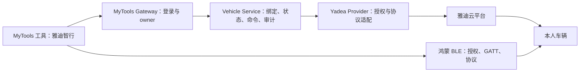
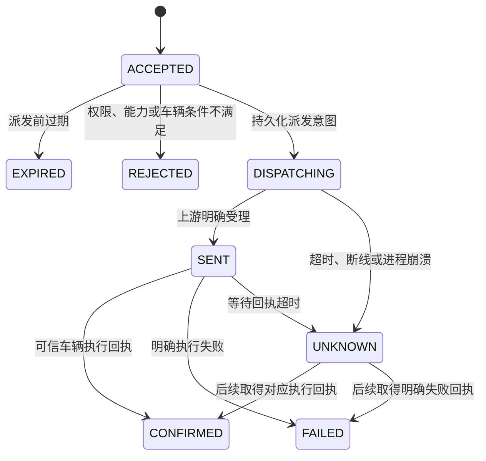

# 雅迪智行接入 MyTools 实现方案

日期：2026-11-03。状态：调研与设计完成；近场蓝牙接入基础模块已实现，并通过构建、自动测试和真机无车辆测试。雅迪私有鉴权、控车与实车连接验收尚未完成，见 [开发记录](../verification/2026-11-03-yadea-ble/README.md)。

## 1. 结论与实施建议

在 MyTools 手机端的「工具」页增加「雅迪智行」入口，集中提供开机、关机、锁车、解锁、寻车、车辆详情与车辆位置。先支持用户本人账号和当前这辆车，不增加一级导航。

**推荐采用“鸿蒙原生页面 + MyTools 车辆服务 + 雅迪协议适配器”，先验证云端接入，再按实际链路补齐手机直连蓝牙。** 云端能力承担远程查询和控车；手机蓝牙承担近场控制。两条链路共享业务模型，但分别实现授权、传输和回执。

功能可以独立集成到 MyTools；工程上的关键依赖是获得可持续使用的雅迪授权和协议，而不是制作按钮。当前未发现可直接申请的官方公开车控 API、OAuth 文档或车控 SDK，因此不能把它当作已有开放接口直接开发。先用一个有明确产出的协议验证阶段消除这个依赖，再进入正式开发。

用户已确认实车支持所需能力。方案按这一功能目标设计；每项能力在关闭蓝牙、远离车辆等条件下使用哪条链路，仍需协议和实车验证。这里的“尚未验证”指 MyTools 的接入方式，不是否定官方 App 已有功能。

后续讨论提出“首次使用雅迪智行连接，之后由 MyTools 蓝牙直连”的路线。该路线作为 P0 的优先验证分支，详见第 17 节；若授权可迁移，可以先交付近场能力，再补远程能力，无需先完整实现雅迪云端登录体系。

## 2. 本次真机观察与适用范围

已通过 HDC 明确选择连接的真实手机截图，未选择两个本地模拟器，也未点击控车、解绑或修改车辆设置。

| 项目 | 本次证据 | 方案影响 |
| --- | --- | --- |
| 页面 | 用户已打开的「设备详情」 | 可确认绑定设备的显示信息 |
| 车辆昵称 | 冠能奢享 Q9-D | 作为显示名称，不作为授权或设备识别依据 |
| 车型名称 | 冠能奢享 Q9-D-豪华版前碟 AC-G | 首批适配限定这一车型及实际中控、固件 |
| 车辆绑定 | 页面存在车辆详情、二维码和解除绑定入口 | 接入已有绑定，首版不重新绑定、不转移车辆所有权 |
| 「车架号」字段 | 页面显示的是长字符串标识 | 先按供应商原始标识处理；不能未经验证就认定为标准 VIN 或配对密钥 |
| 手机环境 | 已取得鸿蒙可调试真机画面；MyTools 工程为 HarmonyOS NEXT API 12 | 采用 ArkTS 原生客户端；实际雅迪客户端的 bundle、版本另行核验 |
| 功能支持 | 用户确认支持所需能力 | 纳入全部功能目标，逐项验证具体调用和回执 |

原始截图仅作本地临时分析，没有放入仓库；本文不保存完整车辆标识、二维码、设备序列号、精确位置或账号凭据。

雅迪的 [Q9 官方产品页](https://www.yadea.com.cn/mob/model-details/q9) 搜索索引提到 App、蓝牙、小程序解锁，但直接访问当前返回 404，故仅作为历史产品线索。[官方说明书目录](https://instructions.yadea.com.cn/web/index) 分列 Q9-D 与标准版；其中 [Q9-D 官方说明书](https://ydinstructions.oss-cn-hangzhou.aliyuncs.com/uploads/pdf/2024/02/02/170911%E5%86%A0%E8%83%BD%E5%A5%A2%E4%BA%ABQ9-D%E8%AF%B4%E6%98%8E%E4%B9%A6.pdf) 封面型号为 TDR1380Z，PDF 第 12 页覆盖仪表蓝牙连接状态，相关示意标注“如适用”。本车“豪华版前碟 AC-G”与这一铭牌型号仍需对应。

说明书通用三包表出现 GPS，不足以证明本车配置；本文采用用户对实车功能的确认作为范围依据，不从通用配件表、旧手册或 VFLY 配置推定本车能力。手册没有给出可供 MyTools 直接使用的云控/蓝牙协议。

## 3. 已查证信息与证据边界

| 事项 | 调研结果 | 来源与边界 |
| --- | --- | --- |
| 国内 Android 应用 | 雅迪智行，开发者为雅迪科技集团有限公司，包名 `com.yadea.smartmoto` | [小米应用商店](https://r.app.xiaomi.com/details?id=com.yadea.smartmoto)。这是安卓研究对象，不等同于已核验当前鸿蒙安装包 |
| 两种控车链路 | 产品介绍同时列出蓝牙控车和云端控车 | 同一官方商店页面；不代表每个车型的每项动作均支持两条链路 |
| 公开产品能力 | 蓝牙近场操作、远程开关锁、闪灯鸣笛等有官方产品描述 | [App Store 官方产品页](https://apps.apple.com/cn/app/id1402479166)；车型权限与实际可用性仍由本车验证 |
| 部分车型云车能力 | VFLY 官方展示远程锁车、车辆信息和轨迹相关能力 | [VFLY 官方科技页面](https://vfly.yadea.com.cn/tech)，仅作双链路架构佐证 |
| 开放接口 | 在本次官方站点、应用商店及公开仓库检索中，未找到可直接接入的公开车控 API/SDK | 不据此断言雅迪内部或合作渠道不存在接口 |
| 开源研究线索 | 存在针对同一安卓包的 Hook 项目，涉及状态读取、BLE 和控制 | [作者原始仓库](https://github.com/ghhccghk/Yadea_Hook)。它依赖 Android/Xposed，不是独立云 API 或鸿蒙 SDK |
| 协议复杂度 | 作者分析区分多种车型控制器和状态模型 | [原始分析文件](https://github.com/ghhccghk/Yadea_Hook/blob/master/VehicleService_Analysis.md)。分析结果未在本车验证，不能照抄命令值 |
| 手机平台能力 | 鸿蒙具备 BLE 扫描和 GATT 客户端基础能力 | [OpenHarmony 官方 BLE 文档](https://github.com/openharmony/docs/blob/master/en/application-dev/reference/apis-connectivity-kit/js-apis-bluetooth-ble.md)。正式实现须按项目 API 12 SDK 校验，不能直接使用文档最新版本的新增 API |

雅迪使用的地图、推送或登录第三方 SDK，不等于雅迪向第三方开放车控 SDK。当前也未找到经核实可直接复用的成熟独立雅迪云端适配器。

## 4. 接入路径比较与选择

| 路径 | 能覆盖什么 | 前置与代价 | 选择 |
| --- | --- | --- | --- |
| 官方授权 API 或 HarmonyOS SDK | 以厂商授权范围为准，可覆盖云端或近场 | 需确认合作入口、车型、授权方式和鸿蒙支持 | 优先；若能取得则替换适配器实现 |
| 已验证的雅迪账号云接口 | 车辆列表、详情、位置及本车已支持的远程命令 | 登录、刷新、签名、设备绑定、风控、回执都需验证 | 首先验证；成功后作为首版主要路径 |
| 鸿蒙原生 BLE | 手机附近的车辆状态和控制 | 需合法密钥、握手、帧格式、计数器、重连及实车兼容 | 第二条正式路径；不能仅凭 UUID 开发 |
| Android 官方 App + Hook 桥接 | 借官方 App 的现有连接验证部分能力 | 依赖额外安卓设备和运行环境、App 版本、进程保活；鸿蒙不能直接运行同一 Hook | 研究备选，不作为日常运行前提 |
| 自动点击官方 App | 可模拟用户操作 | 依赖页面、前台、锁屏与权限状态；难证明命令结果 | 不作为产品控制链路 |
| 跳转官方 App/小程序 | 快捷打开原功能 | 未核实存在官方可调用的控车 URI；跳转不等于在 MyTools 内实现 | 如有官方跳转能力，可作暂时入口，单独标明交付范围 |

云端接入无法成立时，不继续假设 HTTP 可用：转为 BLE 近场方案并明确远程能力缺口；若 BLE 授权同样无法取得，则只有官方合作或依赖外部手机的桥接路径。此时不能宣称已经完成全部迁移。

## 5. 功能定义与能力矩阵

以下是 MyTools 的目标业务语义，不是已经确认的雅迪接口或命令常量。

| 功能 | MyTools 表现 | 云端路径 | BLE 路径 | 必须核实 |
| --- | --- | --- | --- | --- |
| 开机 | 明确设置电源为开 | 按本车实际支持启用 | 按本车实际支持启用 | 是否仅上电；是否同时解防；有无车辆侧安全条件 |
| 关机 | 明确设置电源为关 | 同上 | 同上 | 车辆运动保护、回执，以及关机后是否自动设防 |
| 车锁 | 显示实际锁定/设防状态，提供锁定与解锁 | 同上 | 同上 | 电门锁、防盗设防、龙头锁、座桶锁必须分开；首版只映射已确认含义 |
| 寻车 | 用户主动触发一次鸣笛/闪灯 | 按能力启用 | 按能力启用 | 供应商定义的持续时间和回执，不假设可自定次数 |
| 车辆详情 | 车型、脱敏标识、固件及可读的电量、里程等 | 优先查询 | 有效通知可补充 | 单位、字段缺失、数据时间、双电池等差异；无字段就显示未知 |
| 车辆位置 | 地图、更新时间、位置来源、导航入口 | 使用真实车辆上报 | 仅在协议确有车辆定位时使用 | GNSS、基站、缓存位置、手机停车点的区别 |

每个动作分别返回 `supportedTransports`、`verificationStatus` 和 `disabledReason`。至少区分 `VERIFIED`、`UNVERIFIED`、`UNSUPPORTED`；设备休眠、无网络、凭证过期、服务到期属于运行状态，不混成“不支持”。

不使用通用 `toggle`。开关机与锁车分别建模；若厂商只提供“关机并设防”组合动作，页面和接口必须如实使用该语义，不伪装成两个可独立动作。

## 6. 协议验证阶段：正式开发的前置

### 6.1 需要产出的材料

1. **设备档案**：已确认的车型，加上实际中控类型、硬件/固件版本、雅迪客户端系统与版本、联网服务状态；仅保存脱敏信息。
2. **账号授权说明**：本人账号的可用登录方式、令牌期限、刷新、失效、撤销、单设备或多端登录限制。
3. **只读调用样本**：车辆列表、详情、状态、位置的脱敏响应及字段字典，分别记录数据时间和查询时间。
4. **逐动作说明**：开、关、锁、解锁、寻车对应的真实语义、请求、回执、结果查询，以及该车型支持的链路。
5. **BLE 说明**：设备身份、密钥来源、服务/特征、握手、帧边界、通知、校验、加密/计数器与重连。密钥不进入文档。
6. **兼容记录**：原雅迪 App 与 MyTools 是否抢占蓝牙，账号是否互踢，车辆休眠后能否唤醒，平台是否迟到执行命令。

优先检查官方授权接入方式。若需观察本人客户端通信，只在本人设备、本人账号范围内使用允许的调试方式。普通 HTTPS 抓包不必然能看到内容；设备证明、证书绑定或不可迁移的密钥可能使独立适配不可行，不能把“抓包即可”当成前提。

### 6.2 验证顺序与通过标准

| 门槛 | 验证内容 | 通过标准 |
| --- | --- | --- |
| G0：设备匹配 | Q9-D 对应中控与版本，区分实际客户端和安卓研究包 | 研究线索可定位到本车协议分支 |
| G1：持续授权 | 登录、刷新、过期、撤销、车辆列表 | 可重复完成；不依赖每次手工复制短期 Token，也不影响原 App 正常使用 |
| G2：真实只读 | 详情、状态、位置与官方 App 对照 | 单位、时间、坐标系和字段语义一致；至少包含跨会话/刷新后的验证 |
| G3：动作闭环 | 对每个目标动作分别验证云端和 BLE | 在现场可控且车辆静止时，由车主执行或明确授权的单次测试产生真实结果与回执；不以 HTTP 200 通过 |
| G4：运行边界 | 关闭蓝牙、手机断网、车辆离线、休眠、服务到期、官方 App 并存 | 能正确呈现可用、不可用或结果未知；不跨链路重复发送 |
| G5：鸿蒙闭环 | 当前真机编译安装、授权、连接、页面生命周期 | 原生鸿蒙实现可独立完成目标流程；安卓 PoC 结果不能代替 |

方案编写时仅进行了调研和截图，G0 仅完成车型确认；后续已实现本地蓝牙接入基础模块，但尚未完成这里的实车门槛，当前证据见开发记录。后续测试不为验证故障而在骑行中发出关机/锁车指令，可用仿真和供应商说明验证运动保护，再做静止场景的正向测试。

## 7. 与 MyTools 现有工程的结合

### 7.1 当前代码事实

| 位置 | 已有能力 | 实施决定 |
| --- | --- | --- |
| `app/entry/src/main/ets/pages/Index.ets` | `ToolsPage`、`OpenTool`、`VisibleToolIds` 等维护手机工具入口 | 增加 `yadea-vehicle`；复杂页面放独立目录 |
| `app/entry/src/main/ets/features/tools/ToolUi.ets` | 工具标题、空态、确认组件 | 复用现有组件和 AppTheme |
| `app/entry/src/main/ets/features/auth/AuthApi.ets` | 当前代码调用 Identity 登录/刷新入口 | 复用 MyTools 身份；不从旧 README 推定线上切流状态 |
| `app/entry/src/main/ets/shared/network/AuthorizedApiClient.ets` | 附带令牌，401 后刷新并重发；网络失败只有 GET 可自动回退公网 | 云查询复用；命令必须保持同一请求幂等键 |
| `app/entry/src/main/ets/features/auth/SecureSessionStore.ets` | AssetStoreKit 安全存储 | 借鉴安全存储方式，为车辆凭据设置独立 alias 和账户作用域 |
| `app/entry/src/main/module.json5` | 现无蓝牙、定位权限声明 | BLE 阶段新增按需权限；仅显示车辆位置不要求手机定位 |
| `service/mytools-gateway/` | 登录身份校验、可信 owner 注入、内部令牌、路由开关 | 增加车辆受保护路由，并同步修改 `GatewayRequestFilter` 显式路由表 |
| `service/messaging-service/.../utils/outbound/OutboundSecurity.java` | AES-GCM 和业务上下文绑定的实现范式 | 可借鉴；车辆服务使用独立密钥和密钥版本 |
| `service/storage-gateway-service/.../EnvironmentSecretMaterialResolver.java` | 当前只解析 `env://` 引用 | 不是现成的动态车辆会话保险库，需新增安全存储和轮换 |
| `service/toolbox-service/` | 匿名 `/public/v1` 工具门面 | 与手机工具目录不同；不承载私人车辆、位置或控制 |

### 7.2 目标架构



首版新增一个 `service/vehicle-service/`，内部设置 `YadeaProvider` 边界，不同时拆两个微服务。采用 Java 21、Spring Boot、Maven、独立数据库 schema，独立构建，不隐式加入根 Maven 或现有 reactor。

云链路：App → Gateway → Vehicle Service → 雅迪云 → 车辆。只有服务端持有雅迪云会话；MyTools Bearer 不发给雅迪，雅迪 Token 不返回 App。

蓝牙链路：App → 本地授权/命令策略 → 鸿蒙蓝牙 → 车辆。以下 BLE/GATT 设计以实车确认使用该协议为前提；普通蓝牙图标不能证明协议类型。若为经典蓝牙或必须依赖厂商原生 SDK，需要重新核对系统接口和适配方式，不能直接套用 BLE 实现。

Ubuntu 服务器不能借手机附近的蓝牙直接控车。若密钥需云端签发，获取凭据是独立准备步骤；近场每次控制仍由手机完成。

首版不接入 Scheduler 的通用任务重试，不允许 Copilot、定时任务或后台自动化直接开关机/解锁。后续若增加这些产品能力，应单独设计授权与动作边界。

## 8. 账号与凭据设计

MyTools 登录和雅迪登录分别管理。用户进入工具后连接本人雅迪账号，读取其已有绑定车辆并选择本车；MyTools 本地“断开连接”只撤销自己的授权和数据，不调用雅迪“解除车辆绑定”。

优先使用实际存在的官方授权流程；没有证据时不制作虚构 OAuth 页面。若实际使用手机号验证码或设备确认，严格依照验证后的供应商流程实现，限制频率，不把登录验证码或密码写入日志。仅手动粘贴 Token 可作为受控 PoC，不作为稳定产品的验收结果。

服务端会话加密保存：随机 nonce 的 AES-GCM，AAD 绑定 `ownerId + provider + accountId`，保存 `keyVersion`，加密主密钥位于数据库和仓库之外。刷新按账号串行化，Token 轮换原子写入；明确失效后停止控制并提示重新连接，不循环重试登录。

本机仅在 BLE 确实需要时保存车辆授权材料，使用 AssetStoreKit，绑定 MyTools 服务来源、不可变账户 ID、供应商账号、车辆和设备；切换账号、注销、断开连接时停止扫描、注销回调并清除对应本地材料。不能沿用仅用户名作为安全作用域。

**离线 BLE 不默认承诺立即撤权。** 先支持前台使用和受控有效期凭据；是否允许完全断网控车，由厂商离线密钥机制决定。若支持，明确密钥/租约截止时间及离线撤权延迟，不用永久缓存解决续期问题。凭据到期且无法续期时禁用控制。

## 9. 命令执行与结果确认

### 9.1 业务契约

命令使用明确动作，例如 `POWER_ON`、`POWER_OFF`、`LOCK`、`UNLOCK`、`FIND`。这些只是 MyTools 内部枚举，真实协议映射由适配器验证后填写。

首次点击生成并持久保存 `clientRequestId`。请求包含目标车辆、动作、选定链路、短期截止时间及必要的状态版本；owner 从 Gateway 身份取得，不能由客户端提交。服务端按 `(ownerId, vehicleId, clientRequestId)` 去重，并记录参数摘要；同键同参数返回原结果，同键异参数返回冲突。

车辆操作前读取可用性，危险状态变化需要明确确认。若增加服务端二次认证，使用服务端可验证的新近认证和短期、单次、绑定车辆/动作的授权；不能把客户端传来的 `biometricPassed=true` 当可信授权。现有本机 PIN 确认只能作为交互范式，不能直接充当后端凭证。

### 9.2 状态机



HTTP 成功、平台受理、GATT 写入成功分别只是链路阶段。只有可信的车辆执行回执才能显示“已执行”。若只能观察到目标状态，记录 `desiredStateObserved` 和观察时间，提示状态已经更新，但不伪造该命令的执行编号或因果证明。鸣笛等瞬时动作更不能靠事后状态猜测成功。

### 9.3 防止重复与迟到执行

- 单车在 MyTools 已受理链路中串行；未完成操作不能并发发出相反动作。
- 401 刷新重发保留原 `clientRequestId`；Gateway 必须在执行前完成鉴权。写请求不因公网/局域网切换自动重放。
- 首个 POST 丢失响应、App 尚未拿到 `commandId` 时，按 `vehicleId + clientRequestId` 查询服务端登记结果。查询暂无记录只代表当前未见，首请求仍可能在途，不能据此自动补发或改用 BLE；保留原截止时间，过期请求在服务端接收和派发前都要拒绝。新操作必须经过新的状态核查和用户主动操作。
- 云端或 BLE 结果未知时，先查询结果/读取状态，不自动改链路再次执行。界面返回、超时或取消等待不等于取消已发出的物理动作。
- 上游没有幂等键时，只允许一次派发尝试。发送后进程崩溃，重启将未决记录标为 `UNKNOWN` 并核对，不能重新发；本地幂等不能保证物理动作“恰好一次”。
- BLE 在 GATT 写入之前，也必须先在本机按账户作用域持久化请求 ID、车辆、原动作、链路、截止时间和 `DISPATCHING` 意图。App 被杀或重启后恢复未决记录为 `UNKNOWN`，不重发、不切云；关闭等待界面不能清空未决记录。审计可随后补报，不能代替本地派发日志。
- 截止时间在派发前检查。必须验证雅迪平台是否排队、能否约束命令 TTL；本地 TTL 不能撤销厂商已排队的命令。不能控制迟到风险的高影响动作不开放相应远程路径。
- MyTools 的串行锁无法锁住原 App、其他手机和离线钥匙。通过新状态、版本冲突和提示处理外部操作，不宣称全局互斥。
- 关机、锁定等动作遵循车辆侧真实安全联锁，并核查足够新鲜的运动状态。仅有旧的“车速 0”或用户声称“已停好”不能证明安全；状态未知或过期时禁用相应动作。具体新鲜度门槛由 P0 上报周期确定。

## 10. 状态和位置的真实性

状态至少包含电源、锁定/设防、在线、电量、里程等实际可读字段。每个字段或同批来源保存 `source`、`observedAt`、`receivedAt`，并保留单位和缺失原因，不能让一次蓝牙更新把旧的云端位置也变成“刚更新”。

位置响应包含 `latitude`、`longitude`、`coordinateSystem`、`source`、`observedAt`、`fetchedAt`、可获得时的 `accuracyMeters`、`isStale`。区分：

- 车辆 GNSS/基站实际上报的位置。
- 车辆最后一次上报的位置，并明确其时间。
- 手机在断连时记录的停车点，只有真正实现并取得定位授权后才显示该来源。

没有车辆位置时显示“暂无车辆位置”；不能放置手机当前位置冒充车辆位置，不能把 BLE 信号强度当经纬度。

坐标系未知时先验证，不依据“国内坐标一般是什么”直接转换。保留原坐标系标记，按地图厂商文档转换一次，避免 WGS-84、GCJ-02、BD-09 混用或重复偏移。

首版先采用经过验证的地图应用导航入口，地图不可用时保留位置文字、时间和复制操作。内嵌地图可在同一阶段按成本补充；[高德官方开放平台](https://developer.amap.com/) 列有鸿蒙 SDK，但仍需申请实际应用的 Key 并核验 API 12 兼容性。仅展示车辆坐标不申请手机定位；需要从本人位置导航或记录停车点时才按需申请。

页面可见时进行有界刷新，先采用低频查询与手动刷新，合并同车请求；命令后短时查询回执，离页/后台停止。缓存 TTL 和轮询周期按 P0 的上报频率、限流和休眠机制确定，避免反复唤醒耗电。缓存刷新只改变 `fetchedAt`，不能修改原上报时间。

## 11. 页面方案

工具页增加「雅迪智行」，搜索词包含“雅迪、电动车、车辆、车锁、寻车”。入口受 MyTools 登录与功能开关约束。

进入后一个主页面即可覆盖主要能力：

1. 顶部：返回、车辆名称、连接状态与车辆切换；默认记住本账号选择。
2. 状态区：电量、电源、车锁/设防、在线情况、上报时间；无值显示未知。
3. 操作区：开机/关机、锁定/解锁、寻车。按真实能力、链路和状态启用；主按钮至少 48vp，电源与解锁等关键操作需要明确确认。
4. 位置区：位置来源、地址/坐标、更新时间、查看地图/导航；过期位置显著标记。
5. 详情区：车型、脱敏车辆标识、可读的固件和里程；不把用户未请求的全部调试数据展示出来。
6. 连接管理：雅迪授权状态、重新连接、断开 MyTools 连接；与“解绑车辆”清楚区分。

首版可以把详情和连接管理做子页，其余集中在主页面。链路选定后只显示“蓝牙控制”或“远程控制”等用户可理解的状态，签名、计数器等协议细节留在开发诊断中。

覆盖未连接、登录过期、加载、无车辆、蓝牙关闭/拒绝、车辆离线、位置过期、服务到期、操作中、结果未知等状态。切换车辆、账号、离页或断连后，旧回调不得更新当前车辆页面。

## 12. 数据模型与拟定 API

### 12.1 最小表结构

| 表 | 主要内容 |
| --- | --- |
| `vehicle_account` | owner、供应商、外部账号标识、会话密文、keyVersion、期限、授权状态、revision |
| `vehicle_binding` | owner、账号、本地车辆 ID、供应商设备标识、车型、显示名、协议 profile、能力、revision |
| `vehicle_snapshot` | 同车最新状态及按来源的时间信息，不保存整个上游原始响应 |
| `vehicle_location` | 同车最后位置、来源、坐标系、上报/查询时间；首版不持续保存轨迹 |
| `vehicle_command` | commandId、clientRequestId、owner、车辆、动作/链路、摘要、状态、截止时间、尝试次数、上游回执引用 |
| `vehicle_audit` | 操作者、车辆的内部引用、事件、结果、时间、correlationId；不记录 Secret 和完整位置 |

所有查询、命令结果、凭据更新、位置和断开连接都带 owner 约束。命令去重约束保留到超过全部有效期与客户端重试窗口，不能因清理记录再次派发旧请求。首版建议命令/审计保留 30 天、过期未决记录禁止重发；后续按实际需要调整。断开连接立即停止云调用并清理会话、本机材料和位置缓存，最小审计按保留策略清除。

### 12.2 MyTools 业务 API 草案

**以下路径全部是拟新增的 MyTools 接口，不是查证到的雅迪端点。** 路径、请求和响应将在 P0 后固化到 `service/contracts/vehicle-api.md`。

统一前缀：`/api/app/v1/vehicle`。接口成功信封沿用 App 的 `code: "0000"`，错误使用 `common/ErrorCode.java` 的 `VEHICLE_001` 等集中定义并由前端资源映射文案。

| 方法 | 路径后缀 | 用途 |
| --- | --- | --- |
| POST | `/connections` | 创建实际供应商支持的连接/授权尝试，含请求幂等标识 |
| GET | `/connections/{id}` | 查询授权状态，不返回 Token |
| POST | `/connections/{id}/complete` | 完成经过验证的交互授权；严格限制字段和次数 |
| DELETE | `/connections/{id}` | 断开 MyTools 连接，不解绑雅迪车辆 |
| GET | `/vehicles` | 当前 owner 的车辆摘要 |
| GET | `/vehicles/{id}` | 车辆详情与状态快照 |
| GET | `/vehicles/{id}/capabilities` | 车型/固件/链路能力及禁用原因 |
| GET | `/vehicles/{id}/location` | 位置与来源/时间信息 |
| POST | `/vehicles/{id}/commands` | 云端单次命令，返回业务 commandId 与状态；含 clientRequestId |
| GET | `/vehicles/{id}/commands/{commandId}` | 查询命令状态，供断线后恢复查看 |
| GET | `/vehicles/{id}/command-requests/{clientRequestId}` | 首个响应丢失时找回已登记命令；按 owner 隔离，暂无记录不代表可以安全重发 |

BLE 的安全材料签发、短期控制授权和审计补报接口在确认实际授权模型后另定，另建本机账户隔离的命令派发日志以支持崩溃恢复。不能设计成“客户端提交任意字节，服务器或手机代写”的通用代理。收到本机审计补报也不能直接认定车辆已经执行。

## 13. 文件级工作清单

新增：

```text
app/entry/src/main/ets/features/tools/vehicle/
  VehiclePage.ets
  VehicleModels.ets
  VehicleApi.ets
  VehicleResponseNormalizer.ets
  VehicleCommandPolicy.ets
  VehicleCommandJournal.ets
  VehicleConnectionPolicy.ets
  VehicleLocationPolicy.ets
  VehicleSecureStore.ets                 # BLE 需要本地凭据时新增。
  ble/YadeaBleTransport.ets              # 协议验证通过后新增。
  ble/YadeaBleProtocol.ets

service/vehicle-service/
  pom.xml
  src/main/java/com/yuyutian/mytools/vehicle/
    controller/vehicle/
    service/binding/
    service/vehicle/
    service/command/
    provider/yadea/
    mapper/vehicle/
    model/
    common/ErrorCode.java
  src/main/resources/db/migration/
  src/test/

service/contracts/vehicle-api.md
```

修改手机端 `Index.ets` 的工具注册、标题、搜索、图标和 `toolMode` 分支，增加 `resources/rawfile/tools/yadea-vehicle.svg` 与本地化资源。BLE 阶段再修改 `module.json5`，声明和按需请求 `ohos.permission.ACCESS_BLUETOOTH`；定位仅在对应功能需要时添加。API 12 不使用后续 SDK 才提供的接口。

Gateway 新增 `VehicleGatewayController`、`VehicleGatewayClient`、严格请求模型与配置，修改 `GatewayRequestFilter`、集中错误码、配置与测试。路由只接收白名单方法和路径，内部服务仅监听受控地址并验证专用内部令牌。

Java 公共方法按仓库要求补中文 Javadoc，关键分支写中文注释；代码标识符、配置键和错误码使用英文。业务文案通过资源管理。

## 14. 分阶段执行与工作量

| 阶段 | 交付 | 验收与下一步条件 | 估算 |
| --- | --- | --- | --- |
| P0：协议验证 | 设备档案、可重复授权、只读样本、逐功能链路与协议报告 | G0–G2；能验证的控制继续完成 G3，输出继续/转 BLE/合作接入决定 | 先投入 1–3 人日验证；复杂协议不承诺此时解决 |
| P1：可读工具 | 工具入口、连接账号、车辆详情、位置/地图导航、断开连接 | 当前真机与官方 App 对照，身份隔离、会话轮换和过期状态正确 | 协议稳定后 3–5 人日 |
| P2：云端控制 | 寻车及经验证的开关机、锁/解锁，命令幂等和回执 | G3–G4；重复、超时、断电恢复不重复动作 | 3–5 人日 |
| P3：近场补齐 | 原生 BLE、凭据、状态通知、前台控制及争用处理 | G5；未支持的云能力可在验证后由近场提供，离线另验 | 协议与密钥已知后 5–10 人日 |
| P4：联合验收 | 真机、实车、灰度、监控和关闭演练 | 所有范围内能力有实车证据；官方 App 保持可用 | 2–4 人日 |

估算为单人有效开发量，不含官方合作等待、未知协议研究、设备证明限制和多型号兼容；不应据此承诺固定交付日。协议已取得时，云端主路径约 8–14 人日，连同 BLE 约 13–24 人日。P1 是明确的中间交付，不能代替用户要求的全部控车功能。

## 15. 验证、灰度与回退

自动验证重点：跨 owner 访问；同键重复和异参数冲突；401 后相同请求重放；上游受理后本地超时；派发后崩溃/重启；凭证刷新并发；命令过期；状态过旧；云端/BLE 结果未知时禁止换链路；坐标单位与时间；切车/换账号后的旧回调隔离。使用假传输器注入故障，不用真实车辆产生重复危险动作。

实车验收覆盖当前 Q9-D、当前鸿蒙手机、原雅迪 App 同时在线；分别验证远程关闭蓝牙、近场、车辆休眠/离线、服务不可用、授权过期、重连、真实位置对照和每个动作的物理结果。模拟器、截图、假接口成功均不能充当实车控制验收。

独立构建：

```bash
mvn -f service/vehicle-service/pom.xml compile
mvn -f service/vehicle-service/pom.xml test
mvn -f service/vehicle-service/pom.xml package -DskipTests
mvn -f service/mytools-gateway/pom.xml test
```

App 沿用 `app/README.md` 的 `hvigorw assembleHap`，按实际修改执行对应 ArkTS 检查和策略测试，并在真实手机安装验收。当前近场模块已经完成 App 构建、自动测试、模拟器页面与真机无车辆验证；尚未执行实车连接验收，未新增或部署车辆后端服务。

新增 `VEHICLE_ROUTE_ENABLED`、owner 白名单、`VEHICLE_READ_ENABLED`、`VEHICLE_CONTROL_ENABLED` 和逐链路/逐动作开关，默认关闭，先只读后控制。灰度只开放本人账号及已验证车型。监控记录授权失效、协议解析失败、查询延迟、命令结果和 `UNKNOWN` 比例，不输出上游响应原文或秘密。

回退关闭入口/控制开关并停止新派发，保留未决命令查询及必要审计。普通开关回退不能补发“反向动作”撤销物理效果，已送达雅迪的命令不能因 MyTools 下线被视为已取消。

后续如需 Ubuntu 部署，使用当前本机 SSH 配置解析的既有通道，先验证连接；不经飞书或 UbuntuHermes 传输，不在输出或仓库暴露生产环境内容。本次没有连接服务器或修改生产环境。

## 16. 第一项可执行工作

下一步是为这辆 Q9-D 做 P0：核验当前雅迪客户端版本/实际 bundle 与车辆中控信息，建立本人账号持续授权，先读出一份正确的车辆状态和位置，再逐个验证命令与回执。P0 结束时给出真实能力矩阵及已脱敏的协议契约。

只要云端授权与本车命令协议验证通过，就可以按上述文件清单直接开发；若云端接入受设备证明或未开放协议限制，则依据已验证的 BLE 授权转入近场实现，并明确哪些远程功能仍需官方接入。功能完成的标准是 MyTools 真机上的实际车辆闭环。

## 17. 补充：官方首次连接，后续 MyTools 蓝牙直连

### 17.1 可行性判断

这是值得优先验证的路线，但“在官方 App 连接过一次”本身不能证明自研 App 已获控车授权。需要区分三个层次：

| 层次 | 能否沿用 | 对 MyTools 的要求 |
| --- | --- | --- |
| 已有车辆激活与车主绑定 | 通常可保留，具体依厂商状态 | 不重新解绑或转移车辆，验证使用当前合法车主授权 |
| 同一手机的系统蓝牙配对 | 若实际产生系统配对且系统/车辆允许，可能继续使用 | MyTools 独立取得蓝牙权限并创建客户端；不读取、导出系统配对密钥，不把虚拟 MAC 当稳定身份 |
| 雅迪应用层控车授权 | 不随系统配对自动转移 | 查明是否有独立蓝牙钥匙、挑战应答、会话计数器、有效期与续期；通过可用的授权机制取得 MyTools 所需材料 |

BLE 也可能仅建立连接而不产生系统配对，已配对列表为空不等于无法直连。MyTools 建立自己的 GATT 客户端；操作系统是否复用底层无线链路由系统管理，不能把原 App 的连接对象直接交给 MyTools。官方 App 与 MyTools 是否争用车辆连接仍需测试。

标准蓝牙的 bonding 是保存配对密钥用于后续连接，见 [Bluetooth SIG 安全架构](https://www.bluetooth.com/wp-content/uploads/Files/Specification/HTML/Core-62/out/en/architecture,-change-history,-and-conventions/architecture.html)。[OpenHarmony 配对设备接口](https://github.com/openharmony/docs/blob/master/en/application-dev/reference/apis-connectivity-kit/js-apis-bluetooth-connection.md) 与 [GATT 客户端接口](https://github.com/openharmony/docs/blob/master/en/application-dev/reference/apis-connectivity-kit/js-apis-bluetooth-ble.md) 分别处理设备发现/配对状态与应用客户端连接。

当前 [Yadea_Hook 作者说明](https://github.com/ghhccghk/Yadea_Hook) 已列出 BLE Key 和认证序列相关研究，是存在应用层鉴权的线索；不证明用户这辆 Q9-D 使用相同实现，也不证明材料可长期迁移。[系统应用沙箱](https://github.com/openharmony/docs/blob/master/en/application-dev/file-management/core-file-kit-intro.md) 隔离 App 私有文件，因此不能设计成 MyTools 自动读取雅迪 App 的登录状态或私有钥匙。

### 17.2 目标流程与不成立条件

目标流程为：官方 App 完成车主绑定与初始化 → MyTools 通过实际可用的授权机制取得所需材料 → MyTools 安全保存 → 每次近场自行连接、完成鉴权、读取状态与发出用户指令。授权取得机制可能需要官方接口、SDK 或专门的迁移能力；当前尚未证实存在，不能把它留成一个默认已解决的步骤。

若车辆只依赖可沿用的系统配对和已知协议，官方初始化可能已经足够；若还有可迁移且可续期的应用层钥匙，则需要一次授权准备及后续到期续期。若授权绑定原 App 身份、不可导出的硬件密钥或每次连接所需的云端签名，一次官方连接就不够，需要官方接入或持续的授权服务。

保存单次握手数据或重放抓到的命令，不能代替实现正确的认证、随机数和计数器处理。这里也不承诺“使用一次官方 App 后永久离线控车”。

### 17.3 优先验证的最小闭环

1. 保留现有车辆绑定，在本人真机上确认官方连接建立的实际蓝牙协议与配对状态。
2. 官方释放连接后，用最小鸿蒙验证模块连接本车，先做服务发现和获准的只读操作；连接成功不等于鉴权成功。
3. 确认应用层鉴权条件与材料来源，建立有效授权后读出真实车辆状态。
4. 验证 App 重启、蓝牙重开、手机重启后的重连，以及授权到期后的行为；近场断网能力另行验证。
5. 只读闭环成立后再验证现场可控的单次寻车和其余动作，沿用第 9 节的派发日志与未知结果处理。

这一分支可以减少初期云端开发，但只覆盖实际蓝牙距离内的能力；远程查询、远程控车和车辆云端位置仍需独立的云端接入。若协议确实直接提供车辆位置，可在近场展示并保留真实来源和上报时间。

## 18. 2026-11-03 补充：爱车界面与桌面解锁入口

### 18.1 本次已实现范围

按用户真机上已打开的雅迪智行「爱车」页面调整 MyTools 原生 `VehiclePage`：浅蓝与暖色背景、标注为示意的 Q9-D 车辆大图、开关机/车锁/寻车/车辆详情四个圆形入口、车辆位置卡片，以及默认折叠的连接管理。顶部蓝牙按钮可展开并定位连接管理。沿用 MyTools 字体与系统图标，不引入官方 App 的商城或底部导航。

参考资料仅保存去除状态栏和位置的裁剪；生成的车型示意不是本车实时数据。没有位置时显示未知，详情仅显示实际获准读取的标准设备信息。未接通车辆授权的操作明确显示不可用说明，不发送猜测的控制帧，不声称成功。

### 18.2 桌面长按解锁的行为

通过 EntryAbility 的静态快捷方式元数据注册「解锁」，系统桌面支持时可在长按 MyTools 图标后选取。EntryAbility 冷、热启动都只接收白名单动作 `vehicleShortcutAction=unlock`，为其生成独立的短期内存导航请求，不接收车辆、钥匙或任意指令参数，也不在入口执行蓝牙活动。

Index 等待会话恢复，再经现有登录门禁进入爱车页。未登录时保留仍有效的请求，登录成功后继续；取消登录、离页或退出登录时取消对应意图。请求有效期五分钟，未来时间、畸形或过期请求作废，同一请求在页面中只展示一次。前台恢复和异步媒体退出后重新校验请求，防止旧请求覆盖新请求；文件打开入口保留优先级，未完成阅读批注和退出提示保留原编辑上下文。

当前「解锁」快捷方式交付的是直达爱车解锁说明的入口。真实解锁仍以前述应用层合法授权、协议和实车闭环为前置；后续应把经过认证的单次命令接到页面明确确认的动作上，不能把公开桌面参数当成车辆授权。

### 18.3 验证与剩余条件

已通过 BLE 策略及 39 个行为场景、快捷入口策略/静态声明/真实 EntryAbility 方法测试，以及 11 个真实 Index 导航场景；快捷入口页面测试验证不申请权限、不创建蓝牙传输器。API 12 `assembleHap` 构建成功，新增模块无告警，已有下载工具剪贴板权限告警保留。

本次界面参考截图来自真机。模拟器已安装仅含正式 `pages/Index` 入口的 HAP，实际长按 MyTools 图标出现「解锁」，点击进入生产爱车页并显示未鉴权说明，热启动路径通过；强制停止后的冷启动复验和最终视觉结果以[爱车页验证记录](../verification/2026-11-03-yadea-home/README.md)为准。随后用户重新接入真机，已覆盖安装最终正式入口包，并实际验证桌面长按「解锁」及进入生产爱车页的未鉴权说明；模拟器冷、热启动均通过。实车连接、控车未执行；本次 UI 与快捷入口不会改变第 17 节中尚待验证的独立蓝牙授权条件。
