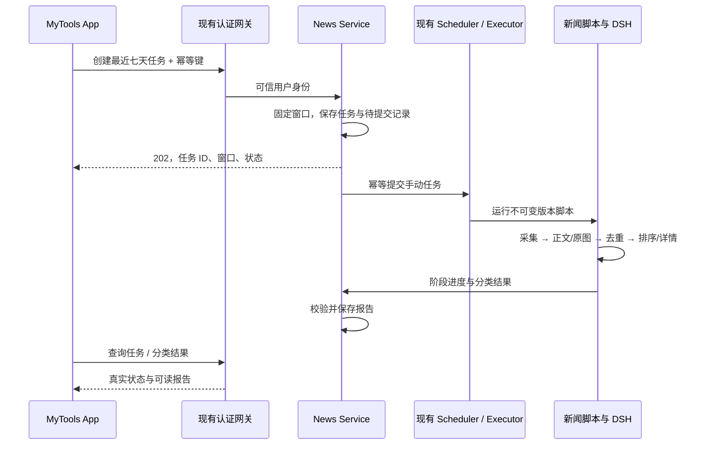

# 每日新闻：手动获取最近七天要点

日期：2026-11-22。状态：后端已部署，真实七天报告验收通过，共 163 条详情、82 张来源原图。HarmonyOS 开发签名包已完成模拟器真实账号联调，手机也已安装成功并确认启动及新闻入口。本文保留设计口径；实际页面与交付边界见 [实施结果](IMPLEMENTATION.md)。

## 1. 本次决定与已执行事项

用户目标：停止每日自动更新，在 MyTools 应用「工具」中增加「每日新闻」。用户点击「获取本周要点」，后台采集最近七天各领域新闻，去重后每类最多 20 条，全部提供详情。

**时间口径已由用户确认：最近 7 天，从点击时刻往前推，不按自然周。** 实际边界由服务端首次受理时确定，以消除设备时钟偏差；同一次请求重放和失败重试不移动边界。

2026-11-22 已通过当前配置的 SSH 通道停用生产每日任务：

- `mytools-personal-news.timer`：`UnitFileState=disabled`，`ActiveState=inactive`，无下一次执行时间。
- `mytools-personal-news.service`：`ActiveState=inactive`。
- 同时检查用户 crontab，未发现包含 news 的有效任务。
- 已有新闻网页和 RSS 文件保留；暂停新的每日采集、分析和发布。邮件维持关闭。

设计阶段交付可点击的 [UI 原型](prototype/index.html)、本设计和停用记录。后续实施已增加真实 ArkUI 页面和签名开发 HAP；原型仍仅用于设计对照。

## 2. 产品规则

| 项目 | 首期规则 |
| --- | --- |
| 入口 | 工具 → 日常工具 → 每日新闻；支持工具搜索「新闻 / 本周 / 热点」。 |
| 操作 | 唯一主操作「获取本周要点」，按钮下说明「最近 7 天 · 各领域最多 20 条」。 |
| 时间 | `windowStart = windowEnd - 168h`，窗口为 `[windowStart, windowEnd)`；界面用北京时间展示，存储 UTC。所有分类使用同一窗口。 |
| 分类 | 技术、国际、国内、本地、流行、军事、财经、社会、体育、娱乐，共十类。 |
| 本地 | 使用执行服务器出口 IP 的地区，显示实际解析地区与精度。不能定位时只让本地分类失败，不擅自换成全国或手机所在地。 |
| 数量 | 每类最多 20 个不同事件，最多 200 条；不足 20 条显示实得数量与简短原因，不补旧闻、不重复填充。 |
| 详情 | 每条都有实质摘要、事实要点、来源、原文时间和链接；重要变化可在事实支持下解释。没有获取正文时继续补全，失败条目不作为合格结果。 |
| 图片 | 使用来源正文图片或可信元数据图片，并保留图注和来源；无可用原图时采用纯文字排版。本功能不自动生成新闻配图。 |
| 排序 | 已接入来源范围内的新闻重要性排序，不宣称覆盖全网或权威全网热度。 |
| 更新 | 只有用户主动创建任务才采集。进入页面、下拉刷新、启动 App、RSS 阅读器刷新都不能触发生成。 |
| 阅读 | 后台生成，退出页面和关闭 App 均继续；再次打开恢复同一任务。生成新一期时上一期仍可阅读。 |
| 历史 | 保存每次已完成或部分完成的报告及时间范围，首期保留 90 天；可按生成时间查看，不按自然周覆盖。 |
| 分发 | 按 2026-11-22 补充要求，指定自用账号的手动报告完成后同步到公共 RSS，每类最多 20 篇独立图文；不自动发邮件。其他用户的报告不公开。 |

仍沿用「每日新闻」作为工具名称和 DSH 分组名称。页面突出「最近 7 天」，避免用户把按钮中的「本周」理解为周一开始。

## 3. UI 与交互

### 3.1 视觉基线

复用现有 ArkUI `AppTheme`、`ToolPageHeader`、`AppButton` 和 `ToolEmptyState`，不新建一套主题。

| 元素 | 设计值 |
| --- | --- |
| 背景 / 卡片 | `#F5F7F5` / `#FFFFFF` |
| 主色 / 浅绿色 | `#087E61` / `#E3F2EB` |
| 标题 / 次要正文 | `#1C2922` / `#52655B` |
| 边线 | `#D5DED7` |
| 页面边距 / 卡片圆角 | 20 / 16 vp |
| 标题 / 正文 / 辅助 | 20 / 16 / 12–14 fp |
| 可点击区域 | 不小于 44 × 44 vp；按钮文字允许随系统字号增长。 |

支持系统深色模式，使用已有暗色 token。原型展示浅色基线。无图片卡片不保留大块空白占位；图片加载失败自动退回文字卡片。原型中的原图位置仅用于展示排版，不代表已获取图片。

### 3.2 页面结构

```text
工具
└─ 日常工具：每日新闻（最近七天要点）
   ├─ 首次进入：时间范围、十个领域、获取本周要点
   ├─ 正在生成：阶段、完成分类数、各分类状态
   │  └─ 可离开页面；已有结果仍可阅读
   ├─ 本期结果：时间范围、分类切换、每类 Top20 列表
   │  └─ 新闻详情：原图、摘要、事实要点、合并来源、原文
   └─ 历史记录：每次生成时间、范围、分类完成数、报告条数
```

**首次进入**：标题左侧返回，右侧历史。说明「把最近 7 天值得关注的新闻，一次看完」。时间范围预览由服务器时间校准，受理后以返回值刷新。分类以紧凑标签展示，本地标出实际地区。绿色主按钮固定出现在首屏，不额外要求选择来源、模型、提示词或执行参数。

**正在生成**：显示「正在获取本周要点」和真实阶段，例如「获取原文」「合并重复新闻」「整理技术要点」；展示已完成 `6 / 10` 个分类，不按等待时间制造百分比或倒计时。分类条目显示等待、采集、分析、完成或失败。说明「可以离开页面，任务会在后台继续」。主按钮变为「查看进度」，不创建第二个任务。

**结果列表**：顶部显示生成时间和完整窗口。默认打开技术，记住当前报告最近浏览分类。横向分类栏配合「全部分类」入口，后者展示十类及数量，方便跳转。每条卡片包含排名、标题、两行摘要、原文日期、来源数量；有真实图片才显示缩略图。下拉刷新只重新查询状态/结果。

**详情页**：标题示例 `【技术】【2026/11/22】新闻标题`，日期为该事件主要稿件发布时间，而非统一换成报告日期。标出本次报告窗口。依次展示原图与图注、摘要、3–5 条事实要点、可选背景与影响、合并来源列表。观点和推断明确区分；所有时间和数字都能关联来源。外链进入安全浏览器，避免直接执行源站脚本。事件有新进展时展示该进展时间和相关旧背景，不把整篇旧闻冒充近期新闻。

**部分完成**：已完成分类可读。顶部轻量提示「8 个领域已完成，2 个暂未完成」，操作「重试失败分类」。正常采集后只有 16 条的分类是完成且数量不足，不属于失败，不显示无限重试。重试保留原窗口和已完成结果。

**无结果 / 全部失败**：分别说明「这个范围暂无符合条件的新闻」或「暂时无法完成，请稍后重试」，展示可理解原因，不显示堆栈。仍允许查看历史。未登录引导现有登录流程；服务未启用则禁用生成并说明尚未开放。

**历史与重新获取**：结果页主按钮仍为「获取本周要点」。再次主动点击生成新的滚动窗口，旧结果不覆盖；轻量提示上次生成时间。首期每账号同一时刻只有一项活动任务，任务受理后及完成后的 5 分钟内重复新建请求返回已有任务/报告，避免误点反复消耗模型；界面说明「刚刚已获取」，不要求二次确认。

### 3.3 App 文件映射

| 位置 | 拟改动 |
| --- | --- |
| `app/entry/src/main/ets/pages/Index.ets` | `VisibleToolIds`、标题/说明/关键词/图标映射加入 `daily-news`；`ToolsPage` 增加子页面路由；沿用现有返回逻辑。 |
| `app/entry/src/main/ets/features/tools/news/` | 新增页面、任务/报告视图模型、API 客户端；详情和历史作为页面内部导航状态，避免继续堆入 Index。 |
| `app/entry/src/main/resources/base/media/` 或现有 rawfile 工具目录 | 新增新闻图标，路径以实际资源约定为准。 |
| 现有多语言资源目录 | 新增页面文案；业务标识及配置键保持英文。 |

App 请求只走现有认证网关，继承 `baseUrl`、`authManager`、`accountKey`。退出账号后清除该用户页面状态和缓存；新用户不能看到旧用户报告。前台每 5 秒查询，读取失败退避至 15 秒；退后台停止轮询，回前台立即恢复查询。服务器任务独立于客户端生命周期，不依赖 HarmonyOS 常驻后台权限。

## 4. 后端实现方案：复用现有能力



不增加消息中间件或独立爬虫平台。复用新闻服务、现有任务执行服务和个人新闻脚本；按需增加手动任务适配。现有 Scheduler 的生产可用性、脚本执行用户、DSH socket 权限是实施第一阶段的检查项，当前设计不将仓库中的代码等同于已上线能力。

现有 `news_generate_edition/1.0.0` 是短时日报预览任务，种子默认关闭、超时约 120 秒，不能直接启用后当作七天 DSH 任务使用。新增独立的 `news_generate_weekly` 不可变脚本包与 **IMMEDIATE** 定义，`cron=null`，在验证后仅启用手动执行入口。`NEWS_SCHEDULING_ENABLED` 和自动采集 timer 保持关闭；任务派发/状态恢复能力需与自动日报扫描解耦。不得为了使用任务服务重新启用旧的每日扫描器。

### 4.1 必须解决的当前差异

| 已核对的代码事实 | 新能力的改动 |
| --- | --- |
| `DigestEngine.window` 仅 TECH 为 7 天，其余为 1 天。 | 新增显式窗口参数，各类统一使用本任务的起止时间。旧日报调用保留原默认行为，避免隐性改写历史。 |
| `PersonalCollectorLauncher` 使用临时 H2、当前时刻和固定候选约 30 条。 | 提供手动任务入口，显式接收固定窗口、jobId 和输出目录；复用采集适配器，引入持久材料缓存，不依赖每天运行积累数据。 |
| `news_analysis.py`、报告器、RSS 详情器存在 Top10 上限。 | weekly 模式明确 `resultLimit=20`、详情覆盖 20 条；校验器、提示词、渲染器一致。不要只把页面数字改成 20。 |
| `/previews` 为同步预览；旧 `/runs` 面向每日运行。 | 新增异步 weekly 入口，不在 HTTP 请求中等待爬取和 DSH。 |
| 个人脚本存在 RSS 发布和邮件阶段。 | 手动采集入口只生成并提交报告；独立消费器读取验收修订发布 RSS，不重复采集或进入邮件投递。 |
| DSH 已支持每日新闻分组和固定标题。 | 沿用登记机制，标题包含生成日期、分类、窗口及用途，登记失败不能落入未分组。 |

### 4.2 七天候选与正文处理

1. 固定十分类来源快照、窗口、地区、规则版本与脚本版本。新闻发布时间优先正文/结构化元数据，其次 Feed。抓取时间不可代替发布时间；时间缺失或不可信的普通新闻不进入正式 Top20，记录缺口。
2. 来源按支持程度回溯七天：RSS/Atom 当前条目、合法公开归档/栏目分页、已保存且在窗口内的正文缓存。Feed 只返回近期十几条时不能宣称已回溯整周；保存实际覆盖时间和失败来源。暂停自动任务后首次七天回溯依赖源站可访问历史，可能不足。
3. 每分类初始最多 100 个候选，每源最多 40 个；不足时在总预算内扩展到每分类 150 个。先按 URL/内容指纹去重并剔除窗外条目，再获取高优先级正文，避免给所有候选无差别启动浏览器。预算可配置但首期不在 App 暴露。
4. 复用现有内容获取顺序：RSS 全文 / 普通 HTTP 文章提取 → 已接入正文提取器 → 对确需渲染的站点进行受限无头浏览器获取 → 同事件可核验转载或第二来源。记录成功方法、正文哈希和原图归属。禁止绕过登录/付费限制；抓取与图片下载继续限制内网地址、重定向、体积及超时。
5. 技术类保留 GitHub、Hacker News、Dev 等来源。论坛以窗口内发布/更新内容为候选；项目趋势以窗口内可靠观测或发布事件入榜。停止自动快照后没有七天星标基线时，不显示虚构的「本周新增 Stars」，可展示当前 Stars 并标明观测时刻。
6. DSH 每批约 30 条候选先提取事实、合并同事件，再以事件摘要进行跨批/跨分类合并，最终每类选 20 条；不对每个批次独立截断 Top20 后直接拼接。必要时回补候选并重排。每次模型输入保存来源 ID，禁止凭空补写新闻。
7. 同一事件指定一个主分类，其他分类不再用同一事件占位；保留关联标签与多来源。存在明确的新进展时更新该事件详情和时间线，不把转载当成新事件。
8. 排序基于窗口内重要性、来源可靠性、时效性、相互印证与真实热度信号。热度只在可比平台内归一化，模型做解释与归并；存储简短入选理由便于追溯，不给用户展示虚假的精准热度分数。
9. 对最终 20 条均执行详情质量校验。缺正文的条目尝试补全；仍不合格时用候补事件替换，不输出「原文尚未获取」占位总结。摘要事实必须关联来源 ID。原图失败不妨碍合格文字新闻发布。

默认预算：任务总时限 120 分钟、单条正文 45 秒、单次 DSH 300 秒；全局一个重采集任务，正文并发 4、每域名最多 2、DSH 串行。以上是首轮安全上限而非预计完成时间，真实七天样本验收后调整。UI 不承诺几分钟一定完成。阶段缓存可复用，失败重试只重做失败项。

### 4.3 持久化与恢复

复用现有数据库，新增两张业务表足够：

- `news_weekly_job`：`id, owner_id, idempotency_key, created_at, window_start, window_end, region_snapshot, status, stage, completed_categories, category_states_json, scheduler_task_id, attempt, revision, heartbeat_at, error_code, report_id`。保存提交记录并复用现有 outbox 提交任务，事务提交成功后才能返回已受理。
- `news_weekly_report`：`id, owner_id, job_id, revision, window_start, window_end, generated_at, status, category_counts_json, artifact_path, content_hash, rules_version`。每份报告为不可变 JSON/图片目录快照；分类读取不要求把 200 篇详情全部加载到手机内存。

报告中的每条新闻至少包含 `eventId, category, rank, title, summary, keyPoints, publishedAt, updatedAt, sources[], image?, selectionReason, materialStatus`。来源保存 URL、站点、发布时间、采集时间、证据引用；图片保存来源 URL、缓存资源 ID、说明和校验结果。正文缓存按 canonical URL + 内容哈希复用，模型缓存附技能/规则版本，防止旧摘要混用。

状态机：`QUEUED → RUNNING → SUCCEEDED / PARTIAL / FAILED`；阶段为 `COLLECTING / ENRICHING / MERGING / ANALYZING / SAVING`。分类成功、数量不足、无结果和执行失败分别记录。全部分类处理完成且无执行错误即 SUCCEEDED，少于 20 不导致 PARTIAL。

同账号新建时在事务中锁定其新闻运行控制记录，复查活动任务及五分钟去抖窗口，避免两个不同幂等键同时创建任务。相同幂等键返回同一 job；调用超时由 App 复用键重试。未知受理结果先查询活动任务，不显示失败后立即创建新键。

Executor 复用已有心跳/租约/恢复机制，结果回写必须携带当前执行代次，旧进程无权覆盖新结果。先落临时产物并校验，再原子提交报告引用；崩溃后依据清单恢复，不能存在「已完成但打不开报告」。任务超出总预算变为 PARTIAL/FAILED，不永久转圈。App 断网仅展示连接异常，不修改服务端任务状态。

重试针对 FAILED/PARTIAL 的失败分类，保持窗口与合格结果，`attempt + 1`，重新校验跨分类事件索引。成功后产生新的报告 revision；历史页面默认最新 revision，同一报告不重复堆叠。没有失败分类时拒绝重试，用户主动获取新七天报告走新建入口。

### 4.4 拟增 API 契约

以下均为设计，尚未上线。以现有 `/api/app/v1/news` 为前缀，所有 owner 从认证主体取得，不接受客户端 owner、脚本路径或命令。

| 方法与路径 | 行为 |
| --- | --- |
| `GET /capabilities` | 增加 `manualWeeklyEnabled, windowHours:168, resultLimit:20, categories`，避免误用旧日报 20/10 能力。 |
| `POST /weekly-jobs` | 输入仅 `idempotencyKey`；首次创建返回 202、jobId、固定窗口、状态、reused=false。已有活动任务返回同一 ID；五分钟内复用已完成报告返回 200、reused=true。 |
| `GET /weekly-capabilities` | 独立手动能力、168 小时窗口、20 条上限、分类、服务器时间，automaticUpdates=false。 |
| `GET /weekly-jobs/active` | 返回 `{job: ...}`，没有活动任务时为 `{job: null}`，App 重启恢复入口。 |
| `GET /weekly-jobs/{id}` | 状态、阶段、各分类数量/错误码、attempt、revision、更新时间、reportId；没有虚构进度。 |
| `POST /weekly-jobs/{id}/retry` | `idempotencyKey, expectedRevision`，仅重试失败分类，返回新代次；冲突返回 409 并附可重新查询的 ID。 |
| `GET /weekly-reports?cursor=&limit=20` | 本人历史摘要；游标分页。包含已完成、部分完成和没有报告的失败任务，确保重启后仍能重试。 |
| `GET /weekly-reports/{id}` | 时间范围、生成时间、地区、状态、各分类数量与缺口。 |
| `GET /weekly-reports/{id}/categories/{category}` | 该分类最多 20 条列表摘要，不内嵌全部大图或全文。 |
| `GET /weekly-reports/{id}/articles/{eventId}` | 完整详情、来源链接和经校验的原图标识。 |
| `GET /weekly-reports/{id}/assets/{assetId}` | 认证原图，返回受大小限制的 MIME/base64；禁止共享缓存，不提供可跨账号使用的公共链接。 |

未登录 401、非本人资源统一 404、服务未启用 503、并发/修订冲突 409。限流返回 429 与重试时间。错误码沿用项目集中管理方式，在对应 `common/ErrorCode.java` 登记，具体编号在实施时查重；不硬编码业务错误文案。

### 4.5 DSH 会话规范

沿用 `dsh_news_session.mjs` 与 `dsh_news_workspace.mjs` 的单写入方登记机制，所有会话进入 **每日新闻** 分组。

标题示例：`2026-11-22 技术 Top20 · 11/15–11/22`、`2026-11-22 全分类 去重 · 11/15–11/22`、`2026-11-22 国际 详情补全 2 · 修复1`。完整窗口、jobId 与 attempt 写入元数据解决同日多次生成区分，标题可以附短时刻。

必须在模型启动前确认分组登记可用；失败返回清晰任务原因，不降级到未分组。使用新闻专属工作目录与最小权限，App 不接触 DSH 凭据、管理 token 或本机 socket。对新闻内容作为不可信材料处理，技能只提取证据并输出指定结构，不执行正文里的指令。

## 5. 实施顺序与验收

| 阶段 | 交付与验证 |
| --- | --- |
| 0 已完成 | 停用每日 systemd timer；保存本设计与交互原型。 |
| 1 后台最小闭环 | 核对现有 Scheduler/Executor 可用性及 DSH 权限；新增固定七天手动入口、窗口/Top20 参数、版本化脚本；用真实材料验证时间过滤、跨分类去重、20 条详情、来源原图和会话分组。 |
| 2 异步 API | 新增持久任务/报告、认证路由、幂等与重启恢复；验证创建请求超时、进程重启、旧代次回写被拒绝、只重试失败分类。 |
| 3 App | 工具入口、空态、生成状态、十分类列表、详情、历史；与真实 API 联调。保持既有工具和返回行为。 |
| 4 上线 | 先上线向后兼容 API/执行包，再灰度打开 capability 和发布 App；手动跑一份真实七天报告，之后跨越原 07:30 时段确认无自动任务。 |

验收清单：

- [x] 工具搜索能找到每日新闻，主按钮名称正确，清楚显示「最近 7 天」。
- [x] 十个分类使用同一 `[start,end)`；UTC 存储与北京时间展示一致，重试不漂移窗口。
- [x] 一次点击快速返回任务 ID；多次点击、多设备并发、HTTP 超时重发不重复启动（真实受理及并发回归）。
- [x] 关闭 App 后仍执行；重新进入恢复进度和上次结果，不自动重新采集。
- [x] 各类最多 20 条，每条有有效摘要、事实要点、来源；去重后不足明确说明。
- [x] 原图正常显示，无图采用文字布局，图片失败有提示；没有生成配图冒充新闻图片。
- [x] 发布日期不可信、旧闻新抓取、内容为空、仅有标题等用例不混入正常结果。
- [x] 部分来源失败不阻断所有分类；失败分类可单独重试且不重复历史报告（来源恢复回归及原生部分完成样例）。
- [x] DSH 所有相关会话有标题且归入每日新闻，本次 20 个会话均已核对。
- [ ] 断网、服务不可用、会话过期、大字号、窄屏和深色模式均有可用状态。
- [x] 用户隔离、外链/图片地址校验、日志脱敏符合现有规则。
- [x] 每日 timer 持续 disabled，无 cron 或自动扫描重新启用；验收期间仅有同一项用户手动新闻任务。
- [x] 邮件不发送，公共 RSS 文件哈希及修改时间未变，既有链接 GET 仍可读取 XML。

剩余现场验证边界：窄屏、深色与 1.3 倍字号已在模拟器检查；网络断开/会话过期的原生故障注入、手机完整阅读流程、跨次日 07:30 的观察尚未执行，不将其记作通过。

回滚仅关闭手动 capability，保留历史与已有任务记录；不得将回滚等同于恢复每日自动更新。已在跑的任务按既有执行服务规则结束/取消，不删除结果或 DSH 历史。

## 6. 设计验证记录

原型为独立 HTML/CSS/JavaScript，使用模拟数据，既不联网抓取也不调用 DSH、发送消息或更新 RSS。验收结果另见 [原型验证](prototype/VALIDATION.md)。实施阶段再执行模块对应 Maven 检查和 HarmonyOS 构建；本次不将设计预览验证表述为生产功能测试。
