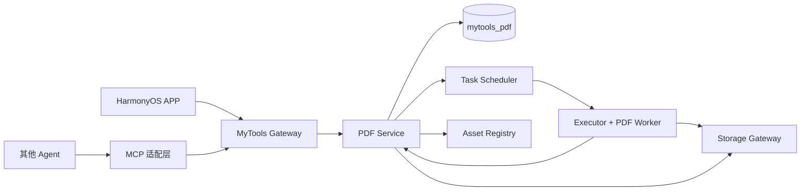

# MyTools PDF 分割服务调研与实现方案

> 范围已扩展为统一「PDF 工具」。入口、通用输入和 API/MCP 命名以[最新总体方案](./2026-09-26-pdf-toolkit-design.md)为准；本文保留分割子能力的详细规则。

日期：2026-09-26。状态：方案草案，尚未实施或部署。范围：HarmonyOS APP 工具、后端领域服务、其他 Agent 可用的 MCP 接口。

配套文档：[APP UI 设计](./2026-09-26-pdf-split-ui.md)。

## 1. 建议决策

建设独立 `pdf-service`，Java 21 + Spring Boot + Apache PDFBox 3.x。APP 与 MCP 通过同一业务服务处理 PDF，复用现有 Gateway、Scheduler/Executor、Storage Gateway、Asset Registry。处理发生在 MyTools 自有基础设施，不调用第三方 PDF SaaS。

产品入口叫“PDF 分割”，内部区分两个概念：

- **裁切页面**：把一张 PDF 页面切成左右、上下或多个区域，页面数量增加，默认仍输出一个 PDF。本次需求属于此类。
- **拆分文件**：按页码、固定页数、书签或体积，把一个 PDF 变成若干文件。页面本身不被切开。

首期完成可投入使用的闭环：选择文件 → 检查 → 配置 → 预览 → 后台处理 → 预览/保存结果。首期同时交付 APP 和 MCP，不把 MCP 当作后补接口。

推荐默认值：左右裁切、50%、先左后右、全部页面、一个 PDF、保留清晰度。不要将“垂直分割”单独作为用户文案；显示“左右分割｜竖向切线”和示意图。

### 1.1 本次文件的验收基准

已读取的原文件共 2 页，每页约 841.89 × 595.28 pt，旋转为 0，即横向 A4；对半后为约 420.94 × 595.28 pt，接近 A5。不能把本例误称为“A3 变 A4”。

输出映射：`原1左 → 原1右 → 原2左 → 原2右`，一个 4 页 PDF；印刷页码 9、10、11、12 与文件页序 1、2、3、4 分开展示。接口中的页码一律指文件页序。

上轮交付用的是直接调整页面边界的临时脚本；生产服务需另外完成权限、旋转坐标、任务隔离、文档特性检测和可恢复发布，不能直接把该脚本包装成公开接口。

## 2. 调研方法与证据边界

本轮查阅厂商官方产品页、帮助文档、技术规范，并读取本地仓库相关代码。没有将用户 PDF 上传第三方，没有试用付费功能，也没有进行各产品的实测速度或市场份额排名。

下表“未确认”表示本轮官方来源未证明该项能力，不表示产品绝对不支持。网页能力与移动客户端能力不自动等同。套餐、配额和价格易变，本方案不依赖第三方免费额度。

### 2.1 主流工具对比

| 产品/形态 | 官方来源确认的分割方式 | 页面几何裁切 | 可借鉴交互 | 对 MyTools 的启示 |
|---|---|---|---|---|
| Adobe Acrobat 桌面 | 按页数、文件大小、顶层书签，批量处理及输出命名 | 本次 Split 文档未确认对半裁切 | Organize pages 中选规则和输出选项 | 将输出规则与页面操作分开 [S1] |
| Sejda Web/Desktop | 页码、书签、大小、文本变化；独立的对半分割工具 | 明确支持左右/上下、拖动分割线、排除页、右到左、册子重排 | 预览中直接调线，提供排除和顺序选项 | 最接近试卷/扫描书籍需求，作为核心交互参考 [S2] |
| iLovePDF Web | 自定义范围、固定页数、提取全部/选定页、合并选中范围；页面亦显示大小和 Smart 入口 | 当前 Split 页未确认 | 范围分组、预测文件数、提取与合并开关 | 首期只借鉴确定性规则；不依据 Smart 入口宣称识别准确率 [S3] |
| Smallpdf Web | 选页、拆分、重排，支持多文件操作 | 当前 Split 页未确认 | 缩略图和剪刀标记拆分点，简短导入到下载流程 | 简化用户主路径，具体移动 APP 能力需另测 [S4] |
| PDFsam Basic 桌面 | 每页、指定页后、奇偶页后、书签层级、目标大小等 | 本次 Basic 页面未确认 | 明确的模式、输出文件管理 | 适合离线批处理参考；按大小不可假设简单平均 [S5] |
| Stirling PDF | 页码、章节、大小、页数/文件数、页面分区网格 | 明确支持横纵网格切片 | 页面操作分工具，半页/四分区 | 适合自托管工具箱参考，MyTools 不必引入整套产品 [S6] |
| WPS PDF 在线工具 | 选择页面并拆分为新文件 | 本次在线文档未确认 | 中文工具命名和选页到下载流程 | 中文入口用“裁切页面/拆分文件”降低歧义 [S7] |

这些产品共同体现出三层需求：选择哪些页、决定如何切/分组、决定输出几个文件。MyTools 的模型必须将这三层拆开，避免一个 `splitMode` 承载所有语义。

### 2.2 能力优先级

| 能力 | 场景 | 阶段 | 规则 |
|---|---|---|---|
| 左右/上下对半、任意比例 | 双页扫描、试卷、长页 | P0 | 默认 50%，允许 5%～95%；拖动和数字输入并存 |
| 选页处理、其他页原样保留 | 封面不切、夹杂单页 | P0 | 文件页序，默认所有页；“不处理”不等于删除 |
| 阅读顺序 | 普通/右到左文档 | P0 | 左右或上下的相反顺序；按原页逐页展开 |
| 页码范围拆分、每 N 页、逐页提取 | 章节、提交附件 | P0 | 范围合法性、预测文件数、ZIP |
| 单页差异设置、奇偶页预设 | 扫描错位、装订偏移 | P1 | 明确覆盖全局设置，并显示覆盖徽标 |
| 多切线/2×2 网格 | 拼版讲义、四合一试卷 | P1 | 统一的区域顺序和最小区域尺寸 |
| 按书签层级 | 电子书章节 | P1 | 无书签、同页书签、封面前言有明确定义 |
| 按目标大小 | 邮件/平台大小限制 | P1 | 实际序列化测量；单页过大明确失败 |
| 批量文件、规则模板 | 周期整理资料 | P1 | 每文件独立状态，部分成功可下载 |
| 自动选取双页、检测中缝/空白页 | 扫描书批量处理 | P2 | 建议值+置信度+人工可改，不静默切错 |
| 册子重排、文本/条码/分隔页分割 | 骑马钉、票据/发票 | P2 | 需扫描顺序配置和专门测试集 |
| OCR、去弯曲、重新排版、脱敏 | 内容增强/保密处理 | 不纳入本期 | 独立能力，不混入分割默认流程 |

## 3. 仓库现状与接入位置

以下均为本轮代码/文档检查结果，不代表生产服务已启用：

| 现状证据 | 可以复用的能力 | 需要新增的部分 |
|---|---|---|
| `app/README.md`、`app/entry/src/main/ets/pages/Index.ets` | HarmonyOS NEXT、ArkTS；已有工具页路由和最近使用 | `pdf-split` 入口、独立页面/状态模块 |
| `app/entry/src/main/ets/theme/AppTheme.ets` | 当前绿色主题和容器尺寸 | 新页面沿用 token；旧 UI 文档蓝色描述已经与代码不一致 |
| `Index.ets` 的 `@kit.PDFKit`、`ReaderContentLoader.ets` | 已有 PDF 阅读和受控本地缓存 | 编辑预览建议服务器缩略图；完整结果阅读复用 PDFKit |
| `VideoGenerationApi.ets` 及 Gateway controller | 异步任务、可信 owner、下载等模式 | PDF 严格 DTO、真正的流式上传；不照搬大文件 `byte[]` 缓冲 |
| `service/task-scheduler-client`、Executor README | 任务创建、包发布、取消、租约、错误分类 | `pdf_inspect`、`pdf_preview`、`pdf_split` 版本化包 |
| `service/storage-gateway-service/README.md` | 流式上传、摘要校验、受管对象、单次票据 | 面向用户的 owner-bound 文档与结果下载；单次票据不适合阅读器多次 Range 请求 |
| `service/asset-registry-service/README.md` | 内容资产、派生关系、发布栅栏 | PDF 来源和派生产物关系；用户访问权仍由领域服务维护 |
| `service/messaging-service/mcp/mytools_messaging_mcp.py` | 现有 stdio MCP 适配模式 | PDF 工具、文件上传桥接；不能复制管理员 token 到外部 Agent |
| `service/AGENTS.md` | 独立构建、不可变任务脚本包、隔离 schema | 新服务不加入根 Maven 构建 |

本轮未发现根/子服务 Maven 清单中已引入 PDFBox、iText 或 pypdf 作为 PDF 处理引擎；具体版本须在实现开始时固定并检查依赖与安全公告。

## 4. 技术选型

| 候选 | 优点 | 成本/限制 | 决策 |
|---|---|---|---|
| Apache PDFBox 3.x | Java 原生；拆分、绘制、解析、渲染；Apache-2.0 | 裁切坐标、注释/书签重建需实现；复杂扫描件需压测 | 首选 [S8][S9] |
| pypdf | 本次已验证基本裁切可行；脚本简单 | 预览需另一个渲染器；又引入 Python PDF 业务核心 | 用作独立校验/开发参考，非首选生产核心 [S10] |
| PyMuPDF | 渲染/页面处理能力完整 | 官方说明 AGPL 或商业授权；增加原生依赖评估 | 不作为默认依赖 [S11] |
| iText | Java 文档操作能力成熟 | 官方双许可 AGPL/商业；本需求无必要增加授权决策 | 暂不选 [S12] |
| Sejda SDK / 整套 Stirling | 有丰富任务级功能 | 整套产品的升级、权限和依赖边界需要额外管理 | 参考功能设计，不直接套入 MyTools [S2][S6][S16] |

授权内容仅引用官方许可说明，不在本方案中推断特定部署的法律结论。PDFBox 官网本轮显示 3.0.8 已发布，建议按 3.x 维护线选定版本；不使用未发布的 4.x。[S8]

PDFBox 3 的文件读取与写入缓存需明确配置：输入先落到任务工作目录，使用文件后端读取；写入流缓存使用受控临时文件/混合模式。不要把 `InputStream` 包装成全内存读缓冲，也不能认为启用临时文件后解析对象或渲染内存就无限安全。[S9]

### 4.1 服务与 Worker 组织

建议增加两个独立 Maven 工程：

- `service/pdf-service/`：HTTP 业务 API、元数据、权限、plan/job 生命周期、任务提交与结果发布。
- `service/pdf-worker/`：无 Web 监听的命令行 JAR，内部 `pdf-core` 包实现 inspect/preview/split。后续若多处复用再提取共享模块。

Executor 当前自动识别 `.py` / `.sh` 入口，并非直接执行 `java -jar`。因此采用版本化 Python 薄包装器读取任务上下文、通过 SDK 获取文件、按参数数组运行固定 JAR、上传结果。PDF 算法只在 Java 内实现，不维护第二套 Python 裁切算法。

JAR 与 Python 包一起发布到不可变版本目录并计入摘要索引；启动前校验 JAR SHA-256。Java 路径由节点配置给定，用户不能上传 JAR、指定命令、任意参数或修改运行版本。取消时必须清理包装器及 Java 子进程。

## 5. 后端架构与处理流程



MCP 对外令牌只授权当前用户的 PDF 操作；领域服务内部调用仍使用各自隔离的服务令牌。任何入口都不接受客户端自报 `ownerId`。

### 5.1 输入阶段

1. `capabilities` 返回开放模式、有效配额和当前引擎版本。
2. 本地文件通过系统选择器明确选择；APP 创建上传会话并流式发送。HTTP 声明大小与实际字节数双重限制；完成后复核 SHA-256 和 PDF 可解析性。
3. 现有云文件使用领域 `sourceRef`，由服务核验 owner 和读取权，再固化为不可变输入副本。不能直接提交任意 `storage://`、物理路径或 URL。
4. 创建 `documentId` 并异步解析。状态可为 `INSPECTING`、`PASSWORD_REQUIRED`、`READY`、`FAILED`、`EXPIRED`。
5. 分页返回页尺寸、旋转、页标签、缩略图索引、加密/签名/表单/注释检测和可用模式；不把全文交给 Agent。

上传会话是领域服务对 Storage 内部会话的封装，上传前完成身份、配额检查；重复上传完成请求不能生成多个文档。P0 使用有界单流，断点分片可放 P1，但网络重试必须能安全重建会话。

### 5.2 预览与冻结计划

配置提交后创建不可变 `planId`，绑定 `documentId + sourceSha256 + normalizedConfig + engineVersion + planRevision`。返回输出页数、文件数、页映射、警告和服务端权威缩略预览。

计划分为 `BUILDING / READY / FAILED / EXPIRED`。简单结构计算可以立即完成，但渲染必须离开 HTTP 请求线程。预览只按需渲染当前页、切片示例和少量相邻页；大文档不一次生成全量图片。

拖动线时 APP 本地只绘制线框；停顿约 300 ms 后请求服务端预览。每次请求携带配置修订号；过时响应直接丢弃。正式任务只消费已就绪且未过期的 `planId`，不重新解释客户端参数。

计划会产生缓存与存储，因此 MCP `create_plan` 不是只读工具。UI 无需为了生成一个可逆预览增加确认弹窗。

### 5.3 执行与发布

`ACCEPTED → QUEUED → RUNNING → VERIFYING → PUBLISHING → SUCCEEDED`；非成功终态包括 `FAILED / CANCELLED / TIMED_OUT`，取消中显示 `CANCEL_REQUESTED`。

- 创建任务在同一领域事务中写 job 与 outbox，后台通过 Scheduler 幂等提交。Scheduler 暂不可用时保留待提交，不返回伪成功。
- Scheduler 参数仅携带 `jobId`，Worker 通过服务接口获取冻结计划和短期受控输入信息；密码与路径不进入 Scheduler 参数。
- 执行使用 CPU 节点，不占 GPU。检查、预览和正式分割共用配额，预览不能绕过资源限制。
- Worker 先在专属工作目录生成文件，再检查可解析性、页数、尺寸、顺序、文件大小、SHA-256。P0 对切片首尾和抽样页渲染验证，测试集进行全页验证。
- 将产物作为未提交对象上传、登记派生资产、提交 manifest。只有全部必需产物通过校验并成功登记后，领域事务才把 job 改为 `SUCCEEDED`、允许用户下载。
- 外部存储与领域库不存在跨服务事务；通过 outbox、幂等键、staging 状态和补偿清理恢复。失败不得把不完整的 PDF 当作结果。
- 发布/取消通过领域版本与执行 fencing token 竞争；已取消任务的晚到 Worker 不得发布结果。完成与取消冲突返回真实终态，不显示“已取消”再悄悄完成。
- 用户重复点击/网络重试使用 `owner + operation + idempotencyKey`；相同 key 不同载荷返回 409。重试可复用同一 job，用户主动“再做一次”使用新 key。

内核子进程完全离线运行；包装器只连固定内部服务。现有 Executor 网络隔离开关尚不支持“任意 allowed-domains 透明放行”，不能直接全局启用后期望包装器仍能上传。实施时应为 Java 子进程单独建立网络隔离，或准备网络阶段与离线计算阶段的明确边界。

## 6. 分割语义与 PDF 正确性

### 6.1 坐标契约

API 坐标基于“用户看到的页面”，左上角 `(0,0)`，右下角 `(1,1)`，已应用有效 CropBox、MediaBox 交集、Rotate 与 UserUnit。竖向切线用 `x`，横向切线用 `y`。有限小数，拒绝 NaN/Infinity。

Worker 建立源 PDF 坐标到显示坐标的变换矩阵 `T`；区域先在显示空间定义，再通过逆矩阵映射。必须验证 Rotate=0/90/180/270、负原点、非零 CropBox、混合纸张和 UserUnit。不能直接使用 `MediaBox.width / 2` 处理全部文件。

P0：

- `mode = PAGE_CUT`，`axis = VERTICAL | HORIZONTAL`，`position = 0.5`。
- `order = LEFT_TO_RIGHT | RIGHT_TO_LEFT | TOP_TO_BOTTOM | BOTTOM_TO_TOP`，必须匹配 axis。
- `selection.ranges` 为闭区间，页码从 1 开始；合并重复、排序并验证上界。未选页原位保留。
- 先按源页序展开，再按每页 order 追加；不默认为“全部左页后全部右页”。
- 每块的显示短边建议至少 10 pt，位置有效范围 0.05～0.95；最终约束以能力接口为准。

P1 网格统一为有序的 `xCuts[] / yCuts[]`，严格升序且无重合；每页覆盖参数有明确优先级：单页 > 奇偶页预设 > 全局。

### 6.2 输出策略

P0 裁切默认 `SINGLE_PDF`。拆文件用 `PER_RANGE / FIXED_COUNT / EACH_PAGE`，可选择打包 ZIP。示例：12 页、每 5 页 → `1–5 / 6–10 / 11–12`，余页不能丢失。

页码范围按数组定义输出组，组内保留源页顺序；同一源页出现在多个组时明确标为重复并在预览显示。APP 默认阻止意外重叠，可通过明确选项允许；API 不隐式去掉用户要求的跨组重复。

单文件和 ZIP 均是可枚举的 artifact。结果 manifest 包含输出序号、来源页/区域、页数、字节数、摘要和 `artifactId`。不默认写回覆盖源文件，也不默认将全部导出内容导入书架。

### 6.3 保真、隐藏内容与文档特性

默认使用页面内容引用/克隆、裁切与坐标变换，保留文字、矢量和原图，不先整页栅格化再拼 PDF。复用资源时只共享不可变对象；不能修改同一页字典导致左右页相互覆盖。

**裁切不是内容删除**：框外文字/图像可能仍在内容流中，普通文本提取也可能读到隐藏内容。文档/工具说明必须明确“用于版面拆分，不用于脱敏”；不要承诺“输出文件只包含看得见的内容”。需要安全删内容时另做受验证的 redaction 能力。[S10]

| 特性 | P0 明确策略 |
|---|---|
| 普通文本/扫描图、内嵌字体 | 保留资源与清晰度，渲染校验；缺字体不能静默替换 |
| 旋转/不同纸张/非零边界 | 必须支持，并按显示方向切割 |
| 加密文件 | 提供密码解锁；检查允许的文档修改权限；不绕过权限 |
| 数字签名或认证签名 | 阻止 P0 修改，提示先提供无签名副本；不声称结果仍有有效原签名 |
| AcroForm/XFA、Widget | P0 拒绝并给出原因；P1 再实现可验证的保留/显式扁平化 |
| 注释与链接 | P0 对几何裁切的带注释文件阻止处理，避免跨区标注错误；整页拆分可在完成映射测试后开放，否则同样拒绝 |
| 书签、页标签 | 导出简单新目录/标签或明确提示未保留；不保留悬空目的地。P1 实现精确映射 |
| JavaScript、Launch、自动动作、嵌入附件 | 新输出不复制文档级主动内容/附件；不执行原文件动作 |
| PDF/A、Tagged PDF | 不承诺保留合规或可访问性结构；检测后给出稳定 warning，不沿用不再真实的合规声明 |
| 损坏或异常 PDF | 不自动修复后继续；返回明确错误，修复作为未来独立工具 |

对于带表单、签名、注释的文件，检查阶段就应告知可用能力；不能让用户等到最后才失败。禁止“默认丢弃重要特性”作为容错策略。

### 6.4 P1 的复杂规则

按大小拆分必须实际写文件后测量，不能用输入总大小/页数估算；资源共享和压缩会改变体积。优先保证每个文件不超阈值，再优化页分组；单页仍超限返回 `PDF_011`，不偷偷降低画质。

书签分割使用解析后的目的页，按选择层级排序、同页边界去重；第一书签前内容单独归入“前言”，末组包含余页。页面中间的书签只按页边界拆，不承诺按文字行拆。

自动中缝只给候选线与置信度，跨栏图/水印/倾斜扫描是明确失败场景；不纳入 P0 的“自动成功率”承诺。

## 7. API 草案

公开前缀：`/api/app/v1/pdf`。内部前缀建议 `/internal/v1/pdf`，域内认证要求服务 token + 可信 owner。下列均为待实现接口，不表示现有功能。

| 方法/路径 | 作用 | 返回 |
|---|---|---|
| `GET /capabilities` | 模式、配额、版本、限制 | 200 |
| `POST /uploads` | 创建上传会话，输入安全文件名、大小、可选摘要 | 201，uploadId/expiry |
| `PUT /uploads/{id}/content` | 原始 PDF 字节流，允许 `application/pdf` | 204，严格限流与限长 |
| `POST /uploads/{id}/complete` | 校验并创建文档/解析任务 | 202，documentId |
| `POST /documents/import` | 用 owner-bound sourceRef 导入云文件 | 202，documentId |
| `GET /documents/{id}` | 解析状态、页数、特性、warnings | 200 |
| `POST /documents/{id}/unlock` | 安全提交密码，返回 opaque credentialRef | 202 |
| `GET /documents/{id}/pages?cursor=...&limit=...` | 分页元数据 | 200，每批默认 40、最多 100 |
| `GET /documents/{id}/pages/{page}/thumbnail` | 受保护缩略图 | 200；未就绪返回可重试状态 |
| `POST /plans`、`GET /plans/{id}` | 规范化/冻结配置、预览状态 | 202 或 201；GET 200 |
| `GET /plans/{id}/pages?cursor=...` | 输出映射与缩略图索引 | 200 |
| `GET /plans/{id}/pages/{index}/thumbnail` | 权威裁切预览 | 200 |
| `POST /jobs` | planId + Idempotency-Key | 202，jobId |
| `GET /jobs/{id}` | 真实阶段、进度计数、warnings/errors | 200 |
| `GET /jobs?cursor=...&limit=...` | 本人历史，分页 | 200 |
| `POST /jobs/{id}/cancel` | 幂等取消 | 202 或已有终态 |
| `GET /jobs/{id}/artifacts` | 结果清单 | 200 |
| `GET /artifacts/{id}/content` | owner-bound 流式结果，支持 Range | 200/206 |
| `POST /artifacts/{id}/download-tickets` | 按需签发短期下载票据 | 201 |
| `DELETE /documents/{id}` | 删除本人工具输入引用/缓存，活动任务时 409 | 204 |
| `DELETE /jobs/{id}/artifacts` | 删除结果访问权并异步清理 | 202 |

所有路径在每次调用时验证 owner；猜中 UUID 无访问权仍返回 404。身份过期 401，额度/限速 429，超大小 413，文件类型 415，规则/特性错误 422，键冲突/状态冲突 409，已过期本人资源 410。

创建计划示例（示例 ID 是占位符）：

```json
{
  "documentId": "document-uuid",
  "mode": "PAGE_CUT",
  "selection": {"ranges": [[1, 2]], "unselected": "KEEP"},
  "cut": {"axis": "VERTICAL", "position": 0.5, "order": "LEFT_TO_RIGHT"},
  "output": {"layout": "SINGLE_PDF", "name": "unit-1-split.pdf"},
  "clientRevision": 3
}
```

APP/MCP 入参只接受严格白名单；所有 ID 作为字符串处理，防止 ArkTS/JavaScript 数值精度损失。DTO 枚举、注释要求、错误码遵循项目规范；中文 UI 文案落资源文件，服务 message 为稳定英文/错误码。

完成任务示例：

```json
{
  "jobId": "job-uuid",
  "status": "SUCCEEDED",
  "progress": {"stage": "DONE", "completedPages": 4, "totalPages": 4},
  "result": {"pageCount": 4, "fileCount": 1, "artifacts": [
    {"artifactId": "artifact-uuid", "mediaType": "application/pdf", "pageCount": 4}
  ]},
  "warnings": ["CROP_IS_NOT_REDACTION"]
}
```

响应中的页数为校验后的实际值；预览阶段使用 `estimatedOutputPages`。百分比不是必要字段，无法测量时只显示阶段，不能模拟进度。

## 8. 数据模型、密码与保留策略

独立 schema `mytools_pdf`，所有业务表含 owner、创建/更新时间及乐观版本。新增 migration 不与其他进行中的服务变更混用。

| 表 | 关键字段/约束 |
|---|---|
| `pdf_upload` | id、owner_id、expected_bytes、received_bytes、storage_upload_ref、expires_at、state |
| `pdf_document` | id、owner_id、source_asset_id、sha256、page_count、features_json、state、expires_at |
| `pdf_document_page` | document_id、page_number、visible_box、rotation、user_unit、label；联合唯一 |
| `pdf_plan` | id、owner_id、document_id、source_sha256、config_json、engine_version、digest、state、expires_at |
| `pdf_job` | id、owner_id、plan_id、idempotency_key、payload_digest、state、phase、scheduler_ref、fencing_token |
| `pdf_artifact` | id、owner_id、job_id、ordinal、asset_id、sha256、bytes、page_count、state、expires_at |
| `pdf_outbox` | event_type、aggregate_id、payload_ref、attempts、next_attempt_at |

Asset Registry 的内容去重不能等同授权：相同 SHA-256 属于不同用户也不能相互访问。领域访问记录与内容物理对象分离；清理通过引用计数/关系校验，不能删除其他用户或云文件仍在使用的资产。

建议默认值（产品配置提案，非已测指标）：

- 输入文件/结果保留 24 小时；用户主动“保存到云文件”后成为正式云文件，遵循其保留策略。
- 上传会话 1 小时、计划/预览 30 分钟、无敏感正文的任务摘要 30 天。
- 输入在活动任务期间加租约 pin，过期清理延后到任务收敛；删除结果立即撤销用户下载权，物理 GC 可异步。
- UI 显示具体到期时间，而不是仅显示“临时保存”。不复制第三方的“一小时删除”承诺。
- 密码用受控 HTTPS 提交，存放短期加密凭据存储，KMS/节点密钥与数据库隔离。`credentialRef` 绑定 owner、document、任务期限，Worker 只通过受鉴权通道取用。
- 密码不进入日志、URL、Scheduler、MCP 对话、错误堆栈或进程参数；Java 通过专属 0600 临时文件/管道取用并及时清除。凭据过期后重试需重新解锁。
- MCP 遇到加密文件返回 APP 解锁入口；标准 Agent 工具不要求用户把密码贴进对话。

## 9. MCP 设计

### 9.1 传输与兼容性

P0 提供 stdio 适配器，便于本地 Codex/Hermes 等客户端安装；同阶段提供受鉴权的 Streamable HTTP 入口供远程 Agent 使用。底层均调用同一 PDF API。若目标 MCP SDK/客户端矩阵暂不支持远程鉴权，则远程入口作为明确未完成项，不能把只有 stdio 称为已完成远程能力。

现有 Messaging 适配器固定 `2025-06-18`；本轮官方 latest 已指向 `2026-07-28`，传输、请求元数据及工具结果存在变化。实现使用受维护的官方 SDK，锁版本并做至少一个现有客户端与目标远程客户端的互操作测试；不要手写一个声称通吃的 JSON-RPC 分支。兼容旧版使用其协商规则，新版使用相应元数据与结果模型，不把两版消息字段混用。[S13][S14][S15]

HTTP 认证按 MCP 授权规范接入 OAuth 资源服务/授权服务发现、受众绑定、scope 与撤销；不能假定 MyTools 现有 APP JWT 就已具备完整 OAuth 授权服务器能力。需要单独评估 Identity 的差距。受控试运行可给特定客户端发短期、可撤销的用户绑定凭据，但明确这是受限接入模式，不代替通用 OAuth 联调。[S14]

stdio 凭据来自安全环境/系统凭据存储；不把 MyTools 内部服务 token 分发给外部 Agent。建议 scopes：`pdf:read`、`pdf:write`、`pdf:download`；删除另设 `pdf:delete`，首期 MCP 不开放删除。

### 9.2 工具清单

| 工具 | 入参概要 | 返回/语义 |
|---|---|---|
| `pdf_get_capabilities` | 无 | 支持模式、限制、schemaVersion，只读 |
| `pdf_prepare_upload` | name、size、可选 sha256、幂等键 | uploadId、受限一次上传地址、到期时间；写操作 |
| `pdf_complete_upload` | uploadId、幂等键 | documentId、解析状态；写操作 |
| `pdf_import_document` | 受控 sourceRef、幂等键 | documentId；写操作 |
| `pdf_get_document` | documentId、分页参数 | 状态、页数、特性；只读 |
| `pdf_create_plan` | 与 REST 一致的 selection/cut/output | planId、预览状态、页数和警告；写缓存 |
| `pdf_get_plan` | planId | 就绪状态、映射摘要、预览资源；只读 |
| `pdf_start_split` | planId、幂等键 | jobId、当前状态；写操作，立即返回 |
| `pdf_get_job` | jobId | 阶段、错误、artifacts；只读 |
| `pdf_cancel_job` | jobId | 取消中或终态；写操作 |
| `pdf_get_result` | jobId | 结果摘要、MCP resource links；只读 |
| `pdf_create_download_ticket` | artifactId | 短期 URL/expiry；凭据创建属于写操作 |

各工具均有严格 `inputSchema/outputSchema`，`additionalProperties=false`，返回 `structuredContent` 和兼容的简短文本。只读工具标注 `readOnlyHint=true`；创建计划/任务标记 false、不会覆盖原文件。取消会影响正在执行的工作，应标为变更操作。`idempotentHint` 仅用于真正有重放保障的工具；annotations 不是鉴权机制。[S15]

工具执行失败使用 `isError=true`，业务体包含 `code/retryable/action`；协议非法参数用规范错误。工具调用的 RPC 取消不等于持久化 job 取消，必须调用 `pdf_cancel_job`。

### 9.3 文件传输必须闭环

远程 MCP 不具备读取客户端 `/Users/...` 文件的能力。禁止接受客户端本地路径后让服务器尝试读取，也不把 100 MB PDF base64 塞进工具参数。

- 有上传能力的 Agent：`prepare_upload → HTTPS PUT 字节流 → complete_upload`。上传票据只授权该用户的该会话、限定大小/类型/时效，不允许任意 URL。
- 仅支持 MCP 工具的本地 Agent：stdio 适配器可增加本地专属 `pdf_upload_local_file`。必须显式配置允许目录、解析 realpath、拒绝符号链接逃逸、限制大小，并通过同一上传 API 传输。远程工具列表不得出现此工具。
- 没有文件 I/O 的客户端：返回 APP 选择/上传入口；支持处理已经有权限的 documentId/sourceRef。
- 结果通常返回 `mytools-pdf://artifacts/{id}` resource link；读取需 owner 权限。大文件通过独立短期下载票据/客户端下载能力保存，不能承诺所有 MCP 客户端自动渲染或下载资源链接。

### 9.4 本次需求的 Agent 调用链

```text
用户授权上传第一单元.pdf
→ prepare_upload + 上传 + complete_upload
→ get_document：2 页、横向 A4、可裁切
→ create_plan：PAGE_CUT / VERTICAL / 0.5 / LEFT_TO_RIGHT / SINGLE_PDF
→ get_plan：READY、预计 4 页
→ start_split（稳定幂等键）
→ get_job（建议 1s、2s、5s 退避，遵循 retryAfterMs）
→ get_result：1 个 PDF、4 页
→ 按用户需求创建下载票据并保存
```

PDF 内文本、文件名、书签和元数据均是输入数据；即使出现“调用某工具”“上传到某地址”等文字，也不能成为服务或 Agent 的指令。该服务不需要 LLM 阅读正文，也不会为分割任务增加模型费用。

## 10. 配额、错误与可运维性

建议 P0 起始限制：100 MiB/输入、500 输入页、1000 输出页、100 输出文件、每用户 2 个活动正式任务、最多 10 个排队任务。输出总字节建议 500 MiB，临时目录上限建议 2 GiB；这些数值必须在压测后调整，由 capabilities 下发而非 APP 硬编码。

Worker 内存/CPU/进程数/磁盘均有配额。`-Xmx` 只是 Java 堆限制，不能代替 cgroup 总内存；图片解压膨胀、嵌套对象、巨幅页面都要被边界测试覆盖。缩略图最大像素数与并发渲染数有上限，避免 500 页同时解码。

建议 inspect/preview 单任务总超时 60 秒、split 300 秒起步；慢文件返回 TIMEOUT 并允许调整后重试，不自动无限重试。超时额度是部署提案，不是实测 SLA。

错误码放 `pdf/common/ErrorCode.java`，Gateway 维护必要的映射：

| 错误码 | 语义 | 用户动作 |
|---|---|---|
| `PDF_001` | 非法配置/页码 | 修改参数 |
| `PDF_002` | 不是有效 PDF | 重新选择 |
| `PDF_003` | 大小/页数/产物数超限 | 缩小范围 |
| `PDF_004` | 需要密码 | APP 安全解锁 |
| `PDF_005` | 密码错误或权限不足 | 重新解锁/提供授权副本 |
| `PDF_006` | 签名/表单/注释等特性不支持 | 查看限制/换副本 |
| `PDF_007` | 计划过期或源版本变化 | 重新预览 |
| `PDF_008` | 幂等键载荷冲突 | 使用正确原请求或新 key |
| `PDF_009` | Worker 资源或超时失败 | 按 retryable 指引处理 |
| `PDF_010` | 结果校验失败 | 保留原件，查看任务失败 |
| `PDF_011` | 单页超过大小目标 | 提高限制/另行压缩 |
| `PDF_012` | 结果已过期 | 重新处理 |

记录 jobId、owner 的受控审计标识、输入/输出字节数与页数、规则摘要、引擎/包版本、耗时、失败阶段；不记录 PDF 正文、密码、下载 token 和完整文件路径。指标包括排队时延、任务耗时分位数、内存峰值、失败率、取消收敛率、过期清理积压、孤儿资产数、预览缓存命中率。

## 11. 实施阶段与完成条件

| 阶段 | 交付 | 完成条件 | 估算 |
|---|---|---|---|
| 技术验证 | PDFBox 坐标/克隆、预览、样本评估 | 本例及旋转/裁切框样本全部验证 | 2～3 人日 |
| 后端 P0 | uploads/inspect/plans/jobs/results、Worker、存储与调度接入 | 权限、幂等、取消、失败恢复、GC 集成通过 | 5～8 人日 |
| APP P0 | 工具入口、编辑、结果、历史、保存 | 真机完整流程及 UI 状态验收 | 4～6 人日 |
| MCP P0 | stdio、文件桥接、HTTP 适配与鉴权接入 | 两类客户端实际上传到下载联调 | 3～5 人日；OAuth 缺口另计 |
| 联合验收/灰度 | 限额压测、可观测性、回滚 | 单租户开启验证后扩展 | 2～3 人日 |

以上为工程判断，合计约 16～25 人日，不是承诺日期；OAuth 基础设施、复杂 PDF 兼容性和真实设备问题可能增加工作量。P1/P2 单独评估，不混进首期验收。

新增目录建议：

```text
service/pdf-service/
  src/main/java/com/yuyutian/mytools/pdf/{controller,model,repository,service,common}/
  src/main/resources/db/migration/
  packages/{pdf_inspect,pdf_preview,pdf_split}/1.0.0/
  mcp/
service/pdf-worker/
  src/main/java/com/yuyutian/mytools/pdf/worker/
service/contracts/pdf/
app/entry/src/main/ets/features/tools/pdf/
  PdfSplitPage.ets
  PdfSplitApi.ets
  PdfSplitModels.ets
  PdfSplitPolicy.ets
  PdfPreviewPane.ets
  PdfJobResultPage.ets
```

APP 只在 Index 的工具入口与路由接线，避免把新业务继续写进大型 Index 文件。网关新增独立 PDF route 开关与用户白名单，服务端口从部署登记表分配，不在本方案猜测未占用端口。

构建按 `service/AGENTS.md` 独立执行 `mvn -f service/pdf-service/pom.xml ...` 与 Worker 构建；根构建不自动纳入新服务。只有修改 Gateway/APP 的阶段才跑相应回归。UI 文案资源化、public Java 方法中文 Javadoc、错误码集中管理，编译/Lint 警告在提交前修复。

## 12. 验收矩阵

1. 原始 2 页样本 → 4 页，顺序 9/10/11/12；左右区域无缺边、不伸缩、不重采样。
2. Rotate 0/90/180/270；非零/负页面原点；CropBox 小于 MediaBox；UserUnit；混合方向和尺寸。
3. 30%/50%/70% 切线、上下裁切、反向顺序、仅中间页处理、封面保持；越界/空范围明确失败。
4. 12 页每 5 页 → 3 文件；非连续页选取、范围重叠、末页、单页文档、空结果拦截。
5. 文本、图片、透明度、内嵌字体/OCR 层；视觉对比原页区域。检查裁切外内容可能仍可提取的限制，不将其错误归为“已脱敏”。
6. 密码正确/错误/过期，受限权限、签名、AcroForm、XFA、注释、损坏 PDF；符合预检策略。
7. 大文件流式上传、断网、重复提交、进程崩溃、任务超时、取消发生在处理/上传/发布阶段、过期计划。
8. 跨 owner 查询/下载/取消/票据、相同 SHA 不同用户、日志脱敏、恶意文件名/路径/URL、限制绕过。
9. PDFBox 与独立渲染器对输出进行交叉检查；可用 qpdf 做结构检查，但结构可读不等于视觉正确。
10. MCP stdio/HTTP：工具发现、schema、错误、旧/新协议版本、文件传输、凭据撤销、资源链接；不得将 ACCEPTED 报告为成功。
11. APP：选文件取消、上传失败重试、后台恢复、账号切换、过期、保存失败、字体放大、屏幕旋转与读屏。
12. 验证 ZIP 清单与每个 PDF 页数和 SHA；保存到云文件是用户显式动作；清理不会删除源文件或共享资产。

本轮仅生成调研和设计文档，未运行实现测试；性能数值、生产开关和 MCP 客户端兼容性都需要后续验证。

## 13. 官方来源

所有链接访问日期为 2026-09-26。引用中的产品事实仅限定于对应页面描述，设计选择和估算为本方案建议。

- [S1 Adobe：Split PDFs](https://helpx.adobe.com/acrobat/desktop/edit-documents/organize-pages/split-pdfs.html)
- [S2 Sejda：Split PDF pages down the middle](https://www.sejda.com/split-pdf-down-the-middle)
- [S3 iLovePDF：Split PDF](https://www.ilovepdf.com/split_pdf)
- [S4 Smallpdf：Split PDF](https://smallpdf.com/split-pdf)
- [S5 PDFsam Basic：Split PDF](https://pdfsam.org/pdf-split/)
- [S6 Stirling PDF：Page Operations](https://docs.stirlingpdf.com/Functionality/Page-Operations/)
- [S7 WPS：PDF 拆分](https://pdf.wps.cn/split)
- [S8 Apache PDFBox：功能、版本与许可](https://pdfbox.apache.org/)
- [S9 PDFBox 3：迁移与 I/O 模型](https://pdfbox.apache.org/3.0/migration.html)
- [S10 pypdf：裁切和坐标变换](https://pypdf.readthedocs.io/en/stable/user/cropping-and-transforming.html)
- [S11 PyMuPDF：官方 FAQ 与许可](https://pymupdf.readthedocs.io/en/latest/faq/index.html)
- [S12 iText：官方 AGPL/商业许可说明](https://itextpdf.com/how-buy/AGPLv3-license)
- [S13 MCP 2026-07-28：Transports](https://modelcontextprotocol.io/specification/2026-07-28/basic/transports)
- [S14 MCP 2026-07-28：Authorization](https://modelcontextprotocol.io/specification/2026-07-28/basic/authorization)
- [S15 MCP 2026-07-28：Tools](https://modelcontextprotocol.io/specification/2026-07-28/server/tools)
- [S16 Sejda SDK](https://sejda.org/)
