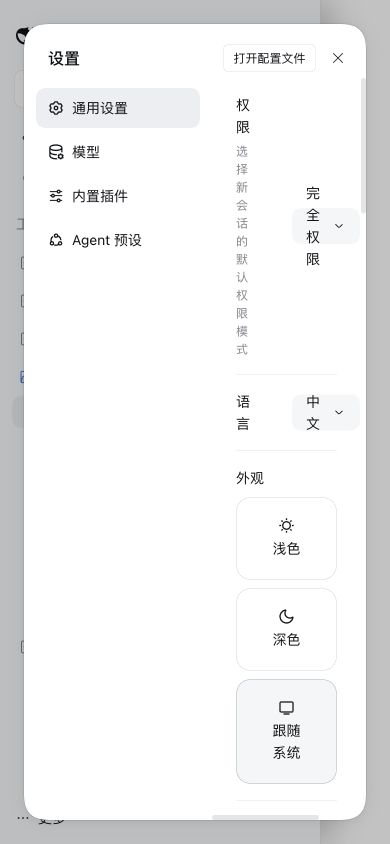
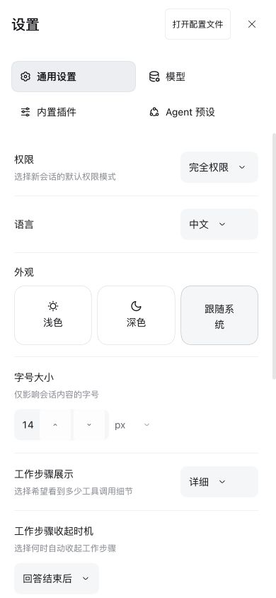
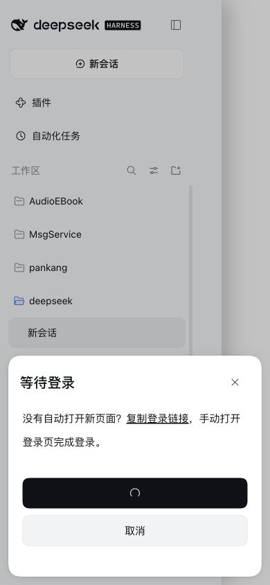

# DSH 手机端设计与实现验证

上线状态：网页资源 `20261103a` 已部署；第四版原生 App 已安装并完成冷启动检查。页面内真机验收被设备断连中断，见[第五轮记录](../2026-11-03-dsh-mobile/round5/README.md)。[网页部署记录](../2026-11-03-dsh-mobile/deployment/README.md)及各轮历史记录保留原时点状态。

最新：[第四轮终端触控、文件预览与验证](../2026-11-03-dsh-mobile/round4/README.md) · [可筛选预览报告](../2026-11-03-dsh-mobile/round4/index.html)。累计盘点 49 项页面与能力，33 项完成对应页面预览验证；其余保留明确的真机、服务、桌面、场景或上游格式限制。[第三轮记录](round3/README.md)和[第二轮记录](round2/README.md)另存，下文保留第一轮证据。

2026-11-02。针对 Ubuntu 上 DSH **0.2.1-rc.2** 的实际页面，通过仅监听本机的 SSH 预览代理加载本轮 CSS/JS。截图来自真实 DSH DOM，不是静态界面稿。认证仅在代理内存中使用，证据不包含凭据。

用户选择本轮先完成代码和预览，因此**未部署网页适配、未安装 App、未验证真实手机登录成功回流**。生产连接修复保持原状。

## 流程健康状态

1. **进入设置：布局通过。** 原来的桌面左栏把 390px 正文挤成竖排；改为全屏单栏、四类设置入口和独立滚动正文。390px 分类按钮实测均为 44px 高，无横向溢出。
   - [修改前](before-settings.png) / [修改后](after-settings-390.png)
2. **登录：页面适配通过；App 跳转待真机。** 浏览器确认上游先预开 about:blank，再异步导航到 DeepSeek 官方平台。App 已补充子窗口中转和失败提示；登录超时面板主次操作已适配。没有输入密码、密钥或提交账号授权。
   - [原登录入口](before-login-entry.png) / [原等待状态](before-login-waiting.png) / [适配后的超时重试](after-login-390.png)
3. **模型与 API Key：布局、入口、取消通过。** 新建提供商和自定义 API 表单可达；320px 页面宽度为 320px，无页面横向溢出。缩小视口后可聚焦 API 地址、滚动正文，并看到取消/创建操作。没有保存模型或凭据。
   - [320px 模型表单](after-model-320.png) / [390×450 可视区域](after-model-keyboard-space.png)
4. **插件与 Agent 预设：设置页面通过。** 插件列表和预设卡片可阅读与滚动。全局插件页标题、返回按钮预留菜单空间，选择页面后侧栏自动收起；实际点击抽屉外空白区域也能收起。
   - [插件设置](after-plugins-390.png) / [320px 预设](after-presets-320.png) / [插件主页面](after-plugin-page-390.png) / [插件详情](after-plugin-detail-390.png)
5. **横屏与桌面：布局通过。** 844×390 横屏设置正文有 290px 可滚动高度；1440×900 桌面仍为 800px 面板，左栏 188px、正文 612px。
   - [横屏](after-settings-landscape.png) / [桌面](after-settings-desktop.png)

## 工程验证

- HarmonyOS assembleHap 成功，签名包已生成。
- 本轮 DSH URL 策略测试通过：固定票据入口、外部 HTTPS 目的地、主页面来源约束。
- JavaScript 语法检查通过。
- 候选 Nginx 配置独立执行 `nginx -t` 通过，没有替换生产配置或重载服务。
- 定向 `git diff --check` 通过。
- 构建仍报告 DownloadToolsPage.ets:78 的既有 READ_PASTEBOARD 权限警告；本轮 DSH 文件没有新增编译警告。见 [构建日志](build.log)。
- [结构化验证与安装包校验值](checks.json)。签名包位于 `app/build/dsh-mobile/entry-dsh-mobile-20261102-signed.hap`。

## 后续验收与限制

- 真实设备：点击登录后系统浏览器打开、授权完成后返回 MyTools、等待状态收敛、取消/重试。
- 真实 ArkWeb 软键盘和系统返回键。390×450 浏览器视口检查只证明小空间可用，不能等同真机键盘验收。
- 没有执行聊天任务、修改设置值、启用插件或保存模型；相关业务写入行为沿用上游。
- 构建类名仍与当前 DSH 版本相关，升级后需要重新跑页面清单。终端、文件预览、复杂编辑器等不在本轮已验证范围内。

## 预览

修改前：

修改后：

