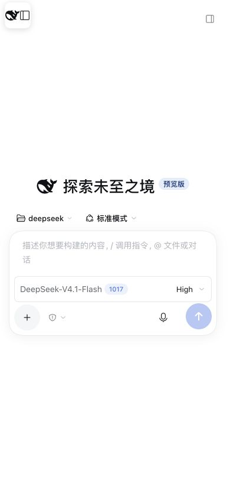
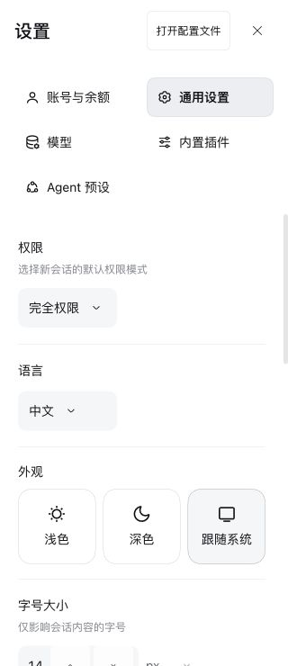

# DSH 手机端第二轮深入优化

日期：2026-11-02。延续第一轮“代码和预览优先”的范围，未部署、未安装，也没有执行聊天任务、修改模型/账号配置或发起充值。

## 新发现与结果

| 问题 | 原因 | 本轮处理 |
| --- | --- | --- |
| 模型名称消失，只剩一个图标 | 上游窄屏规则隐藏标签，原适配仍把模型挤在尾部工具行 | 模型独立一行，名称与推理等级可读；320px 选择器实测 265×44px |
| 系统返回未处理当前网页浮层 | App 只后退网页历史，存在退回已消费票据页的风险 | 菜单、二级弹窗、主设置、文件面板、抽屉逐层返回；根页面返回进入前的 MyTools 标签 |
| 登录窗口在挂载前离页可能悬挂 | 原代码清空本地状态，没有拒绝仍待绑定的窗口请求 | 显式释放；绑定与转交只执行一次；晚到回调隔离；30 秒未收到地址时清理并提示 |
| 文件标签栏及部分账号操作触控区偏小 | 桌面控件尺寸覆盖通用移动规则 | 文件标签、关闭、新标签、退出全屏均实测 44×44px，账号用量、充值链接均实测高 44px，菜单与弹窗操作强化最小高度 |
| 320px 外观选项文字竖排、图标被挤掉 | 每张卡片仍有左右各 32px 的桌面内边距 | 收紧内边距，文字不折成竖排，图标固定 20×20px |
| 适配代码重复并持续监听聊天 DOM | 多轮追加规则、观察器一直扫描 | 合并断点，清理隐藏模型文字的旧规则；首次侧栏挂载后断开观察器 |

登录后新增的“账号与余额”分类已在 320px 下检查，设置容器与滚动宽度均为 320px，五个分类均可达。没有将个人账号信息或余额写入截图证据。

## 实际页面预览

输入区原状态：

本轮输入区：

[320px 输入区](after-composer-320.png) · [缩小可视区域](after-composer-short.png)

设置与二级页面：

[390px 设置](after-settings-390.png) · [快捷键二级弹窗](nested-settings.png) · [文件栏触控区](file-toolbar.png)

## 验证方式与边界

- 网页返回验证使用真实 DSH 页面和实际 `mytoolsDshMobileBack()`。同源 iframe 外的测试按钮在 pointerdown 调用，保留子页焦点，避免菜单因失焦提前关闭。
- 已逐级验证：模型子菜单→父菜单→会话；快捷键弹窗→主设置→侧栏→会话；文件面板→会话；根页面返回 false。
- 原生窗口生命周期测试覆盖挂载前取消、重复绑定、重复转交、绑定失败释放、旧回调与新尝试隔离。30 秒计时和实际浏览器唤起仍需手机验收。
- URL 策略测试、JS 语法检查、定向 diff 检查及 HarmonyOS assembleHap 均通过。
- 构建仍有既有 `DownloadToolsPage.ets:78` 的 READ_PASTEBOARD 警告，DSH 本轮未新增编译警告。见 [构建日志](build.log)。
- 390×450 的浏览器视口中发送按钮下沿为 360px，证明小空间内可达；不是 ArkWeb 软键盘实测。
- 桌面 1440×900 下仍是 800px 设置面板、188px 导航、612px 正文。
- 未验证真实手机系统返回、登录授权成功后回流、输入法、文件编辑与终端命令。这些不能从浏览器模拟推断为通过。

[结构化检查与校验值](checks.json) · [第二版签名安装包](/Users/pankang/mycode/MyTools/app/build/dsh-mobile/entry-dsh-mobile-20261102-v2-signed.hap)

测试入口：[返回验证框架](../../../../deploy/dsh-mobile/tests/back-harness.html)。仅供同源本机预览代理使用，不部署到生产。
