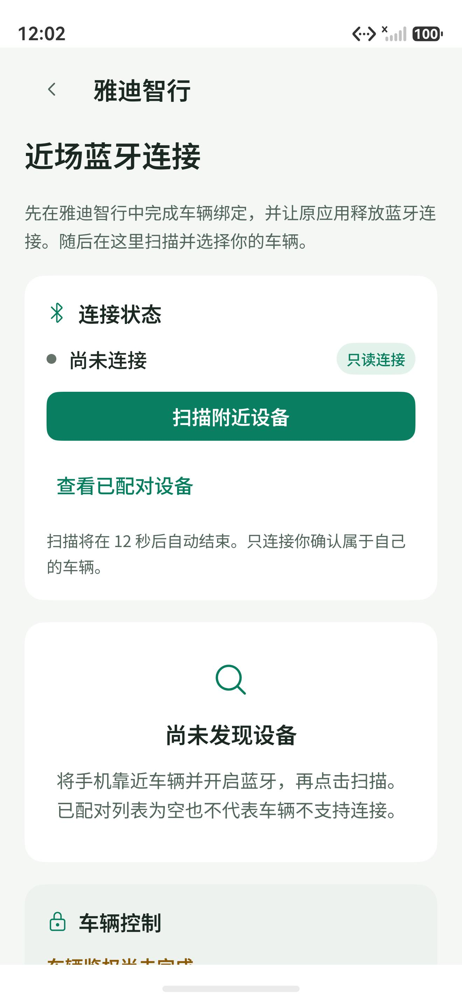
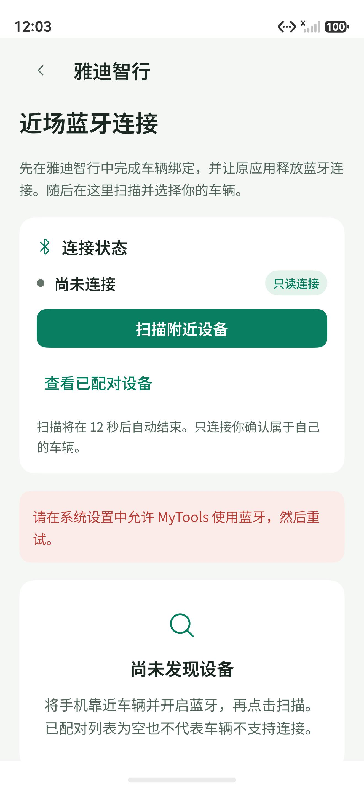

# 雅迪智行近场蓝牙能力开发记录

日期：2026-11-03。范围：MyTools 鸿蒙原生工具页与蓝牙接入基础能力。尚未完成雅迪私有鉴权或实车控车，不能视为整套车辆功能已交付。

## 已实现

- 工具页新增「雅迪智行」，复用现有登录、账户作用域、主题与工具导航。
- 用户点击后申请蓝牙权限，页面打开不会自动申请、扫描或连接。
- 扫描最多 12 秒、保留最多 40 个去重设备；可以手动停止，完整设备地址不展示、不记录日志或持久化。
- 读取系统当前已配对列表；取消配对后重新查询会移除旧记录。
- 用户选择设备后，由 MyTools 创建独立 GATT 客户端，发现服务和特征。
- 仅允许读取标准设备制造商、型号、固件、硬件、软件版本和 Battery Service 电量；设备未提供、权限不足或数值无效时保留未知。
- 标准电量明确标为“蓝牙设备电量”，不能据此认定为车辆牵引电池 SOC。
- 连接、服务发现、读取均有超时；断连、蓝牙关闭、离页、后台、换账户/服务来源时清理状态与句柄，并拒绝迟到响应。
- 页面区分蓝牙连接与车辆授权；没有控车写入、私有特征读取、假位置或假认证成功。

## 未完成及前置

雅迪蓝牙授权材料的取得/续期、独立认证、私有状态解析、开关机、锁车/解锁、寻车、车辆实际 SOC 和位置均尚未接通。

本次一手源码审查基于 [Yadea_Hook 提交 8d3d585](https://github.com/ghhccghk/Yadea_Hook/tree/8d3d585f86d1c98a93bcc39d43d9851b36110eb5)。其中 `VehicleController` 依赖官方 App 的 ClassLoader 与 VehicleService；认证 Hook 观察原 App，不提供完整独立认证算法。另有原生 BleManager 操作的是其他外部设备，不能当成雅迪车辆协议。

因此当前实现没有猜测认证帧或发送查询/控车字节。下一步需要在车主真机和实车上验证本模块能否连接、读到何种服务，以及实际合法授权机制，再实现相应协议。

## 验证结果

| 项目 | 结果 | 证据与边界 |
| --- | --- | --- |
| 策略测试 | 通过 | UUID、广播边界、输入清理、设备限额、标准读取白名单、UTF-8/电量校验、数据复制与 epoch |
| 传输行为 | 20 个场景通过 | 原生端口 mock + 虚拟时钟，不使用真实车辆；包含拒绝空扫描过滤数组的回归，见 [测试日志](tests.log) |
| 页面行为 | 12 个场景通过 | 执行真实页面非渲染方法，验证权限拒绝、前后台、账号变化与授权恢复竞态 |
| API 12 工程构建 | `assembleHap` 成功 | 使用已安装 SDK，见 [构建日志](build.log)；新模块无编译告警 |
| 已有工程告警 | 保留 1 项 | `DownloadToolsPage.ets:79` 的 READ_PASTEBOARD 提示来自已有代码，本轮未修改该页面或扩大剪贴板权限 |
| 模拟器页面 | 通过 | 使用生产 VehiclePage 的临时独立入口，无伪造设备、鉴权或网络会话；见下方截图 |
| 权限拒绝 | 通过 | 点击扫描才出现权限弹窗；拒绝后显示说明且不启动扫描 |
| 正式包检查 | 通过 | 最终包入口为 `pages/Index`，包含蓝牙权限，不含 `VehicleAcceptance` 入口 |
| 真机无车辆测试 | 通过 | 后续已按用户要求安装真机，修复原生扫描参数并验证权限、扫描、停扫及生命周期；见 [真机记录](device/README.md) |
| 实车连接与控车 | 未执行 | 用户明确当前车辆不可连接；未点击设备卡片或发送车辆指令 |

首次审查发现的“授权返回后离页仍启动操作”和“配对列表累积旧设备”均已修复，并加入回归。超时不会启动另一条车辆控制链路。

## 构建与使用

```bash
bash app/scripts/test-vehicle-ble.sh
cd app
/Applications/DevEco-Studio.app/Contents/tools/hvigor/bin/hvigorw \
  --mode module -p module=entry@default -p product=default assembleHap --no-daemon
```

签名调试包：`app/build/vehicle-ble/MyTools-yadea-ble-debug.hap`，同目录提供 SHA-256。正式源码入口与页面清单已经恢复；模拟器上最终也安装回正式入口包。

使用流程：登录 MyTools → 工具 → 雅迪智行 → 扫描附近设备/查看已配对设备 → 选择本人车辆 → 查看连接结果与设备提供的标准信息。连接失败时先检查蓝牙、距离和官方 App 是否占用连接；系统已配对列表为空也不能证明车辆不支持 BLE。

测试专用入口位于 `app/tests/device/VehicleAcceptance.ets`，由 `app/scripts/build-vehicle-acceptance.sh` 临时构建。脚本退出时恢复正式入口；若文件同时被其他人修改，会保留其修改和备份。测试入口不加入正式页面清单。当前本机系统 Python 受 Xcode 许可检查影响，临时验收构建使用 `MYTOOLS_VEHICLE_PYTHON=/opt/homebrew/bin/python3.11` 指定已有 Python，无需修改系统许可。

## 模拟器截图

以下仅证明页面和权限处理，不证明已经连接车辆。




