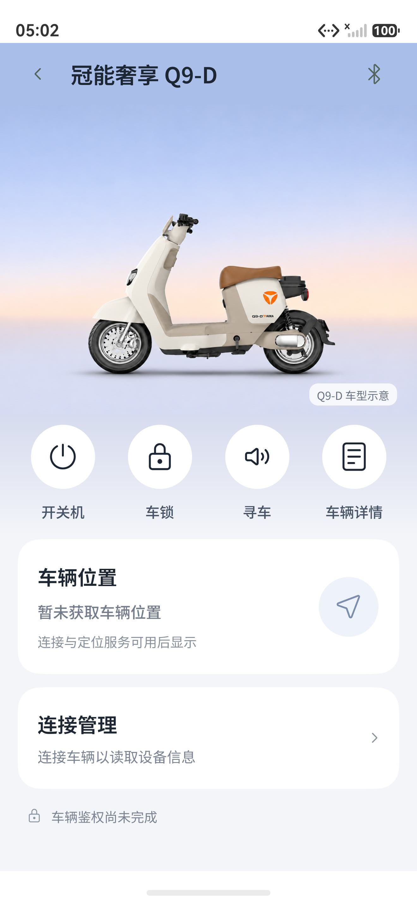
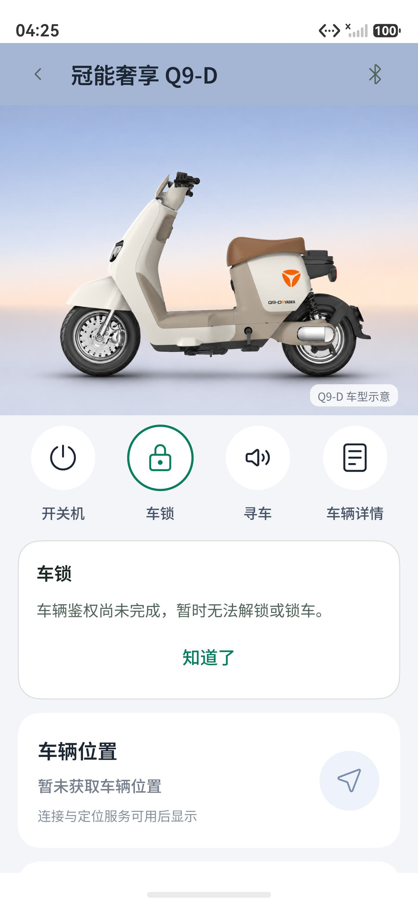
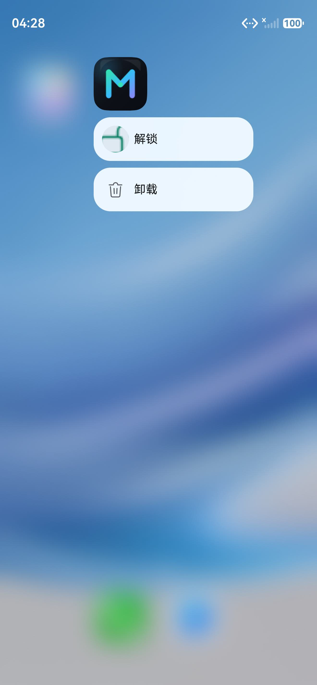
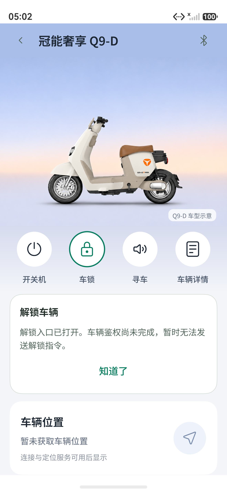
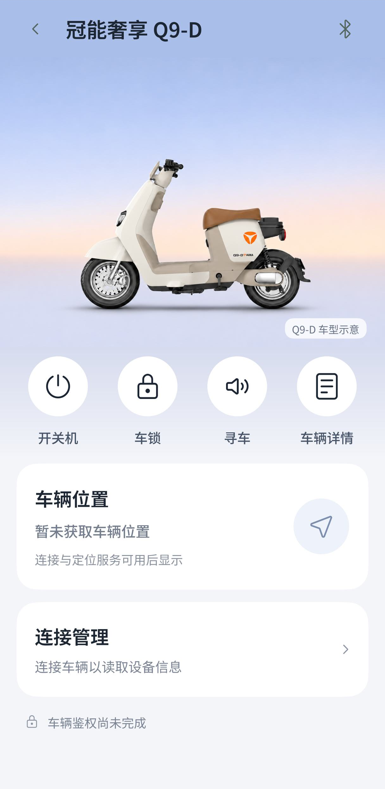
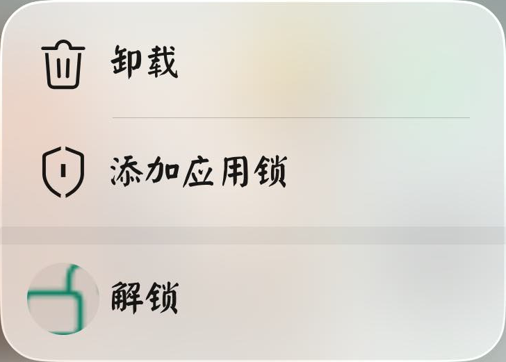
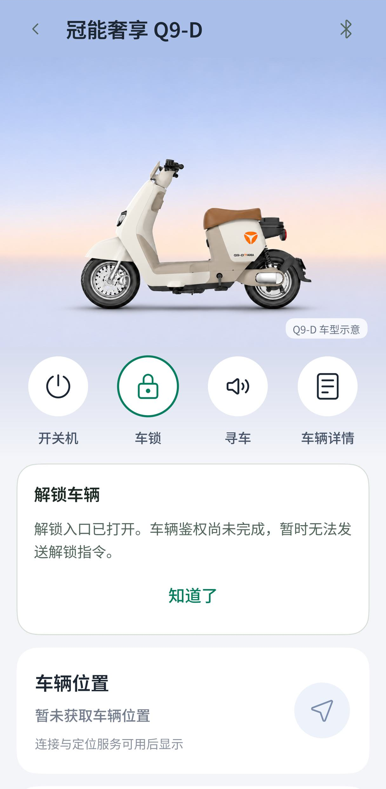

# 雅迪爱车页与桌面解锁入口验证记录

日期：2026-11-03。范围：MyTools 鸿蒙原生爱车页面、桌面图标长按「解锁」导航与现有蓝牙能力回归。当前没有接通雅迪私有鉴权或控车协议，桌面入口不能视为实车解锁已完成。

## 界面实现

参考来自用户已打开的雅迪智行「爱车」真机页面。仓库只保存车辆与操作区域的[参考裁剪](reference-car-controls.png)，已排除状态栏和车辆位置内容；原始含位置信息的整屏截图不纳入验证资料。

- 使用浅蓝天空、暖色地平线与白色 Q9-D 车型示意，保留顶部车型、车辆大图和四个圆形常用操作的层级。
- 四个入口为「开关机」「车锁」「寻车」「车辆详情」。前三项当前明确提示尚未具备车辆授权或控制能力，不发送控制字节；详情展示已读取的标准设备信息，无连接时显示待连接说明。
- 「车辆位置」卡片在没有真实数据时显示未知，不沿用参考图的地址，不把手机位置当成车辆位置。
- 「连接管理」默认折叠，展开后保留现有主动扫描、已配对设备、独立 GATT 连接、标准只读信息和错误提示。顶部蓝牙按钮可展开并定位到该区域；仅展开不申请权限或扫描。
- 车辆画面是生成的车型示意资产，页面标注「Q9-D 车型示意」，不代表本车照片、车辆实时外观或设备返回的数据。文字和图标继续使用 MyTools 字体体系及系统符号。

已在同一张图中比较参考与真机实现：[最终同图对比](comparison-final.png)、[操作区局部对比](comparison-controls.png)。车辆比例、背景衔接与操作区层级的调整见[设计 QA](design-qa.md)。

## 桌面长按「解锁」

静态快捷方式声明在 `app/entry/src/main/resources/base/profile/shortcuts.json`，通过 EntryAbility 的 `ohos.ability.shortcuts` 元数据注册。系统桌面支持时，长按 MyTools 图标可选择「解锁」。图标采用 Heroicons 锁形图标，许可随资源保存。

执行路径为：桌面快捷方式 → EntryAbility 冷启动或热启动接收 → 生成短期导航请求 → 等待会话恢复 → 登录门禁 → 爱车页解锁说明。已登录时直接进入爱车页；未登录时保留仍有效的请求，登录成功后继续。当前说明清楚标明车辆鉴权尚未完成，不显示虚假解锁成功，也不创建蓝牙客户端或自动扫描、连接、写入。

导航约束：

- 外部 Want 仅接受 `vehicleShortcutAction=unlock`，不接收车辆身份、钥匙或控制参数；系统文件打开入口优先。
- 每次请求使用独立 ID，仅保存在进程内存，有效期五分钟；畸形、未来时间或过期请求被丢弃。同一请求在页面中只展示一次。
- 会话恢复完成前等待；取消登录、离开车辆页或退出登录时清理对应意图，账户失效时清除已展示请求。
- 未完成的阅读批注和阅读退出提示保留编辑上下文，不因快捷入口静默丢弃；媒体异步退出后重新核验请求 ID 和有效期，较新的请求优先。
- 应用或车辆页恢复到前台时，只恢复仍有效且尚未展示的入口。导航失败只取消对应请求，不降级为直接解锁。

上述有效期与去重限制导航重放；车辆控制授权仍需后续独立完成，不能由桌面参数授予。

## 当前验证结果

| 项目 | 结果 | 证据与边界 |
| --- | --- | --- |
| BLE 策略与行为回归 | 通过 | 策略测试及 39 个行为场景：20 个真实传输逻辑 mock 场景、19 个真实页面非渲染行为场景；包含 7 个新增快捷请求页面场景 |
| 快捷入口策略与静态契约 | 通过 | 五分钟有效期、畸形/未来请求、静态配置与白名单参数校验 |
| EntryAbility 入口行为 | 通过 | 冷/热启动、文件优先级、无效 Want；执行生产入口方法并替换原生依赖 |
| Index 导航行为 | 11 个场景通过 | 会话恢复、登录继续、取消、阅读保护、媒体异步竞态、过期与失败；执行生产导航方法 |
| 快捷入口蓝牙副作用 | 通过 | 页面回归断言权限请求与传输器创建均为零，不自动开始蓝牙活动 |
| API 12 工程构建 | 成功 | `assembleHap` 已通过；新增模块没有编译告警 |
| 已有工程告警 | 保留 1 项 | `DownloadToolsPage.ets:79` 的 `READ_PASTEBOARD` 提示来自既有代码，本轮未修改该页面或扩大权限 |
| 模拟器界面 | 通过 | 开关机/车锁/寻车/位置不可用说明、详情空状态、顶部蓝牙展开定位和首页均已验证；最终截图使用正式入口包 |
| 正式包入口检查 | 通过 | 模拟器已安装正式入口 HAP；页面清单仅含 `pages/Index`，不包含 `VehicleAcceptance` |
| 系统桌面菜单与热启动 | 通过 | 实际长按桌面 MyTools 图标出现「解锁」，点击进入爱车页并显示未鉴权说明，见下方截图；使用模拟器既有会话，本轮未输入登录资料或更改账号 |
| 桌面快捷入口冷启动 | 通过 | 模拟器正式包强制停止后，实际长按桌面图标选择解锁，启动后正确展示未鉴权说明 |
| 用户真机安装复验 | 通过 | 用户重新接入手机后覆盖安装最终正式入口包；实际长按桌面 MyTools 图标显示解锁，点击进入生产爱车页并显示未鉴权说明；下方保存去除状态栏的页面截图与仅菜单区域裁剪 |
| 实车连接与控车 | 未执行 | 用户已说明当前无法连接电动车；不以模拟器、截图或导航测试代替实车控制验收 |

回归命令：

```bash
bash app/scripts/test-vehicle-ble.sh
bash app/scripts/test-vehicle-shortcut.sh
```

构建与临时验收入口的使用方式见[近场能力开发记录](../2026-11-03-yadea-ble/README.md)。正式包继续使用 `pages/Index`；临时验收入口仅用于隔离验证生产组件，不应进入正式页面清单或作为交付安装包。

交付调试包：[MyTools-yadea-ble-debug.hap](../../../app/build/vehicle-ble/MyTools-yadea-ble-debug.hap)，同目录附 SHA-256。构建日志见 [build.log](build.log)，回归日志见 [BLE 测试](ble-tests.log)与[快捷入口测试](shortcut-tests.log)。两个设备最终均安装回正式入口包，真机停留在爱车首页；未执行扫描、连接车辆或控车。









## 真机最终结果






